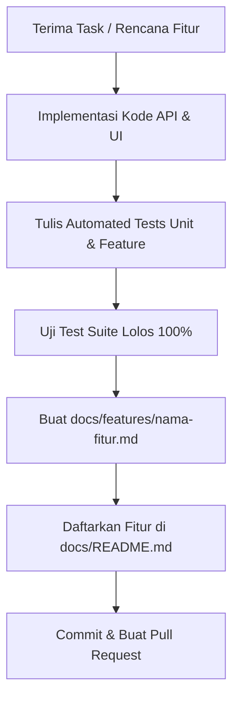

# 📚 Indeks & Panduan Dokumentasi Melarosa GIS

Pusat dokumentasi arsitektur, panduan teknis, dan katalog modul untuk proyek **Melarosa GIS** (Laravel 13 REST API + Nuxt 4 WebGIS + PostGIS & Martin Tile Server).

---

> [!IMPORTANT]
> ### ⚡ Protokol Wajib: Aturan Pembaruan Dokumentasi (Anti-Lupa)
> **Setiap kali membuat atau memodifikasi fitur, pengembang (baik programmer manusia maupun AI agent) WAJIB memperbarui dokumentasi terkait.**
>
> 1. **Dilarang menyelesaikan tugas tanpa memperbarui docs**: Pekerjaan fitur baru atau refactor belum dianggap *SELESAI* (Done) jika berkas dokumentasinya belum dibuat/diperbarui.
> 2. **Lokasi Dokumentasi Fitur**: Buat berkas baru di `docs/features/{nama-fitur-kebab-case}.md` mengikuti standar di [laravel-13-features-doc-prompt.md](./laravel-13-features-doc-prompt.md).
> 3. **Perbarui Indeks**: Daftarkan berkas fitur baru pada tabel di [docs/README.md](./README.md) di bawah kategori yang sesuai.
> 4. **Jaga Konsistensi**: Cantumkan route API/Nuxt, permission RBAC, integrasi tabel database, diagram alur (Mermaid), dan file sentral.

---

## 🗂️ Navigasi Direktori Dokumentasi

| Direktori / Berkas | Deskripsi |
|---|---|
| [docs/README.md](./README.md) | **Halaman ini** — Indeks utama dan panduan alur dokumentasi seluruh sistem |
| [docs/features/](./features/) | Folder berkas dokumentasi spesifik per modul/fitur dalam format modular |
| [docs/issues/](./issues/) | Rencana tahapan pengerjaan fase implementasi sistem (Fase 1 s.d. Fase 5) |
| [docs/laravel-13-features-doc-prompt.md](./laravel-13-features-doc-prompt.md) | Master AI Prompt dan panduan standar 11 poin dokumentasi fitur Laravel 13 |
| [docs/laravel-13-testing-prompt.md](./laravel-13-testing-prompt.md) | Master AI Prompt dan standar penulisan Automated Testing (Unit & Feature Tests) |

---

## 🗺️ Matriks Fitur & Modul Sistem (`docs/features/`)

Daftar modul fungsional dalam Melarosa GIS beserta status dokumentasi resminya:

### 1. Administrasi, Keamanan & Akun

| Modul / Fitur | Berkas Dokumentasi | Status | Deskripsi Singkat |
|---|---|:---:|---|
| **Audit Trail & Logs** | [audit-logs.md](./features/audit-logs.md) | ✅ Lengkap | Jejak riwayat mutasi data spasial, administratif, dan sistem |
| **Autentikasi & Sesi** | `docs/features/auth-and-sessions.md` | 📝 Terencana | Login Sanctum, token revoke, proteksi CSRF, dan device disconnect |
| **RBAC (Roles & Permissions)** | `docs/features/roles-and-permissions.md` | 📝 Terencana | Matriks hak akses Spatie (Superadmin, Bappeda, Kecamatan, Desa) |
| **Manajemen Pengguna** | `docs/features/user-management.md` | 📝 Terencana | Pengelolaan akun operator, aktivasi, dan assignment peran wilayah |

### 2. Geospasial & Master Wilayah (WebGIS)

| Modul / Fitur | Berkas Dokumentasi | Status | Deskripsi Singkat |
|---|---|:---:|---|
| **Batas Wilayah Desa** | `docs/features/batas-wilayah-desa.md` | 📝 Terencana | Geometri polygon desa, metadata BPS/Pemkab, split wilayah |
| **Batas Wilayah Kecamatan** | `docs/features/batas-wilayah-kecamatan.md` | 📝 Terencana | Batas administratif 28 kecamatan di Kabupaten Bojonegoro |
| **Jalan Poros Desa** | [jalan-poros-desa.md](./features/jalan-poros-desa.md) | ✅ Lengkap | Jaringan linestring ruas jalan, kondisi perkerasan & pemotongan segmen |
| **Layer & Martin Tile Server** | `docs/features/layer-management.md` | 📝 Terencana | Konfigurasi layer spasial, styling MVT, dan integrasi tile server Martin |

### 3. Perencanaan & Penganggaran Infrastruktur

| Modul / Fitur | Berkas Dokumentasi | Status | Deskripsi Singkat |
|---|---|:---:|---|
| **Tipe Infrastruktur** | `docs/features/infrastruktur-tipe.md` | 📝 Terencana | Master klasifikasi konstruksi fisik jalan, jembatan, dan drainase |
| **Referensi Sumber Dana** | `docs/features/ref-sumber-dana.md` | 📝 Terencana | Master kategori pendanaan (APBD Kabupaten, BKKD, DAK, Bantuan Provinsi) |
| **Plotting Anggaran** | `docs/features/plotting-anggaran.md` | 📝 Terencana | Penautan alokasi pagu anggaran tahunan ke segmen jalan fisik di peta |

### 4. Realisasi Fisik & Verifikasi Berjenjang

| Modul / Fitur | Berkas Dokumentasi | Status | Deskripsi Singkat |
|---|---|:---:|---|
| **Segmen Pengerjaan Fisik** | `docs/features/infrastruktur-segmen.md` | 📝 Terencana | Detail segmen pengerjaan jalan, koordinat batas, dan spesifikasi teknis |
| **Monitoring Realisasi** | `docs/features/monitoring-realisasi.md` | 📝 Terencana | Pelaporan berkala progres fisik (%), serapan dana, & upload Berita Acara |
| **Alur Verifikasi Bertingkat** | `docs/features/infrastruktur-verifikasi.md` | 📝 Terencana | Siklus approval berjenjang: Operator Desa ➔ Kecamatan ➔ Bappeda |

---

## 📐 Standar 11 Komponen Dokumen Fitur

Setiap berkas dokumentasi di `docs/features/{slug}.md` wajib mematuhi 11 bagian standar berikut (lihat detail di [laravel-13-features-doc-prompt.md](./laravel-13-features-doc-prompt.md)):

```
# [Nama Fitur]
Kembali ke indeks dokumentasi: docs/README.md
---
## 1. Tujuan
## 2. Latar Belakang & Masalah (Tabel Sebelum vs Sesudah)
## 3. Fitur Saat Ini / Kapabilitas Modul
## 4. Logika Alur & Arsitektur (Diagram Mermaid)
## 5. Halaman dan Route (Endpoint API & Nuxt Pages)
## 6. Permission & Hak Akses (RBAC)
## 7. Alur Pengguna (Step-by-Step User Journey)
## 8. Integrasi Data & Skema Database
## 9. Efek Bisnis Penting (DB Transaction, Audit, Integritas Spasial)
## 10. Batasan Saat Ini & Edge Cases
## 11. File Sentral (Core Files Backend & Frontend)
```

---

## 🧪 Standar Penerapan Automated Testing (`tests/`)

Seluruh modul dan fitur baru **wajib memiliki automated tests** yang mematuhi standar di [laravel-13-testing-prompt.md](./laravel-13-testing-prompt.md):

### 1. Struktur & Konvensi
- **Feature Tests**: Simpan pada `tests/Feature/{Module}/{FeatureName}Test.php` untuk menguji integrasi HTTP request, database, middleware, dan response JSON.
- **Unit Tests**: Simpan pada `tests/Unit/{Domain}/` untuk logika murni tanpa dependensi HTTP/DB berat.
- **Penamaan Method**: Format snake_case deskriptif `test_{actor}_{action}_{expected_outcome}(): void`. Contoh:
  - `test_admin_can_access_audit_logs_api(): void`
  - `test_unauthorized_user_cannot_access_admin_layers(): void`
  - `test_action_fails_validation_when_required_field_is_missing(): void`

### 2. Matriks Pengujian Wajib
1. **Happy Path (200 / 201)**: Input valid, assert status OK/Created, assert mutasi data via `$this->assertDatabaseHas(...)`.
2. **Negative Path / Validasi (422)**: Payload kosong atau tidak valid, assert validation error pada response.
3. **RBAC & Keamanan (401 / 403)**: Akses tanpa token (Unauthenticated 401) dan tanpa permission (Forbidden 403).
4. **Edge Cases**: Batas data (boundary), duplikasi nilai unik, atau kondisi relasi data tidak ditemukan.

### 3. Konfigurasi Lingkungan Pengujian
- **Database**: SQLite in-memory (`:memory:`) super cepat.
- **Trait**: Wajib sertakan `use RefreshDatabase;` pada Feature Test.
- **Kompatibilitas Spasial**: Gunakan mock function SQLite atau driver check agar fungsi PostGIS (`ST_*`) tidak memutus test suite.

---

## 🔄 Alur Kerja Checklist Developer & AI Agent

Saat mengimplementasikan fitur baru atau melakukan perubahan besar:



- [ ] Kode controller, service, model, dan migration telah diuji.
- [ ] Automated tests dibuat mengikuti panduan [laravel-13-testing-prompt.md](./laravel-13-testing-prompt.md).
- [ ] Dokumen fitur modular telah dibuat di `docs/features/{slug}.md`.
- [ ] Tautan dan status modul telah didaftarkan/diperbarui di `docs/README.md`.
- [ ] Tidak ada breaking change yang tidak terdokumentasi.
