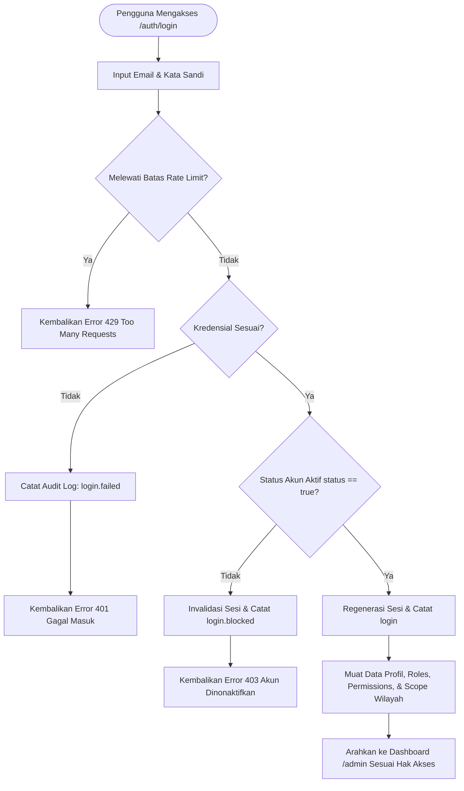
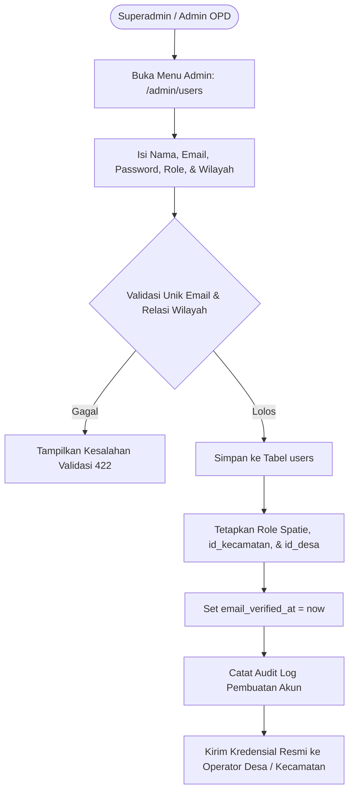
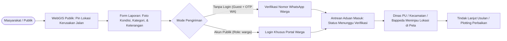

# Autentikasi, Sesi, & Tata Kelola Akun (Auth & Sessions)

Kembali ke indeks dokumentasi: [docs/README.md](../README.md)

---

## 1. Tujuan

Menyediakan sistem keamanan autentikasi, manajemen sesi perangkat, dan pengendalian akses pengguna berbasis peran (*Role-Based Access Control* / RBAC) yang terikat langsung pada hierarki wilayah administratif Kabupaten Bojonegoro (Desa, Kecamatan, Bappeda, dan Superadmin).

Modul ini mengamankan pintu masuk sistem monitoring infrastruktur dan WebGIS daerah dengan memberlakukan **model pendaftaran tertutup (*Closed Provisioning*)**. Pengguna sistem merupakan aparatur dan operator resmi pemerintah yang ditugaskan melalui Surat Keputusan (SK) atau surat tugas kedinasan, guna menjamin integritas data perencanaan, penganggaran BKKD, serta pelaporan Berita Acara fisik.

---

## 2. Latar Belakang & Masalah

| Aspek | Kondisi Sebelumnya (Pendaftaran Mandiri) | Kondisi Sekarang (Closed Provisioning) |
|---|---|---|
| **Pendaftaran Akun** | Siapa pun di internet dapat mendaftar mandiri via `/auth/register` atau OAuth Google. | Pendaftaran mandiri publik ditutup (403 Forbidden). Akun hanya dapat dibuat oleh Administrator. |
| **Penetapan Peran & Wilayah** | Akun pendaftar mandiri otomatis berstatus role `user` tanpa relasi `id_kecamatan` dan `id_desa`, sehingga pengguna bingung karena tidak dapat mengakses menu apa pun. | Setiap akun langsung dikaitkan dengan role resmi (`admin`, `bappeda`, `kecamatan`, `desa`) serta kode wilayah administratif yang valid saat dibuat oleh admin. |
| **Akuntabilitas & Audit Trail** | Potensi akun anonim atau penyalahgunaan data usulan jalan dan Berita Acara pencairan dana. | Setiap aksi di audit trail tercatat atas nama aparatur yang tervalidasi dan memiliki kewenangan sah. |
| **Keamanan Sistem** | Rentan serangan spam pendaftaran, bot registration, dan pencemaran basis data. | Permukaan serangan berkurang drastis karena form registrasi publik ditiadakan. |

---

## 3. Fitur Saat Ini / Kapabilitas Modul

1. **Autentikasi Aman Berbasis Sanctum & Session**
   - Proteksi cookie sesi terenkripsi dengan perlindungan CSRF (`/api/v1/sanctum/csrf-cookie`).
   - Rate limiting ketat pada percobaan login guna mencegah serangan brute force.
   - Pengecekan status keaktifan akun (`status = true`). Akun nonaktif langsung ditolak saat mencoba login.
2. **Penyediaan Akun Terpusat (*Admin Provisioning*)**
   - Pembuatan akun baru dilakukan oleh Superadmin atau Admin Wilayah melalui menu Manajemen Pengguna (`/admin/users`).
   - Email pengguna otomatis ditandai terverifikasi (`email_verified_at`) saat dibuat oleh admin.
   - Hak akses wilayah dikunci per kecamatan dan per desa sesuai penugasan operator.
3. **Penonaktifan Registrasi Mandiri Publik (Opsi A)**
   - Halaman `/auth/register` otomatis dialihkan (*redirect*) ke `/auth/login`.
   - Tautan pendaftaran pada kartu login diganti dengan informasi tata kelola akun kedinasan.
   - Endpoint `POST /api/v1/register` mengembalikan status `403 Forbidden`.
   - Login OAuth hanya diizinkan untuk email yang sudah terdaftar sebelumnya di basis data.
4. **Manajemen Sesi Perangkat (*Active Devices & Session Revocation*)**
   - Menampilkan daftar perangkat aktif yang sedang masuk (IP address, nama browser/OS, aktivitas terakhir).
   - Pengguna dapat memutuskan sesi perangkat lain secara mandiri (*device disconnect*).
5. **Alur Reset Kata Sandi Kedinasan**
   - Pengiriman token reset kata sandi ke email resmi pengguna yang terdaftar dengan validasi tanda tangan digital berbatas waktu.
6. **Audit Trail Autentikasi**
   - Pencatatan otomatis ke tabel `audit_logs` untuk setiap kejadian: `login`, `login.failed`, `login.blocked`, `logout`, `password.reset`, dan `device.disconnected`.

---

## 4. Logika Alur & Diagram

### A. Alur Masuk Pengguna (Login Flow)

---

### B. Alur Penyediaan Akun Operator (Admin Provisioning)

---

## 5. Halaman dan Route

### Frontend Nuxt (`apps/web`)

| Route / Halaman | Middleware | Keterangan |
|---|---|---|
| `/auth/login` | `guest` | Halaman login utama untuk aparatur dan operator. |
| `/auth/register` | `inline redirect` | Otomatis dialihkan ke `/auth/login` (pendaftaran mandiri ditutup). |
| `/auth/forgot` | `guest` | Formulir permintaan tautan reset kata sandi via email. |
| `/auth/reset-password` | `guest` | Formulir penetapan kata sandi baru menggunakan token. |
| `/admin/users` | `auth` | Panel manajemen pembuatan dan pengelolaan akun operator. |

### Backend Laravel API (`apps/api`)

| Route Name | Method | URI Endpoint | Controller Action | Keterangan |
|---|---|---|---|---|
| `login` | `POST` | `/api/v1/login` | `AuthController@login` | Autentikasi pengguna dengan rate limiter. |
| `register` | `POST` | `/api/v1/register` | `AuthController@register` | Dinonaktifkan (mengembalikan 403 Forbidden). |
| `logout` | `POST` | `/api/v1/logout` | `AuthController@logout` | Mengakhiri sesi aktif dan invalidasi token/cookie. |
| `user` | `GET` | `/api/v1/user` | `AuthController@user` | Mengambil profil user, roles, permissions, dan menu navigasi. |
| `devices` | `GET` | `/api/v1/devices` | `AuthController@devices` | Daftar sesi perangkat aktif milik pengguna. |
| `devices.disconnect` | `POST` | `/api/v1/devices/disconnect` | `AuthController@deviceDisconnect` | Memutus sesi perangkat berdasarkan session ID. |
| `password.email` | `POST` | `/api/v1/forgot-password` | `AuthController@sendResetPasswordLink` | Mengirim tautan reset kata sandi ke email. |
| `password.store` | `POST` | `/api/v1/reset-password` | `AuthController@resetPassword` | Mengubah kata sandi dengan verifikasi token. |
| `admin.users.store` | `POST` | `/api/v1/admin/users` | `Admin\UserController@store` | Pembuatan akun resmi oleh administrator. |

---

## 6. Permission & Hak Akses (RBAC)

| Peran (Role) | Hak Akses Modul Akun | Cakupan Data Wilayah |
|---|---|---|
| **Superadmin** | Penuh (`users-create`, `users-view`, `users-update`, `users-delete`) | Seluruh kabupaten (tanpa batas). |
| **Bappeda / Dinas** | `users-view`, `dashboard-view` | Seluruh kabupaten (tingkat OPD/koordinasi). |
| **Kecamatan** | `users-view`, `users-create` (khusus desa di wilayahnya) | Terkunci pada `id_kecamatan` masing-masing. |
| **Desa** | Hanya profil mandiri (`user`, `account.update`, `account.password`) | Terkunci pada `id_desa` dan `id_kecamatan` desa bersangkutan. |

---

## 7. Alur Pengguna (User Journey)

1. **Permohonan Akun Baru**:
   - Kepala Desa atau Camat menugaskan operator melalui Surat Tugas / SK.
   - Admin OPD / Kominfo membuka panel `/admin/users` dan menginput data operator: nama, email dinas/resmi, role (`desa`), pilihan kecamatan, dan pilihan desa.
2. **Aktivasi & Masuk Pertama Kali**:
   - Operator menerima informasi kredensial dari admin.
   - Operator membuka `/auth/login`, memasukkan email dan kata sandi sementara.
   - Sistem memvalidasi akun, meregenerasi sesi, dan mengarahkan operator langsung ke dashboard kerja desa.
3. **Pembaruan Keamanan Mandiri**:
   - Operator disarankan mengganti kata sandi default melalui menu Profil Akun (`/admin/profile`).

---

## 8. Integrasi Data & Skema Database

- **Tabel `users`**:
  - `id`, `uuid`, `name`, `email`, `password`
  - `id_kecamatan` (FK opsional ke `bataswilayah_kecamatan.id`)
  - `id_desa` (FK opsional ke `bataswilayah_desa.id`)
  - `status` (boolean, default: `true`)
  - `email_verified_at` (timestamp)
- **Tabel `sessions`**:
  - Menyimpan payload sesi Laravel, `user_id`, `ip_address`, `user_agent`, dan `last_activity`.
- **Tabel Spatie Permissions (`roles`, `permissions`, `model_has_roles`)**:
  - Menghubungkan user dengan role (`admin`, `bappeda`, `kecamatan`, `desa`).
- **Tabel `audit_logs`**:
  - Relasi polymorphic ke model `User` yang mencatat aktivitas login, logout, dan pembaruan profil.

---

## 9. Efek Bisnis Penting

- **Integritas Usulan dan Verifikasi Berjenjang**:
  - Penutupan registrasi mandiri menjamin bahwa setiap proposal BKKD, usulan segmen jalan poros, dan Berita Acara yang masuk ke sistem hanya dapat diajukan oleh pengguna yang terikat pada SK penugasan resmi desa/kecamatan.
- **Isolasi Data Antar-Desa**:
  - Otorisasi di tingkat controller dan policy memastikan operator Desa A tidak dapat mengubah atau mengintip draft usulan milik Desa B.

---

## 10. Batasan Saat Ini & Roadmap Jangka Panjang

### Batasan Saat Ini
- Pendaftaran akun masih bergantung pada pembuatan manual oleh administrator melalui form manajemen user atau seeder database.

### Roadmap Jangka Panjang: Modul Aduan Berbasis Spasial (Bappeda Public Reporting)
Di masa mendatang, Bappeda merencanakan penambahan **Fitur Aduan Masyarakat Berbasis Spasial** (pelaporan kerusakan jalan atau infrastruktur oleh warga sipil). Arsitektur yang disiapkan untuk mendukung rencana tersebut:

**Pertimbangan Arsitektural untuk Aduan Spasial:**
1. **Pemisahan Role yang Ketat**: Jika akun warga dibuka di masa depan, gunakan role terpisah `warga` atau `public_user` yang sama sekali tidak memiliki akses ke panel administrasi internal (`/admin/*`).
2. **Alternatif Tanpa Registrasi (Guest with OTP / NIK)**: Pelaporan warga dapat dirancang tanpa perlu membuat akun penuh, melainkan cukup mengisi formulir cepat dengan verifikasi nomor WhatsApp (OTP) atau verifikasi identitas sederhana. Hal ini mempermudah partisipasi masyarakat tanpa mengotori tabel pengguna kedinasan.

---

## 11. File Sentral

### Backend (Laravel 13 API)
- Controller Autentikasi: `apps/api/app/Http/Controllers/AuthController.php`
- Controller Manajemen User: `apps/api/app/Http/Controllers/Admin/UserController.php`
- Policy User: `apps/api/app/Policies/UserPolicy.php`
- Model User: `apps/api/app/Models/User.php`
- Service Audit Log: `apps/api/app/Services/AuditLogService.php`
- Route API: `apps/api/routes/web.php`
- Automated Test: `apps/api/tests/Feature/Auth/RegistrationTest.php`

### Frontend (Nuxt 4 Web)
- Komponen Login: `apps/web/app/components/auth/Login.vue`
- Halaman Login: `apps/web/app/pages/auth/login.vue`
- Halaman Registrasi (Redirect): `apps/web/app/pages/auth/register.vue`
- Store Autentikasi: `apps/web/app/stores/auth.ts`
- Panel Manajemen User: `apps/web/app/pages/admin/users/index.vue`
