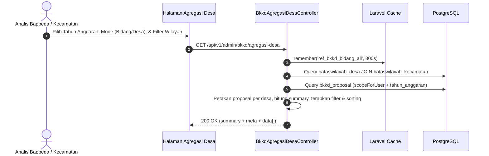

# BKKD Agregasi Wilayah Desa

## 1. Gambaran Umum (Overview)
Modul **BKKD Agregasi Wilayah Desa** menyajikan matriks pemantauan keterisian dan distribusi usulan Bantuan Keuangan Khusus Desa (BKKD) di seluruh desa dan kecamatan se-Kabupaten Bojonegoro pada suatu Tahun Anggaran.

**Masalah yang diselesaikan:**
- Membantu Bappeda memantau secara menyeluruh **desa mana saja yang sudah mengajukan usulan** dan **desa mana yang sama sekali belum memiliki usulan (`0 usulan`)** pada tahun anggaran berjalan.
- Menyediakan dua mode tampilan analitis:
  1. **Mode Per Bidang (`mode=bidang`)**: Memecah baris per kombinasi Desa dan Bidang BKKD yang diusulkan.
  2. **Mode Konsolidasi Desa (`mode=desa`)**: Menggabungkan seluruh bidang ke dalam satu baris per Desa beserta rincian daftar proposal dan status analisa spasialnya.

---

## 2. Daftar Kapabilitas (Features List)
- **Matriks Seluruh Desa (Termasuk Desa 0 Usulan)**: Menggabungkan seluruh master `bataswilayah_desa` dan `bataswilayah_kecamatan` dengan koleksi `bkkd_proposal` pada tahun anggaran terpilih sehingga desa yang belum mengajukan tetap tampil dengan `jumlah_usulan = 0`.
- **Dual Aggregation Mode (`bidang` vs `desa`)**: Mendukung pengelompokan baris per bidang kegiatan atau konsolidasi penuh per desa.
- **Ringkasan Eksekutif Cakupan Wilayah (`summary`)**: Menghitung `total_desa`, `desa_ada_usulan`, `desa_belum_ada_usulan`, `total_usulan`, dan `total_nilai_usulan`.
- **Rincian Proposal Inline (`proposals[]`)**: Setiap baris agregasi menyertakan daftar ringkas proposal milik desa tersebut (`id`, `nomor_registrasi`, `judul_kegiatan`, `bidang`, `nilai_usulan`, `status_analisa_spasial`) untuk navigasi cepat ke Workspace Peta.
- **Filter, Pencarian & Pengurutan Multi-Kolom**: Filter berdasarkan `tahun_anggaran`, `id_kecamatan`, `id_desa`, `id_bidang`, `status` (`ALL`, `sudah_ada`, `belum_ada`), pencarian teks bebas, serta pengurutan berdasarkan `kecamatan`, `desa`, `bidang`, `jumlah_usulan`, atau `total_nilai_usulan`.
- **Ekspor CSV Terformat (`GET /export`)**: Mengunduh tabel agregasi sesuai filter aktif ke dalam file CSV ber-BOM UTF-8 (`Agregasi_Usulan_Desa_BKKD_{tahun}_{timestamp}.csv`).

---

## 3. Arsitektur & Alur Kerja (Architecture & Data Flow)



---

## 4. Spesifikasi Endpoint API (Routes & Endpoints)

| Method | Endpoint URI | Controller & Action | Middleware / Permission | Deskripsi |
| :--- | :--- | :--- | :--- | :--- |
| `GET` | `/api/v1/admin/bkkd/agregasi-desa` | `BkkdAgregasiDesaController@index` | `auth:sanctum`, `permission:bkkd-proposal-view` | Mengambil matriks agregasi usulan per desa disertai ringkasan cakupan desa |
| `GET` | `/api/v1/admin/bkkd/agregasi-desa/export` | `BkkdAgregasiDesaController@export` | `auth:sanctum`, `permission:bkkd-proposal-view` | Mengunduh matriks agregasi usulan desa dalam format CSV (Excel-ready) |

---

## 5. Kontrak Request & Response (Payload Schema)

### A. Parameter Query (`GET /api/v1/admin/bkkd/agregasi-desa`)
- `tahun_anggaran` (integer, default: tahun berjalan)
- `mode` (`bidang` | `desa`, default: `bidang`)
- `id_kecamatan` (integer, opsional)
- `id_desa` (integer, opsional)
- `id_bidang` (uuid atau `ALL`, opsional)
- `status` (`ALL` | `sudah_ada` | `belum_ada`, default: `ALL`)
- `search` (string, opsional)
- `sort_by` (`kecamatan` | `desa` | `bidang` | `jumlah_usulan` | `total_nilai_usulan`, default: `kecamatan`)
- `sort_order` (`asc` | `desc`, default: `asc`)
- `page` & `per_page` (1 s.d. 500, default: `25`)

### B. Contoh Response `200 OK`
```json
{
  "ok": true,
  "tahun_anggaran": 2027,
  "summary": {
    "total_desa": 430,
    "desa_ada_usulan": 312,
    "desa_belum_ada_usulan": 118,
    "total_usulan": 485,
    "total_nilai_usulan": 121250000000
  },
  "meta": {
    "current_page": 1,
    "per_page": 25,
    "total": 430,
    "last_page": 18
  },
  "data": [
    {
      "id_desa": 3522010001,
      "nama_desa": "Desa Sukorejo",
      "id_kecamatan": 3522010,
      "nama_kecamatan": "Kecamatan Bojonegoro",
      "id_bidang": "9b1deb4d-3b7d-4bad-9bdd-2b0d7b3dcb6d",
      "nama_bidang": "BKK JALAN",
      "jumlah_usulan": 1,
      "total_nilai_usulan": 350000000,
      "proposals": [
        {
          "id": "01964e2a-8c3e-72a1-9b1c-84736291a0bc",
          "nomor_registrasi": "BKKD/2027/3522010001/001",
          "judul_kegiatan": "Pembangunan Jalan Rigid Beton Poros Sukorejo",
          "id_bidang": "9b1deb4d-3b7d-4bad-9bdd-2b0d7b3dcb6d",
          "bidang": "BKK JALAN",
          "nilai_usulan": 350000000,
          "status_analisa_spasial": "aman",
          "status": "aman"
        }
      ]
    }
  ]
}
```

---

## 6. Skema Database & Model Eloquent (Database & Models)
Modul ini bersifat *read-only aggregation* yang menggabungkan tiga model utama:
- `App\Models\BatasWilayahDesa` (`bataswilayah_desa`)
- `App\Models\BatasWilayahKecamatan` (`bataswilayah_kecamatan`)
- `App\Models\BkkdProposal` (`bkkd_proposal`) dan `App\Models\RefBkkdBidang` (`ref_bkkd_bidang`)

---

## 7. Keamanan, Otorisasi & Kebijakan Akses (Security & Authorization)
- Menggunakan `Gate::authorize('viewAny', BkkdProposal::class)` (membutuhkan permission `bkkd-proposal-view`).
- Query proposal menerapkan `BkkdProposal::forUser($user)` sehingga pengguna tingkat Kecamatan atau Desa hanya melihat agregasi usulan sesuai cakupan wilayahnya.

---

## 8. Ketergantungan & Konfigurasi (Dependencies & Configuration)
- Menggunakan `Cache::remember('ref_bkkd_bidang_all', 300, ...)` untuk menyimpan daftar referensi bidang di memori selama 5 menit agar tidak membebani database pada setiap filter.

---

## 9. Panduan Pengujian (Testing Guide)
```bash
cd apps/api
php artisan test --filter=BkkdPerformanceTest
```

---

## 10. Struktur File Inti (Core Files Reference)
- **Backend**:
  - [BkkdAgregasiDesaController.php](file:///c:/laragon/www/melarosa-laravel-nuxt/apps/api/app/Http/Controllers/Admin/BkkdAgregasiDesaController.php)
- **Frontend**:
  - [index.vue](file:///c:/laragon/www/melarosa-laravel-nuxt/apps/web/app/pages/admin/bkkd/agregasi-desa/index.vue)
  - [useBkkdApi.ts](file:///c:/laragon/www/melarosa-laravel-nuxt/apps/web/app/composables/useBkkdApi.ts)

---

## 11. Catatan Operasional & Troubleshooting (Edge Cases & Gotchas)
- **Perbedaan Total Baris (`meta.total`) vs Total Desa (`summary.total_desa`)**: Pada `mode=bidang`, satu desa yang mengajukan usulan di 3 bidang berbeda akan menghasilkan 3 baris agregasi, sehingga `meta.total` dapat lebih besar daripada `summary.total_desa`. Gunakan `mode=desa` jika ingin tepat 1 baris per desa.
