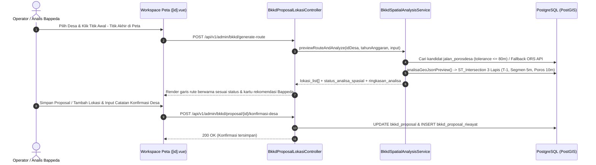

# BKKD Multi-Lokasi LineString & Analisa Spasial 3 Lapis

## 1. Gambaran Umum (Overview)
Modul **BKKD Analisa Spasial & Multi-Lokasi** menyediakan kemampuan pemetaan geospasial tingkat lanjut bagi usulan Bantuan Keuangan Khusus Desa (BKKD) dengan relasi **One-to-Many (`1:N`)** antara satu proposal (`bkkd_proposal`) dan banyak segmen garis lokasi (`bkkd_proposal_lokasi`).

**Masalah yang diselesaikan:**
- **Dukungan Multi-Lokasi `LineString`**: Satu proposal desa kerap mencakup pembangunan di lebih dari satu titik atau melintasi persimpangan beberapa ruas Jalan Poros Desa (misal: Dusun A sepanjang 300 m dan Dusun B sepanjang 200 m). Setiap titik disimpan sebagai record `LineString` (SRID 4326) terpisah dengan perhitungan panjang GIS otomatis.
- **Ekstraksi Geometri Mengikuti Kelengkungan Jalan & Pemecahan Ruas Otomatis**: Pengguna cukup memilih titik awal dan titik akhir di peta; sistem otomatis memotong (`slice`) seluruh titik belokan (vertex) dari `jalan_porosdesa` dalam toleransi snapping 80 meter, memecahnya menjadi beberapa lokasi jika melintasi lebih dari satu ruas jalan poros desa (termasuk deteksi ruas perantara/tengah), atau menggunakan fallback **OpenRouteService Directions API** jika berada di luar koridor jalan poros desa.
- **Analisa Tumpang Tindih Spasial 3 Lapis (Three-Layer Spatial Overlap)**: Setiap segmen lokasi diuji secara simultan terhadap:
  1. **Lapis 1 - Usulan BKKD Tahun Sebelumnya ($T-1$)**: Mendeteksi pengajuan berulang pada lokasi yang sama di tabel `bkkd_proposal_lokasi`.
  2. **Lapis 2 - Realisasi Fisik Infrastruktur Segmen (`infrastruktur_segmen`)**: Menghitung panjang fisik yang sudah terbangun dalam buffer 5 meter untuk membedakan ruas yang **sudah tuntas terbangun ($\ge 90\%$)** dengan ruas yang **belum tuntas ($< 90\%$)** sehingga Bappeda dapat mengonfirmasi apakah pengajuan tahun berjalan merupakan penuntasan sisa volume.
  3. **Lapis 3 - Koridor Jalan Poros Desa (`jalan_porosdesa`)**: Memvalidasi keterhubungan usulan terhadap master ruas jalan poros desa dalam buffer 10 meter beserta persentase cakupan ruas dan kondisi eksistingnya.

---

## 2. Daftar Kapabilitas (Features List)
- **Multi-Lokasi `LineString` per Proposal**: CRUD segmen garis lokasi (`bkkd_proposal_lokasi`) dengan urutan, dimensi rencana (`panjang_rencana_m`, `lebar_m`), referensi `id_jalan_poros`, dan perhitungan `panjang_gis_m` otomatis (Haversine / PostGIS `ST_Length`).
- **Preview Rute & Analisa Spasial Instan (`POST /generate-route`)**: Menghasilkan geometri rute dari koordinat awal-akhir dan langsung mengembalikan hasil analisa spasial 3 lapis tanpa harus menyimpan ke database terlebih dahulu (`analisaGeoJsonPreview`).
- **Auto-Snap & Multi-Ruas Split (`extractLocationsFromCoordinatesOrGeoJson`)**: Mengekstrak kelengkungan `MultiLineString`/`LineString` dari `jalan_porosdesa` (setara `ST_LineMerge`), mendukung pemecahan otomatis melintasi 2 hingga 3 ruas yang bersimpangan.
- **Penyediaan Layer Kontekstual Desa (`GET /ref-jalan-poros` & `GET /proposal/{id}/lokasi`)**: Mengirimkan GeoJSON `FeatureCollection` untuk batas desa (`bataswilayah_desa`), koridor `jalan_poros_desa`, realisasi `infrastruktur_segmen`, dan `usulan_tahun_lalu` untuk dirender berlapis pada kanvas OpenLayers.
- **Klasifikasi Otomatis 5 Status Spasial**:
  - `aman`: Lokasi baru, tidak ditemukan tumpang tindih dengan usulan tahun sebelumnya maupun segmen terbangun.
  - `lanjutan_ruas`: Hanya bersinggungan di ujung ruas ($\le 10$ meter) untuk menyambung pembangunan tahun lalu atau segmen eksisting.
  - `konfirmasi_belum_tuntas`: Beririsan $> 10$ meter dengan usulan tahun lalu atau segmen fisik yang realisasinya masih $< 90\%$. Sistem menghasilkan rekomendasi teks spesifik bagi Bappeda (lengkap dengan angka panjang usulan lama, panjang terealisasi, dan sisa meter yang belum tuntas).
  - `duplikasi_tuntas`: Beririsan $> 10$ meter dengan usulan tahun lalu atau segmen kondisi Baik yang sudah terealisasi tuntas ($\ge 90\%$).
  - `belum_dianalisa`: Proposal belum memiliki geometri lokasi.
- **Pencatatan Konfirmasi Pemerintah Desa**: Menyimpan berita acara/catatan hasil konfirmasi Bappeda dengan Pemerintah Desa (`catatan_konfirmasi_desa`, `dikonfirmasi_oleh`, `dikonfirmasi_pada`) pada tabel `bkkd_proposal` disertai audit trail.

---

## 3. Arsitektur & Alur Kerja (Architecture & Data Flow)



---

## 4. Spesifikasi Endpoint API (Routes & Endpoints)

| Method | Endpoint URI | Controller & Action | Middleware / Permission | Deskripsi |
| :--- | :--- | :--- | :--- | :--- |
| `GET` | `/api/v1/admin/bkkd/ref-jalan-poros` | `BkkdProposalLokasiController@jalanPorosByDesa` | `auth:sanctum`, `permission:bkkd-proposal-view` | Mengambil opsi ruas `jalan_porosdesa` beserta layer GeoJSON `jalan_poros_desa`, `infrastruktur_segmen`, dan `batas_desa` untuk suatu `id_desa` |
| `POST` | `/api/v1/admin/bkkd/generate-route` | `BkkdProposalLokasiController@generateRoute` | `auth:sanctum`, `permission:bkkd-proposal-view\|bkkd-proposal-create\|bkkd-proposal-update` | Menghasilkan preview rute `LineString` dari koordinat awal-akhir dan langsung menjalankan analisa spasial 3 lapis |
| `GET` | `/api/v1/admin/bkkd/analisa-spasial` | `BkkdProposalLokasiController@daftarKonfirmasi` | `auth:sanctum`, `permission:bkkd-proposal-view` | Daftar proposal yang difilter berdasarkan `status_analisa_spasial` untuk pemantauan konfirmasi |
| `GET` | `/api/v1/admin/bkkd/proposal/{id}/lokasi` | `BkkdProposalLokasiController@index` | `auth:sanctum`, `permission:bkkd-proposal-view` | Mengambil daftar lokasi, GeoJSON `FeatureCollection` usulan, serta 3 layer referensi desa (`usulan_tahun_lalu`, `infrastruktur_segmen`, `jalan_poros_desa`) |
| `POST` | `/api/v1/admin/bkkd/proposal/{id}/lokasi` | `BkkdProposalLokasiController@store` | `auth:sanctum`, `permission:bkkd-proposal-update` | Menambahkan lokasi `LineString` baru (mendukung auto-split multi-ruas) & memicu analisa spasial |
| `PUT` | `/api/v1/admin/bkkd/proposal/{id}/lokasi/{lokasiId}` | `BkkdProposalLokasiController@update` | `auth:sanctum`, `permission:bkkd-proposal-update` | Memperbarui geometri/atribut lokasi & menghitung ulang analisa spasial |
| `DELETE` | `/api/v1/admin/bkkd/proposal/{id}/lokasi/{lokasiId}` | `BkkdProposalLokasiController@destroy` | `auth:sanctum`, `permission:bkkd-proposal-update` | Menghapus lokasi & menyinkronkan ulang status spasial proposal induk |
| `POST` | `/api/v1/admin/bkkd/proposal/{id}/analisa-spasial` | `BkkdProposalLokasiController@reanalyze` | `auth:sanctum`, `permission:bkkd-proposal-update` | Memicu perhitungan ulang analisa spasial 3 lapis untuk seluruh lokasi pada proposal |
| `POST` | `/api/v1/admin/bkkd/proposal/{id}/konfirmasi-desa` | `BkkdProposalLokasiController@simpanKonfirmasiDesa` | `auth:sanctum`, `permission:bkkd-proposal-update` | Menyimpan catatan hasil konfirmasi Bappeda dengan Pemerintah Desa |

---

## 5. Kontrak Request & Response (Payload Schema)

### A. Request Preview Rute (`POST /api/v1/admin/bkkd/generate-route`)
```json
{
  "id_desa": 3522010001,
  "tahun_anggaran": 2027,
  "nama_lokasi": "Pembangunan Jalan Poros Dusun Krajan",
  "latitude": -7.1501,
  "longitude": 111.8901,
  "latitude_akhir": -7.1530,
  "longitude_akhir": 111.8930,
  "panjang_rencana_m": 450,
  "lebar_m": 4.0
}
```

### B. Contoh Struktur `ringkasan_analisa` pada Response Lokasi
```json
{
  "status": "konfirmasi_belum_tuntas",
  "sumber_rute": "jalan_porosdesa",
  "panjang_usulan_gis_m": 454.82,
  "total_irisan_jalan_poros_m": 454.82,
  "persen_koridor_jalan_poros": 100.0,
  "total_irisan_segmen_m": 200.0,
  "total_irisan_segmen_baik_m": 200.0,
  "sisa_belum_tuntas_m": 254.82,
  "persen_irisan_segmen": 44.0,
  "terdeteksi_overlap_usulan": true,
  "terdeteksi_overlap_segmen": true,
  "terhubung_jalan_poros": true,
  "rekomendasi_bappeda": "Lokasi beririsan sepanjang 454.82 m dengan Usulan 2026 (BKKD/2026/3522010001/099) yang realisasi fisiknya baru mencapai 200 m dari 454.82 m (sisa 254.82 m belum tuntas). Konfirmasi ke Pemerintah Desa bahwa pengajuan tahun 2027 merupakan penuntasan sisa volume tahun 2026. Berada pada koridor Jalan Poros Desa \"Ruas Poros Sukorejo - Krajan\" (Panjang ruas: 800 m, Kondisi: Rusak Berat, Cakupan usulan: 56.9%).",
  "referensi_tahun_lalu": [
    {
      "id_proposal_lama": "01964e20-1111-7000-8000-000000000001",
      "nomor_registrasi": "BKKD/2026/3522010001/099",
      "tahun_anggaran": 2026,
      "judul_kegiatan": "Pembangunan Jalan Rabat Beton",
      "id_lokasi_lama": "01964e20-2222-7000-8000-000000000002",
      "nama_lokasi_lama": "Tahap 1 Poros Sukorejo 2026",
      "panjang_usulan_lama_m": 454.82,
      "panjang_realisasi_m": 200.0,
      "sisa_belum_tuntas_m": 254.82,
      "persen_realisasi": 44.0,
      "panjang_irisan_usulan_m": 454.82
    }
  ],
  "referensi_infrastruktur_segmen": [
    {
      "id_segmen": "7c9e6679-7425-40de-944b-e07fc1f90ae7",
      "tipe_kode": "JALAN",
      "namobj": "Realisasi Rigid Beton Sukorejo 2026",
      "kondisi": "Baik",
      "status_kondisi": "Eksisting",
      "tahun_pembangunan": 2026,
      "sumber_dana": "BKKD",
      "panjang_segmen_m": 200.0,
      "panjang_irisan_m": 200.0,
      "persen_irisan_usulan": 44.0
    }
  ],
  "referensi_jalan_poros": [
    {
      "id_jalan_poros": "5f9b4c12-8a41-4d0e-9a8b-1029384756ab",
      "kode_ruas": 101,
      "nama_ruas": "Ruas Poros Sukorejo - Krajan",
      "panjang_ruas_m": 800.0,
      "lebar_ruas_m": 4.0,
      "perkerasan": "Beton",
      "kondisi": "Rusak Berat",
      "status_eksisting": "Jalan Desa",
      "panjang_irisan_m": 454.82,
      "persen_cakupan_ruas": 56.9,
      "persen_masuk_koridor": 100.0
    }
  ],
  "analyzed_at": "2026-11-14T10:05:00+07:00"
}
```

---

## 6. Skema Database & Model Eloquent (Database & Models)

### Tabel `bkkd_proposal_lokasi` (Model: `App\Models\BkkdProposalLokasi`)
| Kolom | Tipe Data | Constraint / Index | Keterangan |
| :--- | :--- | :--- | :--- |
| `id` | `uuid` | `PRIMARY KEY` | Identifier unik segmen lokasi |
| `id_proposal` | `uuid` | `FK -> bkkd_proposal(id) ON DELETE CASCADE`, `INDEX` | Referensi ke proposal induk |
| `id_jalan_poros` | `uuid` | `NULLABLE`, `INDEX` | Referensi ke `jalan_porosdesa(id)` jika berada pada koridor jalan poros |
| `urutan` | `smallint` | `DEFAULT 1` | Urutan segmen lokasi di dalam proposal |
| `nama_lokasi` | `varchar(255)` | `NOT NULL` | Nama segmen lokasi (otomatis diberi sufiks nama ruas saat auto-split) |
| `panjang_rencana_m` | `decimal(10,2)` | `NULLABLE` | Panjang fisik rencana yang diusulkan desa (meter) |
| `panjang_gis_m` | `decimal(10,2)` | `DEFAULT 0` | Panjang geodetik hasil kalkulasi GIS dari geometri `geom` (meter) |
| `lebar_m` | `decimal(6,2)` | `NULLABLE` | Lebar rencana konstruksi (meter) |
| `status_analisa_spasial` | `varchar(40)` | `INDEX` | `belum_dianalisa`, `aman`, `lanjutan_ruas`, `konfirmasi_belum_tuntas`, `duplikasi_tuntas` |
| `ringkasan_analisa` | `json` | `NULLABLE` | Detail hasil evaluasi 3 lapis (`BkkdRingkasanAnalisaSpasial`) |
| `geom` | `geometry(LineString, 4326)` | `GIST INDEX` (PostGIS) / `text` (SQLite) | Geometri garis lokasi usulan |
| `created_by`, `updated_by` | `uuid` | `NULLABLE` | UUID pengguna pembuat dan pengubah |
| `created_at`, `updated_at` | `timestamp` | | Timestamp pembuatan dan pembaruan |

---

## 7. Keamanan, Otorisasi & Kebijakan Akses (Security & Authorization)
- Seluruh operasi mutasi lokasi (`store`, `update`, `destroy`, `reanalyze`, `simpanKonfirmasiDesa`) menggunakan `Gate::authorize('update', $proposal)` yang memvalidasi permission `bkkd-proposal-update` serta kecocokan wilayah (`id_kecamatan` / `id_desa`) melalui `BkkdProposalPolicy`.
- Operasi pembacaan (`index`, `daftarKonfirmasi`, `jalanPorosByDesa`, `generateRoute`) memvalidasi `Gate::authorize('view', $proposal)` atau `Gate::authorize('viewAny', BkkdProposal::class)`.

---

## 8. Ketergantungan & Konfigurasi (Dependencies & Configuration)
- **PostGIS Spatial Functions**: Menggunakan `ST_Buffer(geom::geography, 5)::geometry` untuk toleransi pergeseran GPS 5 meter saat menguji irisan dengan `bkkd_proposal_lokasi` ($T-1$) dan `infrastruktur_segmen`, serta buffer 10 meter untuk koridor `jalan_porosdesa`.
- **OpenLayers (Frontend)**: Digunakan pada `apps/web/app/pages/admin/bkkd/proposal/[id].vue` untuk merender basemap (OSM, Citra Satelit Esri, Carto Light), poligon batas desa, garis koridor jalan poros desa, garis realisasi segmen fisik, garis usulan, serta marker titik awal (`A`) dan akhir (`B`).

---

## 9. Panduan Pengujian (Testing Guide)
```bash
cd apps/api
php artisan test --filter=BkkdProposalLokasiAnalysisTest
```
Seluruh 9 skenario pada `BkkdProposalLokasiAnalysisTest` memverifikasi alur penambahan multi-lokasi, deteksi `konfirmasi_belum_tuntas` vs `duplikasi_tuntas` vs `aman`, penyimpanan konfirmasi desa, ekstraksi vertex jalan poros desa yang berbelok, pemecahan otomatis melintasi dua ruas jalan poros, dan fallback OpenRouteService API.

---

## 10. Struktur File Inti (Core Files Reference)
- **Backend**:
  - [BkkdProposalLokasi.php](file:///c:/laragon/www/melarosa-laravel-nuxt/apps/api/app/Models/BkkdProposalLokasi.php)
  - [BkkdProposalLokasiController.php](file:///c:/laragon/www/melarosa-laravel-nuxt/apps/api/app/Http/Controllers/Admin/BkkdProposalLokasiController.php)
  - [BkkdSpatialAnalysisService.php](file:///c:/laragon/www/melarosa-laravel-nuxt/apps/api/app/Services/BkkdSpatialAnalysisService.php)
  - [StoreBkkdProposalLokasiRequest.php](file:///c:/laragon/www/melarosa-laravel-nuxt/apps/api/app/Http/Requests/Admin/StoreBkkdProposalLokasiRequest.php)
  - [UpdateBkkdProposalLokasiRequest.php](file:///c:/laragon/www/melarosa-laravel-nuxt/apps/api/app/Http/Requests/Admin/UpdateBkkdProposalLokasiRequest.php)
  - [BkkdProposalLokasiResource.php](file:///c:/laragon/www/melarosa-laravel-nuxt/apps/api/app/Http/Resources/BkkdProposalLokasiResource.php)
- **Database Migrations**:
  - [2026_10_30_000001_create_bkkd_proposal_lokasi_table.php](file:///c:/laragon/www/melarosa-laravel-nuxt/apps/api/database/migrations/2026_10_30_000001_create_bkkd_proposal_lokasi_table.php)
  - [2026_11_14_000001_simplify_bkkd_proposal_schema.php](file:///c:/laragon/www/melarosa-laravel-nuxt/apps/api/database/migrations/2026_11_14_000001_simplify_bkkd_proposal_schema.php)
- **Frontend**:
  - [[id].vue](file:///c:/laragon/www/melarosa-laravel-nuxt/apps/web/app/pages/admin/bkkd/proposal/%5Bid%5D.vue)
  - [index.vue](file:///c:/laragon/www/melarosa-laravel-nuxt/apps/web/app/pages/admin/bkkd/proposal/index.vue)
  - [useBkkdApi.ts](file:///c:/laragon/www/melarosa-laravel-nuxt/apps/web/app/composables/useBkkdApi.ts)
  - [bkkd.ts](file:///c:/laragon/www/melarosa-laravel-nuxt/apps/web/app/types/bkkd.ts)

---

## 11. Catatan Operasional & Troubleshooting (Edge Cases & Gotchas)
- **Urutan Prioritas Status Proposal Induk**: Apabila satu proposal memiliki beberapa lokasi dengan status berbeda (misal Lokasi 1 berstatus `aman` dan Lokasi 2 berstatus `konfirmasi_belum_tuntas`), metode `determineOverallStatus()` menetapkan status proposal induk mengikuti tingkat risiko tertinggi dengan urutan: `duplikasi_tuntas` > `konfirmasi_belum_tuntas` > `lanjutan_ruas` > `aman` > `belum_dianalisa`.
- **Toleransi Snapping Jalan Poros Desa (80 Meter)**: Saat pengguna mengklik titik awal dan akhir di peta, sistem mencari ruas `jalan_porosdesa` dalam jarak proyeksi $\le 80$ meter. Jika jarak titik ke ruas jalan poros melebihi 80 meter, sistem menganggap lokasi berada pada jalan lingkungan non-poros dan beralih ke OpenRouteService API atau garis koordinat langsung.
