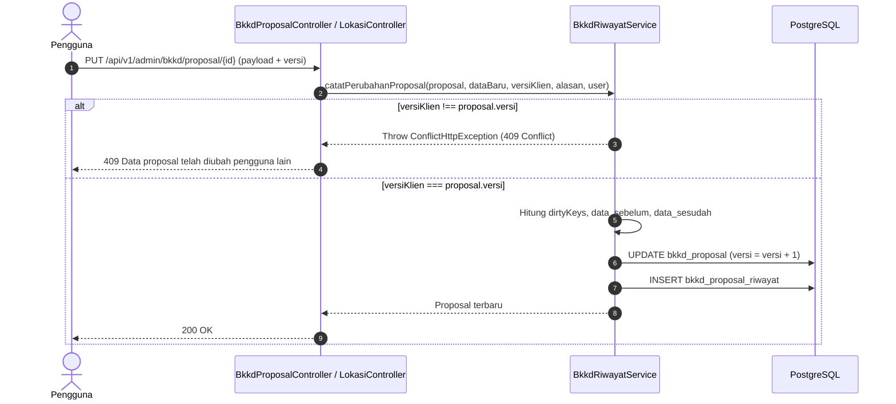

# BKKD Audit & Riwayat Perubahan

## 1. Gambaran Umum (Overview)
Modul **BKKD Audit & Riwayat Perubahan** mencatat jejak historis (*immutable audit trail*) setiap pembuatan, pembaruan atribut, penambahan/perubahan lokasi spasial, penyimpanan konfirmasi desa, penghapusan sementara (*soft delete*), hingga pemulihan (*restore*) pada usulan proposal BKKD di dalam tabel `bkkd_proposal_riwayat`.

**Masalah yang diselesaikan:**
- Menjamin transparansi dan akuntabilitas perubahan anggaran maupun titik lokasi usulan BKKD dengan menyimpan kondisi sebelum (`data_sebelum`) dan sesudah (`data_sesudah`) dalam format `jsonb`.
- Mencegah kondisi balapan (*race condition*) saat dua pengguna mengedit proposal yang sama secara bersamaan melalui mekanisme **Optimistic Locking** berbasis kolom `versi`.

---

## 2. Daftar Kapabilitas (Features List)
- **Diff Snapshot Otomatis (`data_sebelum` & `data_sesudah`)**: Metode `BkkdRiwayatService::catatPerubahanProposal` hanya merekam field yang benar-benar berubah (`field_berubah`) beserta nilai lama dan nilai barunya.
- **Pencatatan Aksi Spasial & Siklus Hidup (`catatAksiProposal`)**: Mencatat aksi `created` (baik input manual maupun import Excel), `updated` (termasuk penambahan/pembaruan/penghapusan lokasi `LineString` dan penyimpanan catatan konfirmasi desa), `deleted`, dan `restored`.
- **Optimistic Locking (`409 Conflict`)**: Membandingkan `versi` yang dikirim klien dengan `proposal->versi` di database sebelum menyimpan perubahan.
- **Timeline Riwayat per Proposal & Global Audit Log**: Tersedia endpoint riwayat spesifik per proposal (`/proposal/{id}/riwayat`) maupun daftar riwayat lintas seluruh proposal (`/riwayat`) dengan filter tahun anggaran, kecamatan, desa, dan jenis aksi.

---

## 3. Arsitektur & Alur Kerja (Architecture & Data Flow)



---

## 4. Spesifikasi Endpoint API (Routes & Endpoints)

| Method | Endpoint URI | Controller & Action | Middleware / Permission | Deskripsi |
| :--- | :--- | :--- | :--- | :--- |
| `GET` | `/api/v1/admin/bkkd/proposal/{id}/riwayat` | `BkkdProposalController@riwayat` | `auth:sanctum`, `permission:bkkd-riwayat-view` | Menampilkan daftar riwayat perubahan versi untuk satu proposal tertentu |
| `GET` | `/api/v1/admin/bkkd/riwayat` | `BkkdProposalController@riwayatSemua` | `auth:sanctum`, `permission:bkkd-riwayat-view` | Menampilkan log riwayat perubahan seluruh proposal secara terpaginasi |

---

## 5. Kontrak Request & Response (Payload Schema)

### Contoh Response `GET /api/v1/admin/bkkd/proposal/{id}/riwayat`
```json
{
  "ok": true,
  "data": [
    {
      "id": "01964e30-9a1b-7111-8222-112233445566",
      "id_proposal": "01964e2a-8c3e-72a1-9b1c-84736291a0bc",
      "versi": 2,
      "aksi": "updated",
      "field_berubah": ["nilai_usulan", "judul_kegiatan"],
      "data_sebelum": {
        "nilai_usulan": "300000000.00",
        "judul_kegiatan": "Pembangunan Jalan Poros"
      },
      "data_sesudah": {
        "nilai_usulan": 350000000,
        "judul_kegiatan": "Pembangunan Jalan Rigid Beton Poros Sukorejo"
      },
      "alasan_perubahan": "Penyesuaian RAB hasil survei lapangan",
      "changed_by": "a1b2c3d4-e5f6-7890-abcd-ef1234567890",
      "changed_by_name": "Verifier Bappeda",
      "created_at": "2026-11-14T11:30:00+07:00"
    }
  ]
}
```

---

## 6. Skema Database & Model Eloquent (Database & Models)

### Tabel `bkkd_proposal_riwayat` (Model: `App\Models\BkkdProposalRiwayat`)
| Kolom | Tipe Data | Constraint / Index | Keterangan |
| :--- | :--- | :--- | :--- |
| `id` | `uuid` | `PRIMARY KEY` | Identifier unik log riwayat |
| `id_proposal` | `uuid` | `FK -> bkkd_proposal(id) ON DELETE CASCADE`, `INDEX (id_proposal, versi)` | Referensi proposal yang diubah |
| `versi` | `integer` | `NOT NULL` | Nomor versi proposal saat aksi terjadi |
| `aksi` | `varchar(50)` | `NOT NULL` | Jenis aksi (`created`, `updated`, `deleted`, `restored`) |
| `field_berubah` | `jsonb` | `NULLABLE` | Array nama kolom yang mengalami perubahan |
| `data_sebelum` | `jsonb` | `NULLABLE` | Snapshot nilai atribut sebelum perubahan |
| `data_sesudah` | `jsonb` | `NULLABLE` | Snapshot nilai atribut sesudah perubahan |
| `alasan_perubahan` | `text` | `NULLABLE` | Keterangan atau alasan perubahan |
| `changed_by` | `uuid` | `FK -> users(uuid)` | Pengguna yang melakukan aksi |
| `created_at` | `timestampTz` | `NOT NULL` | Waktu pencatatan riwayat |

---

## 7. Keamanan, Otorisasi & Kebijakan Akses (Security & Authorization)
- Membutuhkan permission `bkkd-riwayat-view` (atau role `admin`).
- Endpoint global `/api/v1/admin/bkkd/riwayat` memfilter riwayat menggunakan `whereHas('proposal', fn ($q) => $q->forUser($user))` sehingga pengguna Kecamatan/Desa hanya dapat melihat riwayat proposal di wilayahnya sendiri.

---

## 8. Ketergantungan & Konfigurasi (Dependencies & Configuration)
- Terintegrasi langsung dengan `App\Services\BkkdRiwayatService` yang diinjeksikan ke dalam `BkkdProposalController` dan `BkkdProposalLokasiController`.

---

## 9. Panduan Pengujian (Testing Guide)
```bash
cd apps/api
php artisan test --filter=BkkdProposalLokasiAnalysisTest
```

---

## 10. Struktur File Inti (Core Files Reference)
- **Backend**:
  - [BkkdProposalRiwayat.php](file:///c:/laragon/www/melarosa-laravel-nuxt/apps/api/app/Models/BkkdProposalRiwayat.php)
  - [BkkdRiwayatService.php](file:///c:/laragon/www/melarosa-laravel-nuxt/apps/api/app/Services/BkkdRiwayatService.php)
  - [BkkdRiwayatResource.php](file:///c:/laragon/www/melarosa-laravel-nuxt/apps/api/app/Http/Resources/BkkdRiwayatResource.php)
- **Frontend**:
  - [index.vue](file:///c:/laragon/www/melarosa-laravel-nuxt/apps/web/app/pages/admin/bkkd/riwayat/index.vue)
  - [BkkdRiwayatTimeline.vue](file:///c:/laragon/www/melarosa-laravel-nuxt/apps/web/app/components/bkkd/BkkdRiwayatTimeline.vue)

---

## 11. Catatan Operasional & Troubleshooting (Edge Cases & Gotchas)
- **Tidak Ada Perubahan Field (`dirtyKeys` Kosong)**: Apabila pengguna menekan tombol simpan pada form edit proposal tanpa mengubah nilai atribut `bkkd_proposal` apa pun, `catatPerubahanProposal` tidak akan menaikkan nomor `versi` pada `bkkd_proposal` dan tidak membuat baris duplikat kosong di `bkkd_proposal_riwayat` (namun perubahan lokasi spasial tetap dicatat melalui `catatAksiProposal`).
