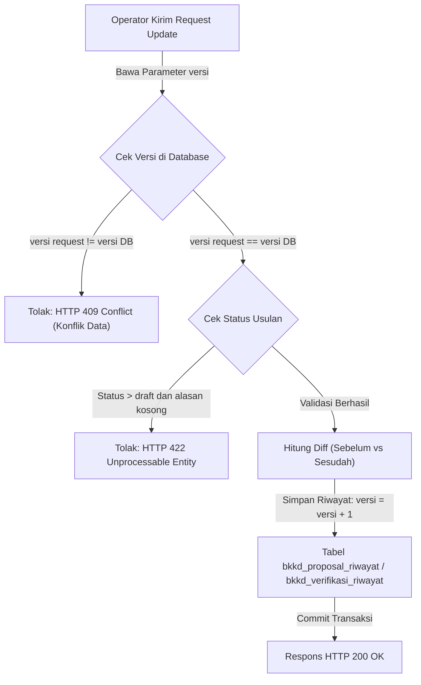

# Riwayat Perubahan & Audit Trail BKKD

Kembali ke indeks dokumentasi: [docs/README.md](../README.md)

---

## 1. Tujuan

Menyediakan pencatatan jejak audit (audit trail) dan snapshot versioning komprehensif untuk setiap mutasi data pada modul BKKD, baik terhadap data atribut usulan proposal maupun hasil telaah verifikasi OPD teknis. Modul ini menerapkan mekanisme pencegahan tabrakan data (Optimistic Locking via HTTP 409 Conflict), mewajibkan pengisian alasan perubahan pasca-tahap draft, serta memvisualisasikan perbandingan sebelum vs sesudah (diff view) secara transparan.

---

## 2. Latar Belakang & Masalah

| Kondisi Sebelum Modul Riwayat BKKD | Kondisi Sesudah Modul Riwayat BKKD |
| :--- | :--- |
| Perubahan anggaran atau volume target tidak meninggalkan jejak siapa pengubah dan apa dasarnya. | Setiap perubahan merekam nomor versi (`versi`), user pengubah, stempel waktu, serta snapshot JSON lengkap data sebelum vs sesudah. |
| Dua operator yang membuka usulan yang sama dapat saling menimpa data tanpa disadari (silent overwrite). | Mekanisme Optimistic Locking menolak request penyimpanan yang versinya sudah kedaluwarsa dengan pesan HTTP 409 Conflict. |
| Pengubahan usulan yang sudah diajukan ke dinas dapat dilakukan bebas tanpa pencatatan alasan resmi. | Sistem mewajibkan input `alasan_perubahan` jika usulan telah melewati tahap `draft`. |
| Tidak ada visualisasi riwayat yang mudah dipahami oleh auditor internal. | Antarmuka timeline interaktif menampilkan kartu riwayat dan tabel perbandingan kolom yang berubah (diff). |

---

## 3. Fitur Saat Ini / Kapabilitas Modul

- **Pencatatan Snapshot Otomatis**: Setiap update pada `bkkd_proposal` dan `bkkd_verifikasi` memicu pembandingan field dan pembuatan baris baru di tabel riwayat.
- **Optimistic Locking**: Request update menyertakan nomor `versi`. Jika nomor versi di database telah lebih tinggi, server merespons dengan HTTP 409 Conflict.
- **Validasi Alasan Perubahan Berdasarkan Status**:
  - Pada status `draft`: Alasan perubahan bersifat opsional untuk mempercepat pengisian awal.
  - Pada status selain `draft` (`diajukan_opd`, `layak`, dll.): Alasan perubahan bersifat wajib (HTTP 422 jika kosong).
- **Klasifikasi Aksi Terperinci**:
  - Proposal: `created`, `updated`, `status_changed`, `deleted`, `restored`, `lampiran_added`, `lampiran_removed`, `ditetapkan_tapd`, `batalkan_tapd`.
  - Verifikasi: `verifikasi_created`, `verifikasi_koreksi`.
- **Diff Viewer Atribut**: Menampilkan perbandingan nilai lama (tercoret merah) dan nilai baru (hijau tebal) untuk seluruh kolom yang mengalami modifikasi.
- **Umpan Log Global**: Halaman audit terpusat dengan filter tahun anggaran, wilayah kecamatan/desa, dan jenis aksi.

---

## 4. Logika Alur & Arsitektur

---

## 5. Halaman dan Route

### Frontend Nuxt (`apps/web`)

- `/admin/bkkd/riwayat` : Halaman umpan audit trail global dengan tab proposal dan tab verifikasi OPD.
- `/admin/bkkd/proposal/:id` (Tab Riwayat Perubahan) : Riwayat audit khusus untuk usulan proposal tertentu.

### Backend REST API (`apps/api`)

- `GET /api/v1/admin/bkkd/riwayat` : Mengambil daftar seluruh riwayat perubahan (tipe `proposal` atau `verifikasi`) dengan filter dan pagination.
- `GET /api/v1/admin/bkkd/proposal/{id}/riwayat` : Mengambil riwayat aktivitas khusus usulan tertentu.
- `GET /api/v1/admin/bkkd/verifikasi/{id}/riwayat` : Mengambil riwayat koreksi khusus telaah OPD tertentu.

---

## 6. Permission & Hak Akses (RBAC)

| Peran Pengguna (Role) | Hak Akses | Deskripsi Operasional |
| :--- | :--- | :--- |
| `admin` | Penuh (`*`) | Memantau seluruh jejak audit sistem BKKD tanpa batasan wilayah. |
| `verifierBappeda` | `bkkd-riwayat-view` | Memeriksa riwayat perubahan usulan desa dan telaah OPD untuk pengawasan. |
| `verifierKecamatan` | Read-Only Terfilter | Memeriksa riwayat perubahan terbatas pada usulan desa di wilayah kecamatannya. |

---

## 7. Alur Pengguna (Step-by-Step User Journey)

1. Pengguna membuka halaman detail proposal atau menu **Proposal BKKD ➔ Riwayat Perubahan**.
2. Pengguna melihat kartu timeline aktivitas yang tersusun urut dari waktu terbaru ke terlama.
3. Setiap kartu menampilkan penanda aksi (misal: *Data Diperbarui*, *Status Berubah*, *Ditetapkan TAPD*), nomor versi, nama operator pengubah, serta tanggal dan jam transaksi.
4. Jika terdapat alasan perubahan yang dicantumkan, catatan tersebut ditampilkan dalam kotak kutipan resmi.
5. Pada bagian bawah kartu, pengguna dapat memeriksa kolom apa saja yang diubah lengkap dengan nilai sebelum dan sesudahnya.
6. Jika saat mengedit usulan muncul peringatan **Konflik Data (409 Conflict)**, pengguna diarahkan untuk memuat ulang data terbaru agar tidak menimpa pekerjaan operator lain.

---

## 8. Integrasi Data & Skema Database

### Tabel: `bkkd_proposal_riwayat`

| Kolom | Tipe Data | Keterangan |
| :--- | :--- | :--- |
| `id` | `uuid` (Primary Key) | Identitas unik record riwayat. |
| `id_proposal` | `uuid` (Foreign Key) | Relasi ke tabel `bkkd_proposal`. |
| `versi` | `integer` | Nomor versi saat snapshot diambil. |
| `aksi` | `varchar(50)` | Jenis tindakan mutasi data. |
| `field_berubah` | `jsonb` (Nullable) | Array nama-nama kolom yang mengalami perubahan. |
| `data_sebelum` | `jsonb` (Nullable) | Objek JSON nilai atribut sebelum perubahan. |
| `data_sesudah` | `jsonb` (Nullable) | Objek JSON nilai atribut sesudah perubahan. |
| `alasan_perubahan` | `text` (Nullable) | Justifikasi perubahan oleh pengguna. |
| `changed_by` | `uuid` | Foreign key ke user yang melakukan mutasi. |
| `created_at` | `timestamp` | Waktu pencatatan snapshot. |

### Tabel: `bkkd_verifikasi_riwayat`

- Memiliki skema identik dengan `bkkd_proposal_riwayat`, namun bertaut ke kolom foreign key `id_verifikasi` untuk merekam jejak koreksi hasil telaah OPD teknis.

---

## 9. Efek Bisnis Penting

- **Akuntabilitas Finansial & Pemeriksaan BPK**: Seluruh mutasi usulan anggaran terikat pada akun pengguna otentik dan stempel waktu permanen, menjamin kesiapan data saat diaudit oleh Inspektorat Daerah maupun Badan Pemeriksa Keuangan (BPK).
- **Non-Destructive Versioning**: Riwayat snapshot bersifat append-only (hanya bertambah) dan tidak pernah mengalami pembaruan atau penghapusan record.
- **Integritas Konkurensi**: Optimistic locking mencegah data loss yang diakibatkan oleh kondisi balapan jaringan (network race condition) antar operator.

---

## 10. Batasan Saat Ini & Edge Cases

- **Berkas Fisik Lampiran**: Riwayat merekam aksi penambahan dan penghapusan berkas lampiran beserta nama file aslinya, namun isi biner fisik file yang telah dihapus tidak disimpan kembali (hanya tersisa jejak nama dan metadata ukuran filenya).
- **Pembersihan Log**: Snapshot log riwayat disimpan permanen tanpa retensi kadaluwarsa karena berfungsi sebagai bukti hukum audit keuangan daerah.

---

## 11. File Sentral

### Backend (`apps/api`)
- Models: `app/Models/BkkdProposalRiwayat.php`, `app/Models/BkkdVerifikasiRiwayat.php`
- Service: `app/Services/BkkdRiwayatService.php` (Core diff generator, reason validator, and version incrementor)
- Resources: `app/Http/Resources/BkkdRiwayatResource.php`
- Controller: `app/Http/Controllers/Admin/BkkdProposalController.php` (method: `riwayat`, `riwayatSemua`), `app/Http/Controllers/Admin/BkkdVerifikasiController.php` (method: `riwayat`)

### Frontend (`apps/web`)
- Components: `app/components/bkkd/BkkdRiwayatTimeline.vue`
- Pages: `app/pages/admin/bkkd/riwayat/index.vue`, `app/pages/admin/bkkd/proposal/[id].vue`
