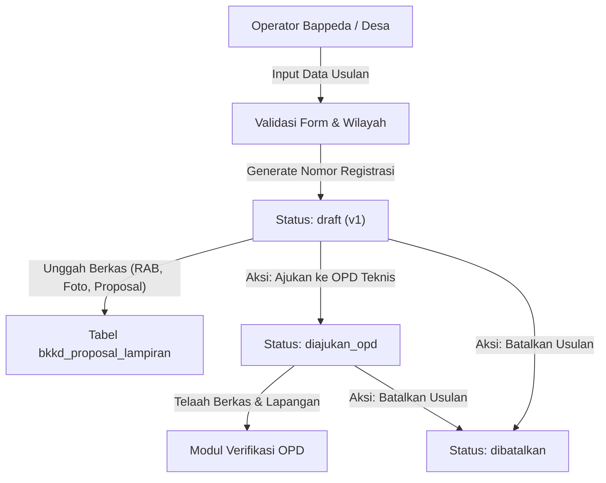

# Proposal Usulan BKKD

Kembali ke indeks dokumentasi: [docs/README.md](../README.md)

---

## 1. Tujuan

Menyediakan sistem pencatatan, pemantauan, dan manajemen usulan Bantuan Keuangan Khusus Desa (BKKD) di lingkungan Pemerintah Kabupaten Bojonegoro. Modul ini mendigitalisasi proses registrasi proposal pembangunan fisik desa, memfasilitasi pelacakan status usulan secara real-time, mengamankan dokumen lampiran desa, serta menyiapkan pondasi spasial PostGIS untuk visualisasi sebaran usulan anggaran.

---

## 2. Latar Belakang & Masalah

| Kondisi Sebelum Modul BKKD | Kondisi Sesudah Modul BKKD |
| :--- | :--- |
| Usulan BKKD dicatat manual melalui lembaran proposal fisik dan spreadsheet sporadis, menyulitkan rekapitulasi tingkat kabupaten. | Seluruh usulan desa tercatat dalam database terpusat dengan nomor registrasi unik (`BKKD/{tahun}/{kode_kec}/{kode_desa}/{seq}`). |
| Potensi tumpang tindih usulan antar desa tanpa kejelasan status pengajuan. | Status usulan transparan dari tahap draft, pengajuan OPD, verifikasi, hingga penetapan TAPD. |
| Berkas RAB, foto kondisi 0%, dan surat desa sering tercecer di dinas teknis yang berbeda. | Berkas lampiran tersimpan aman pada penyimpanan privat server dengan otorisasi unduh berjenjang. |
| Tidak ada mekanisme pencegahan tabrakan penyimpanan data antar operator (concurrency collision). | Penerapan versioning dan Optimistic Locking (HTTP 409 Conflict) untuk mencegah timpa-menimpa data. |

---

## 3. Fitur Saat Ini / Kapabilitas Modul

- **Pendaftaran Usulan Proposal**: Registrasi judul kegiatan, bidang BKKD, nilai usulan, target volume/satuan, dan lokasi kegiatan.
- **Penomoran Registrasi Otomatis**: Generator nomor registrasi standar pemerintah daerah berbasis tahun anggaran dan kode wilayah desa.
- **Hierarki Wilayah Terintegrasi**: Pemilihan kecamatan dan desa menggunakan komponen `WilayahSelector` yang terkunci sesuai role pengguna.
- **Manajemen Lampiran Terproteksi**: Unggah berkas proposal desa, RAB, gambar teknis, dan foto kondisi 0% pada disk lokal privat.
- **Transisi Siklus Hidup Usulan**: Aksi pengajuan usulan ke OPD teknis (`diajukan_opd`) dan pembatalan usulan (`dibatalkan`) dengan catatan alasan resmi.
- **Pondasi Geometri PostGIS**: Atribut `geom` bertipe geometri umum SRID 4326 dengan indeks GiST yang siap untuk digitasi spasial.
- **Soft Deletes & Pemulihan**: Usulan berstatus draft dapat dihapus sementara dan dipulihkan kembali jika diperlukan.

---

## 4. Logika Alur & Arsitektur

---

## 5. Halaman dan Route

### Frontend Nuxt (`apps/web`)

- `/admin/bkkd/proposal` : Halaman daftar usulan, ringkasan metrik, filter tahun/status/wilayah, dan modal tambah usulan.
- `/admin/bkkd/proposal/:id` : Halaman rincian usulan lengkap dengan tab ringkasan, verifikasi OPD, berkas lampiran, dan audit trail.

### Backend REST API (`apps/api`)

- `GET /api/v1/admin/bkkd/proposal` : Mengambil daftar proposal usulan dengan pagination, filter, dan rangkuman metrik.
- `POST /api/v1/admin/bkkd/proposal` : Menyimpan data usulan proposal baru (status awal `draft`).
- `GET /api/v1/admin/bkkd/proposal/{id}` : Mengambil informasi detail usulan, OPD aktif, dan daftar lampiran.
- `PUT /api/v1/admin/bkkd/proposal/{id}` : Memperbarui atribut usulan dengan validasi versi (`versi`).
- `DELETE /api/v1/admin/bkkd/proposal/{id}` : Menghapus usulan (soft delete).
- `POST /api/v1/admin/bkkd/proposal/{id}/restore` : Memulihkan usulan dari tempat sampah.
- `POST /api/v1/admin/bkkd/proposal/{id}/ajukan` : Mengajukan usulan ke OPD teknis.
- `POST /api/v1/admin/bkkd/proposal/{id}/batalkan` : Membatalkan pengajuan usulan dengan alasan resmi.
- `POST /api/v1/admin/bkkd/proposal/{id}/lampiran` : Mengunggah dokumen lampiran proposal.
- `DELETE /api/v1/admin/bkkd/proposal/{id}/lampiran/{lampiranId}` : Menghapus berkas lampiran.
- `GET /api/v1/admin/bkkd/proposal/{id}/lampiran/{lampiranId}/download` : Mengunduh berkas fisik secara aman (streaming download).

---

## 6. Permission & Hak Akses (RBAC)

| Peran Pengguna (Role) | Hak Akses | Deskripsi Operasional |
| :--- | :--- | :--- |
| `admin` | Penuh (`*`) | Bypass seluruh izin untuk pengawasan dan perbaikan darurat sistem. |
| `verifierBappeda` | CRUD Proposal & Tindakan | Mencatat usulan, mengajukan ke OPD, mengelola lampiran, dan memperbarui data. |
| `verifierKecamatan` | Read-Only (`bkkd-proposal-view`) | Melihat daftar dan detail usulan terbatas pada wilayah kecamatannya (`forUser`). |

---

## 7. Alur Pengguna (Step-by-Step User Journey)

1. Operator membuka menu **Proposal BKKD ➔ Daftar Proposal**.
2. Operator memilih tombol **Tambah Usulan Proposal** untuk menampilkan form modal.
3. Operator memilih Tahun Anggaran, Bidang BKKD, Wilayah Kecamatan, Desa, dan mengisi judul serta estimasi nilai usulan.
4. Sistem memvalidasi kelengkapan data dan menerbitkan Nomor Registrasi unik.
5. Pada halaman rincian usulan, operator mengunggah dokumen wajib seperti Surat Permohonan Desa dan RAB.
6. Setelah berkas siap, operator mengklik tombol **Ajukan ke OPD** sehingga usulan berpindah ke antrean telaah teknis dinas terkait.

---

## 8. Integrasi Data & Skema Database

### Tabel Utama: `bkkd_proposal`

| Kolom | Tipe Data | Keterangan |
| :--- | :--- | :--- |
| `id` | `uuid` (Primary Key) | Identitas unik record usulan. |
| `nomor_registrasi` | `varchar(100)` (Unique) | Nomor standar registrasi BKKD. |
| `tahun_anggaran` | `smallint` (Index) | Tahun anggaran perencanaan. |
| `id_kecamatan` | `bigint` (Foreign Key) | Relasi ke tabel `ref_kecamatan`. |
| `id_desa` | `bigint` (Foreign Key) | Relasi ke tabel `ref_desa`. |
| `id_bidang` | `uuid` (Foreign Key) | Relasi ke tabel `ref_bkkd_bidang`. |
| `judul_kegiatan` | `varchar(255)` | Judul nama kegiatan fisik desa. |
| `uraian_kegiatan` | `text` (Nullable) | Penjelasan detail pekerjaan. |
| `lokasi_kegiatan` | `text` | Alamat atau dusun lokasi pekerjaan. |
| `latitude` / `longitude` | `double precision` (Nullable) | Titik koordinat sentroid. |
| `geom` | `geometry(Geometry, 4326)` | Geometri spasial PostGIS dengan indeks GiST. |
| `nilai_usulan` | `decimal(15,2)` | Anggaran yang diusulkan oleh pihak desa. |
| `status` | `varchar(30)` (Index) | Status siklus hidup (`draft`, `diajukan_opd`, dll.). |
| `versi` | `integer` (Default: 1) | Penanda versi untuk optimistic locking. |
| `nilai_disetujui_tapd` | `decimal(15,2)` (Nullable) | Anggaran pagu hasil penetapan TAPD. |
| `catatan_tapd` | `text` (Nullable) | Pertimbangan penetapan prioritas TAPD. |
| `tanggal_penetapan_tapd` | `date` (Nullable) | Tanggal sidang atau keputusan TAPD. |
| `ditetapkan_oleh` | `uuid` (Nullable) | Foreign key ke user yang menetapkan. |

### Tabel Pendukung: `bkkd_proposal_lampiran`

- Menyimpan metadata berkas pendukung (`proposal_desa`, `rab`, `gambar_rencana`, `foto_kondisi_0`, dll.).
- File biner disimpan pada disk `local` privat di direktori `bkkd/{tahun}/{id_proposal}/{uuid}.{ext}`.

---

## 9. Efek Bisnis Penting

- **Pemisahan dari Modul Plotting Anggaran**: Modul BKKD berdiri mandiri dan tidak melakukan integrasi atau modifikasi data pada tabel `plotting_anggaran`.
- **Integritas Spasial**: Nama kolom geometri menggunakan standar PostGIS `geom` dengan proyeksi EPSG:4326, menjamin interoperabilitas dengan tool WebGIS dan Martin Tile Server.
- **Pencegahan Akses Ilegal Berkas**: Berkas lampiran desa tidak disimpan pada direktori publik (`public/storage`), melainkan di-stream melalui kontroler terotentikasi yang memeriksa kebijakan akses (`BkkdProposalPolicy`).

---

## 10. Batasan Saat Ini & Edge Cases

- **Pencatatan Terpusat (Fase 1)**: Pada fase implementasi awal, seluruh input data dilakukan oleh Operator Bappeda berdasarkan dokumen resmi fisik/surat dari desa.
- **Digitasi Spasial**: Kolom `geom` telah aktif di database, namun kanvas digitasi visual linestring peta penuh akan diaktifkan pada Fase 2 spasial editor.
- **Konflik Versi (409)**: Jika dua operator mengedit usulan yang sama secara bersamaan, sistem akan menolak penyimpanan kedua dengan pesan kesalahan konflik versi.

---

## 11. File Sentral

### Backend (`apps/api`)
- Model: `app/Models/BkkdProposal.php`, `app/Models/BkkdProposalLampiran.php`, `app/Models/RefBkkdBidang.php`
- Controller: `app/Http/Controllers/Admin/BkkdProposalController.php`, `app/Http/Controllers/Admin/RefBkkdController.php`
- Requests & Resources: `app/Http/Requests/Admin/StoreBkkdProposalRequest.php`, `app/Http/Requests/Admin/UpdateBkkdProposalRequest.php`, `app/Http/Resources/BkkdProposalResource.php`, `app/Http/Resources/BkkdProposalDetailResource.php`
- Policy: `app/Policies/BkkdProposalPolicy.php`

### Frontend (`apps/web`)
- Types: `app/types/bkkd.ts`
- Composable: `app/composables/useBkkdApi.ts`
- Components: `app/components/bkkd/BkkdProposalFormModal.vue`, `app/components/bkkd/BkkdLampiranList.vue`, `app/components/bkkd/BkkdStatusBadge.vue`
- Pages: `app/pages/admin/bkkd/proposal/index.vue`, `app/pages/admin/bkkd/proposal/[id].vue`
