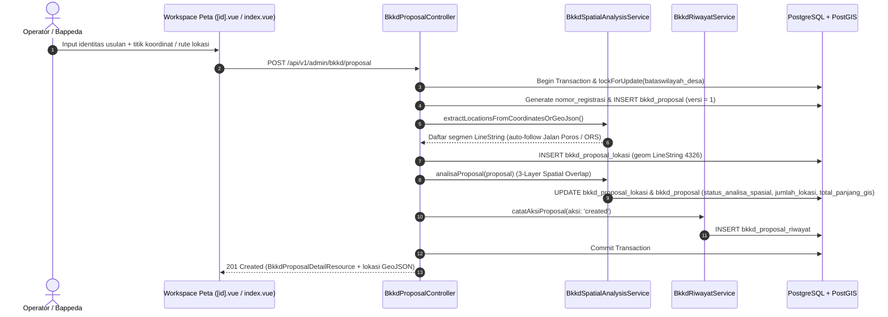

# BKKD Proposal & Workspace Spasial

## 1. Gambaran Umum (Overview)
Modul **BKKD Proposal** mengelola siklus pencatatan, pemetaan geospasial, import massal, dan evaluasi usulan Bantuan Keuangan Khusus Desa (BKKD) di Kabupaten Bojonegoro. Pasca penyederhanaan skema pada migrasi `2026_11_14_000001_simplify_bkkd_proposal_schema`, modul ini berfokus langsung pada **pencatatan identitas usulan desa**, **pemetaan multi-lokasi bergaris (`LineString` `1:N`)**, dan **analisa spasial 3 lapis secara otomatis** tanpa birokrasi status administratif bertingkat (kolom legacy surat desa, pengajuan OPD, penetapan TAPD, PAPBD, dan tabel lampiran terpisah telah dihapus).

**Masalah yang diselesaikan:**
- Menghilangkan kerumitan input form administratif berlapis dengan menyatukan pencatatan proposal dan pemetaan rute langsung di dalam **Workspace Peta Interaktif Full-Bleed** (`/admin/bkkd/proposal/baru` dan `/admin/bkkd/proposal/[id]`).
- Mencegah kesalahan penomoran ganda melalui generator `nomor_registrasi` otomatis berurutan per desa dan tahun anggaran dengan penguncian baris transaksi (`lockForUpdate`).
- Mempercepat migrasi data usulan daerah melalui fitur **Import Excel/CSV Massal** yang dilengkapi algoritma inferensi cerdas untuk memetakan nama Kecamatan, Desa, dan Bidang BKKD (termasuk deteksi kata kunci dari judul kegiatan).
- Menghitung metrik agregat (`total_proposal`, `total_nilai_usulan`, `total_lokasi`, `total_panjang_gis`, serta rincian jumlah per status analisa spasial) dalam satu query SQL teroptimasi pada endpoint daftar proposal.

---

## 2. Daftar Kapabilitas (Features List)
- **Generator Nomor Registrasi Otomatis & Thread-Safe**: Menghasilkan kode unik berformat `BKKD/{tahun_anggaran}/{id_desa}/{nomor_urut_3_digit}` (contoh: `BKKD/2027/3522010001/001`) menggunakan `BatasWilayahDesa::lockForUpdate()`.
- **Sinkronisasi Spasial Otomatis Saat Simpan Proposal (`syncLokasiSpasialOnProposalSave`)**: Pembuatan maupun pembaruan proposal dapat langsung menyertakan array `lokasi[]`, `geojson`, koordinat titik awal-akhir (`latitude`, `longitude`, `latitude_akhir`, `longitude_akhir`), atau referensi `id_jalan_poros` yang langsung diekstrak menjadi geometri `LineString` dan dianalisis terhadap 3 lapis geospasial.
- **Import Proposal Massal (CSV / Array JSON)**: Mengimpor ratusan baris usulan sekaligus dengan resolusi cerdas master Kecamatan, Desa, dan Bidang BKKD (`resolveBidang` berbasis UUID, nama, pencocokan tanpa awalan, kamus kata kunci kegiatan infrastruktur, hingga fallback otomatis).
- **Unduh Template Import CSV**: Menyediakan file template standar `Template_Import_Proposal_BKKD.csv` ber-BOM UTF-8 untuk memudahkan pengisian data oleh operator.
- **Single-Query Consolidated Summary**: Endpoint daftar proposal mengembalikan paginasi data sekaligus ringkasan metrik 5 status spasial (`aman`, `lanjutan_ruas`, `konfirmasi_belum_tuntas`, `duplikasi_tuntas`, `belum_dianalisa`) dalam satu eksekusi agregasi database.
- **Optimistic Locking (`versi`)**: Menolak pembaruan konkuren yang menggunakan versi usang dengan respons `409 Conflict` melalui `BkkdRiwayatService`.
- **Pembatasan Akses Wilayah Otomatis (Territorial RBAC)**: Mengunci wilayah input dan filter (`scopeForUser`) secara otomatis bagi pengguna berlevel Kecamatan (`id_kecamatan`) atau Desa (`id_desa`).
- **Soft Delete & Pemulihan (Restore)**: Mendukung penghapusan sementara (`deleted_at`) dan pemulihan kembali proposal beserta pencatatan jejak audit otomatis.

---

## 3. Arsitektur & Alur Kerja (Architecture & Data Flow)



---

## 4. Spesifikasi Endpoint API (Routes & Endpoints)

| Method | Endpoint URI | Controller & Action | Middleware / Permission | Deskripsi |
| :--- | :--- | :--- | :--- | :--- |
| `GET` | `/api/v1/admin/ref-bkkd/opd` | `RefBkkdController@opd` | `auth:sanctum` | Daftar master OPD pendamping BKKD aktif |
| `GET` | `/api/v1/admin/ref-bkkd/bidang` | `RefBkkdController@bidang` | `auth:sanctum` | Daftar master Bidang kegiatan BKKD beserta OPD default |
| `GET` | `/api/v1/admin/bkkd/proposal` | `BkkdProposalController@index` | `auth:sanctum`, `permission:bkkd-proposal-view` | Daftar proposal terpaginasi dengan filter & ringkasan metrik spasial |
| `POST` | `/api/v1/admin/bkkd/proposal` | `BkkdProposalController@store` | `auth:sanctum`, `permission:bkkd-proposal-create` | Membuat proposal baru, mengekstrak lokasi `LineString`, dan menjalankan analisa spasial |
| `GET` | `/api/v1/admin/bkkd/proposal/import/template` | `BkkdProposalController@importTemplate` | `auth:sanctum`, `permission:bkkd-proposal-create` | Mengunduh file CSV template import usulan proposal BKKD |
| `POST` | `/api/v1/admin/bkkd/proposal/import` | `BkkdProposalController@importExcel` | `auth:sanctum`, `permission:bkkd-proposal-create` | Import massal proposal dari file CSV atau payload JSON `rows[]` |
| `GET` | `/api/v1/admin/bkkd/proposal/{id}` | `BkkdProposalController@show` | `auth:sanctum`, `permission:bkkd-proposal-view` | Detail lengkap proposal beserta koleksi `lokasi` (GeoJSON & centroid) |
| `PUT` | `/api/v1/admin/bkkd/proposal/{id}` | `BkkdProposalController@update` | `auth:sanctum`, `permission:bkkd-proposal-update` | Memperbarui proposal (wajib `versi`), menyinkronkan ulang lokasi & analisa spasial |
| `DELETE` | `/api/v1/admin/bkkd/proposal/{id}` | `BkkdProposalController@destroy` | `auth:sanctum`, `permission:bkkd-proposal-delete` | Menghapus sementara proposal (soft delete) & mencatat riwayat |
| `POST` | `/api/v1/admin/bkkd/proposal/{id}/restore` | `BkkdProposalController@restore` | `auth:sanctum`, `permission:bkkd-proposal-delete` | Memulihkan proposal yang telah dihapus sementara |
| `GET` | `/api/v1/admin/bkkd/proposal/{id}/riwayat` | `BkkdProposalController@riwayat` | `auth:sanctum`, `permission:bkkd-riwayat-view` | Menampilkan riwayat perubahan versi spesifik pada satu proposal |

---

## 5. Kontrak Request & Response (Payload Schema)

### A. Filter Query `GET /api/v1/admin/bkkd/proposal`
- `tahun_anggaran` (integer, opsional)
- `id_kecamatan` (integer, opsional)
- `id_desa` (integer, opsional)
- `id_bidang` (uuid, opsional)
- `status_analisa_spasial` (string, opsional: `aman`, `lanjutan_ruas`, `konfirmasi_belum_tuntas`, `duplikasi_tuntas`, `belum_dianalisa`)
- `search` (string, opsional: mencari pada `judul_kegiatan`, `nomor_registrasi`, atau `lokasi_kegiatan`)
- `sort` (string, opsional: `created_at`, `nomor_registrasi`, `nilai_usulan`, `tahun_anggaran`, `status_analisa_spasial`) & `direction` (`asc` / `desc`)
- `page` & `per_page` (1 s.d. 100, default `15`)

### B. Contoh Request `POST /api/v1/admin/bkkd/proposal`
Validasi ditangani oleh `StoreBkkdProposalRequest` (dan `UpdateBkkdProposalRequest` untuk `PUT` yang mewajibkan field `versi`):
```json
{
  "tahun_anggaran": 2027,
  "id_kecamatan": 3522010,
  "id_desa": 3522010001,
  "id_bidang": "9b1deb4d-3b7d-4bad-9bdd-2b0d7b3dcb6d",
  "judul_kegiatan": "Pembangunan Jalan Rigid Beton Poros Sukorejo",
  "uraian_kegiatan": "Perkerasan beton mutu K-300 penghubung antar dusun",
  "lokasi_kegiatan": "Dusun Krajan RT 01 - RT 04",
  "nilai_usulan": 350000000,
  "lokasi": [
    {
      "nama_lokasi": "Segmen 1 Poros Krajan",
      "urutan": 1,
      "id_jalan_poros": "5f9b4c12-8a41-4d0e-9a8b-1029384756ab",
      "panjang_rencana_m": 450,
      "lebar_m": 4.0,
      "latitude": -7.1501,
      "longitude": 111.8901,
      "latitude_akhir": -7.1530,
      "longitude_akhir": 111.8930
    }
  ]
}
```

### C. Contoh Response Sukses (`201 Created` / `200 OK`)
```json
{
  "ok": true,
  "message": "Proposal usulan BKKD berhasil dicatat.",
  "data": {
    "id": "01964e2a-8c3e-72a1-9b1c-84736291a0bc",
    "nomor_registrasi": "BKKD/2027/3522010001/001",
    "tahun_anggaran": 2027,
    "id_kecamatan": 3522010,
    "id_desa": 3522010001,
    "nama_kecamatan": "Kecamatan Bojonegoro",
    "nama_desa": "Desa Sukorejo",
    "id_bidang": "9b1deb4d-3b7d-4bad-9bdd-2b0d7b3dcb6d",
    "nama_bidang": "BKK JALAN",
    "id_opd_default": "8a0cda3c-2a6c-4a9c-8acc-1a9c6a2cba5c",
    "judul_kegiatan": "Pembangunan Jalan Rigid Beton Poros Sukorejo",
    "uraian_kegiatan": "Perkerasan beton mutu K-300 penghubung antar dusun",
    "lokasi_kegiatan": "Dusun Krajan RT 01 - RT 04",
    "nilai_usulan": 350000000,
    "jumlah_lokasi": 1,
    "total_panjang_gis": 454.82,
    "status_analisa_spasial": "aman",
    "catatan_konfirmasi_desa": null,
    "dikonfirmasi_oleh": null,
    "dikonfirmasi_pada": null,
    "lokasi": [
      {
        "id": "01964e2a-8c45-7012-a123-9876543210fe",
        "id_proposal": "01964e2a-8c3e-72a1-9b1c-84736291a0bc",
        "id_jalan_poros": "5f9b4c12-8a41-4d0e-9a8b-1029384756ab",
        "urutan": 1,
        "nama_lokasi": "Segmen 1 Poros Krajan",
        "panjang_rencana_m": 450,
        "panjang_gis_m": 454.82,
        "lebar_m": 4.0,
        "status_analisa_spasial": "aman",
        "geojson": {
          "type": "LineString",
          "coordinates": [[111.8901, -7.1501], [111.893, -7.153]]
        }
      }
    ],
    "versi": 1,
    "creator_name": "Verifier Bappeda",
    "created_at": "2026-11-14T10:00:00+07:00"
  }
}
```

---

## 6. Skema Database & Model Eloquent (Database & Models)

### Tabel `bkkd_proposal` (Model: `App\Models\BkkdProposal`)
| Kolom | Tipe Data | Constraint / Index | Keterangan |
| :--- | :--- | :--- | :--- |
| `id` | `uuid` | `PRIMARY KEY` | Identifier unik proposal |
| `nomor_registrasi` | `varchar(50)` | `UNIQUE` | Nomor urut otomatis (`BKKD/{tahun}/{id_desa}/{urut}`) |
| `tahun_anggaran` | `integer` | `INDEX` | Tahun anggaran pengajuan (`2020` s.d. `2100`) |
| `id_kecamatan` | `integer` | `FK -> bataswilayah_kecamatan(id)`, `INDEX` | Referensi wilayah kecamatan |
| `id_desa` | `bigint` | `FK -> bataswilayah_desa(id)`, `INDEX` | Referensi wilayah desa |
| `id_bidang` | `uuid` | `FK -> ref_bkkd_bidang(id)`, `INDEX` | Referensi bidang kegiatan BKKD |
| `judul_kegiatan` | `varchar(255)` | `NOT NULL` | Nama atau judul kegiatan yang diusulkan |
| `uraian_kegiatan` | `text` | `NULLABLE` | Deskripsi teknis / rincian usulan kegiatan |
| `lokasi_kegiatan` | `text` | `NULLABLE` | Keterangan tekstual lokasi kegiatan (dusun / RT / RW) |
| `nilai_usulan` | `decimal(15,2)` | `NULLABLE` | Nilai anggaran yang diusulkan dalam Rupiah |
| `jumlah_lokasi` | `integer` | `DEFAULT 0` | Jumlah segmen `LineString` pada `bkkd_proposal_lokasi` |
| `total_panjang_gis` | `decimal(12,2)` | `DEFAULT 0` | Akumulasi panjang geodetik seluruh segmen lokasi (meter) |
| `status_analisa_spasial` | `varchar(40)` | `INDEX (status_analisa_spasial, tahun_anggaran)` | Status terburuk dari lokasi anak (`aman`, `lanjutan_ruas`, `konfirmasi_belum_tuntas`, `duplikasi_tuntas`, `belum_dianalisa`) |
| `catatan_konfirmasi_desa` | `text` | `NULLABLE` | Catatan hasil klarifikasi Bappeda dengan Pemerintah Desa |
| `dikonfirmasi_oleh` | `uuid` | `NULLABLE`, `FK -> users(uuid)` | Pengguna Bappeda yang menyimpan konfirmasi desa |
| `dikonfirmasi_pada` | `timestamp` | `NULLABLE` | Waktu penyimpanan catatan konfirmasi desa |
| `versi` | `integer` | `DEFAULT 1` | Counter versi untuk optimistic locking |
| `created_by`, `updated_by` | `uuid` | `FK -> users(uuid)` | Jejak pengguna pembuat dan pengubah terakhir |
| `created_at`, `updated_at`, `deleted_at` | `timestampTz` | `SoftDeletes` | Timestamp siklus hidup record |

**Relasi Eloquent Utama pada `BkkdProposal`:**
- `kecamatan()`: `BelongsTo` ke `BatasWilayahKecamatan` (`id_kecamatan` -> `id`)
- `desa()`: `BelongsTo` ke `BatasWilayahDesa` (`id_desa` -> `id`)
- `bidang()`: `BelongsTo` ke `RefBkkdBidang` (`id_bidang` -> `id`)
- `lokasi()`: `HasMany` ke `BkkdProposalLokasi` (`id_proposal` -> `id`), diurutkan berdasarkan `urutan`
- `riwayat()`: `HasMany` ke `BkkdProposalRiwayat` (`id_proposal` -> `id`), diurutkan menurun berdasarkan `versi`
- `konfirmator()`, `creator()`, `updater()`: `BelongsTo` ke `User` (`uuid`)

---

## 7. Keamanan, Otorisasi & Kebijakan Akses (Security & Authorization)
Otorisasi dikelola oleh `App\Policies\BkkdProposalPolicy` dan query scope `BkkdProposal::scopeForUser`:
- **Permissions Spatie**:
  - `bkkd-proposal-view`: Melihat daftar, detail, agregasi desa, serta preview rute.
  - `bkkd-proposal-create`: Membuat proposal baru dan melakukan import Excel/CSV.
  - `bkkd-proposal-update`: Memperbarui proposal, mengelola titik lokasi `LineString`, memicu analisa ulang spasial, dan menyimpan konfirmasi desa.
  - `bkkd-proposal-delete`: Menghapus sementara (`destroy`) dan memulihkan (`restore`) proposal.
  - `bkkd-riwayat-view`: Melihat histori perubahan proposal.
- **Isolasi Wilayah (Territorial Scoping)**:
  - Role `admin` dan `verifierBappeda` memiliki akses penuh lintas seluruh kecamatan dan desa.
  - Role `verifierKecamatan` atau pengguna dengan atribut `id_kecamatan` hanya dapat mengakses dan mengimpor proposal di dalam kecamatannya sendiri.
  - Pengguna dengan atribut `id_desa` (`operatorDesa`) hanya dapat mengakses dan memodifikasi proposal milik desanya sendiri.

---

## 8. Ketergantungan & Konfigurasi (Dependencies & Configuration)
- **Database Spasial**: PostgreSQL dengan ekstensi **PostGIS** (`ST_AsGeoJSON`, `ST_SetSRID`, `ST_GeomFromGeoJSON`, `ST_Buffer`, `ST_Intersection`, `ST_Length`) serta fallback perhitungan Haversine/geometri murni PHP pada driver SQLite untuk kebutuhan pengujian otomatis.
- **Layanan Eksternal (Opsional)**: `services.openrouteservice.key` dan `services.openrouteservice.base_url` (`config/services.php`) untuk fallback pembuatan rute jalan lingkungan di luar koridor Jalan Poros Desa.
- **Trait Audit**: `App\Traits\Auditable` (`$auditModule = 'bkkd-proposal'`) dan `App\Services\BkkdRiwayatService`.

---

## 9. Panduan Pengujian (Testing Guide)
Jalankan suite pengujian fitur dan performa BKKD melalui perintah berikut di direktori `apps/api`:
```bash
php artisan test --filter=BkkdProposalLokasiAnalysisTest
php artisan test --filter=BkkdPerformanceTest
```
Cakupan skenario yang diuji meliputi:
1. Penambahan multi-lokasi `LineString` pada satu proposal dan konsistensi agregasi `jumlah_lokasi` serta `total_panjang_gis`.
2. Deteksi otomatis status `konfirmasi_belum_tuntas`, `duplikasi_tuntas`, dan `aman` terhadap usulan tahun $T-1$, realisasi `infrastruktur_segmen`, dan koridor `jalan_porosdesa`.
3. Ekstraksi kelengkungan vertex `jalan_porosdesa` dari titik awal-akhir serta pemecahan otomatis (auto-split) menjadi multi-lokasi ketika melintasi persimpangan dua ruas jalan poros desa.
4. Fallback pembuatan rute ke OpenRouteService API saat koordinat berada di luar koridor jalan poros desa.
5. Isolasi akses wilayah (`403 Forbidden`) ketika `verifierKecamatan` mencoba memodifikasi proposal kecamatan lain.
6. Konsolidasi ringkasan metrik proposal dalam satu query pada `BkkdPerformanceTest`.

---

## 10. Struktur File Inti (Core Files Reference)
- **Backend Models**:
  - [BkkdProposal.php](file:///c:/laragon/www/melarosa-laravel-nuxt/apps/api/app/Models/BkkdProposal.php)
  - [BkkdProposalLokasi.php](file:///c:/laragon/www/melarosa-laravel-nuxt/apps/api/app/Models/BkkdProposalLokasi.php)
  - [RefBkkdBidang.php](file:///c:/laragon/www/melarosa-laravel-nuxt/apps/api/app/Models/RefBkkdBidang.php)
  - [RefOpd.php](file:///c:/laragon/www/melarosa-laravel-nuxt/apps/api/app/Models/RefOpd.php)
- **Backend Controllers & Requests**:
  - [BkkdProposalController.php](file:///c:/laragon/www/melarosa-laravel-nuxt/apps/api/app/Http/Controllers/Admin/BkkdProposalController.php)
  - [RefBkkdController.php](file:///c:/laragon/www/melarosa-laravel-nuxt/apps/api/app/Http/Controllers/Admin/RefBkkdController.php)
  - [StoreBkkdProposalRequest.php](file:///c:/laragon/www/melarosa-laravel-nuxt/apps/api/app/Http/Requests/Admin/StoreBkkdProposalRequest.php)
  - [UpdateBkkdProposalRequest.php](file:///c:/laragon/www/melarosa-laravel-nuxt/apps/api/app/Http/Requests/Admin/UpdateBkkdProposalRequest.php)
- **Backend Services, Policies & Resources**:
  - [BkkdSpatialAnalysisService.php](file:///c:/laragon/www/melarosa-laravel-nuxt/apps/api/app/Services/BkkdSpatialAnalysisService.php)
  - [BkkdRiwayatService.php](file:///c:/laragon/www/melarosa-laravel-nuxt/apps/api/app/Services/BkkdRiwayatService.php)
  - [BkkdProposalPolicy.php](file:///c:/laragon/www/melarosa-laravel-nuxt/apps/api/app/Policies/BkkdProposalPolicy.php)
  - [BkkdProposalResource.php](file:///c:/laragon/www/melarosa-laravel-nuxt/apps/api/app/Http/Resources/BkkdProposalResource.php)
  - [BkkdProposalDetailResource.php](file:///c:/laragon/www/melarosa-laravel-nuxt/apps/api/app/Http/Resources/BkkdProposalDetailResource.php)
- **Frontend Nuxt**:
  - [index.vue](file:///c:/laragon/www/melarosa-laravel-nuxt/apps/web/app/pages/admin/bkkd/proposal/index.vue) (Daftar & Ringkasan Analisa Spasial Proposal BKKD)
  - [[id].vue](file:///c:/laragon/www/melarosa-laravel-nuxt/apps/web/app/pages/admin/bkkd/proposal/%5Bid%5D.vue) (Workspace Peta Full-Bleed untuk tambah baru `/baru` dan edit/detail `/[id]`)
  - [useBkkdApi.ts](file:///c:/laragon/www/melarosa-laravel-nuxt/apps/web/app/composables/useBkkdApi.ts)
  - [bkkd.ts](file:///c:/laragon/www/melarosa-laravel-nuxt/apps/web/app/types/bkkd.ts)

---

## 11. Catatan Operasional & Troubleshooting (Edge Cases & Gotchas)
- **Penanganan Konflik Versi (`409 Conflict`)**: Setiap request `PUT /api/v1/admin/bkkd/proposal/{id}` wajib menyertakan integer `versi` terakhir yang dimuat klien. Jika pengguna lain telah mengubah proposal yang sama, server mengembalikan `409 Conflict` dan klien harus memuat ulang data terbaru.
- **Format File Import CSV**: Parser CSV pada `BkkdProposalController::parseCsvFile` otomatis mengenali delimiter koma (`,`) maupun titik koma (`;`) dari Microsoft Excel regional Indonesia serta membersihkan BOM UTF-8.
- **Resolusi Bidang saat Import**: Jika kolom `Bidang` pada CSV dikosongkan atau menggunakan istilah lokal (seperti `"Rabat Beton"`, `"Talud"`, `"Gorong-gorong"`), metode `resolveBidang` akan mencocokkannya dengan kamus kata kunci (`keywordRules`) dari kolom `Bidang` dan `Judul Kegiatan` sebelum jatuh ke fallback bidang jalan.
