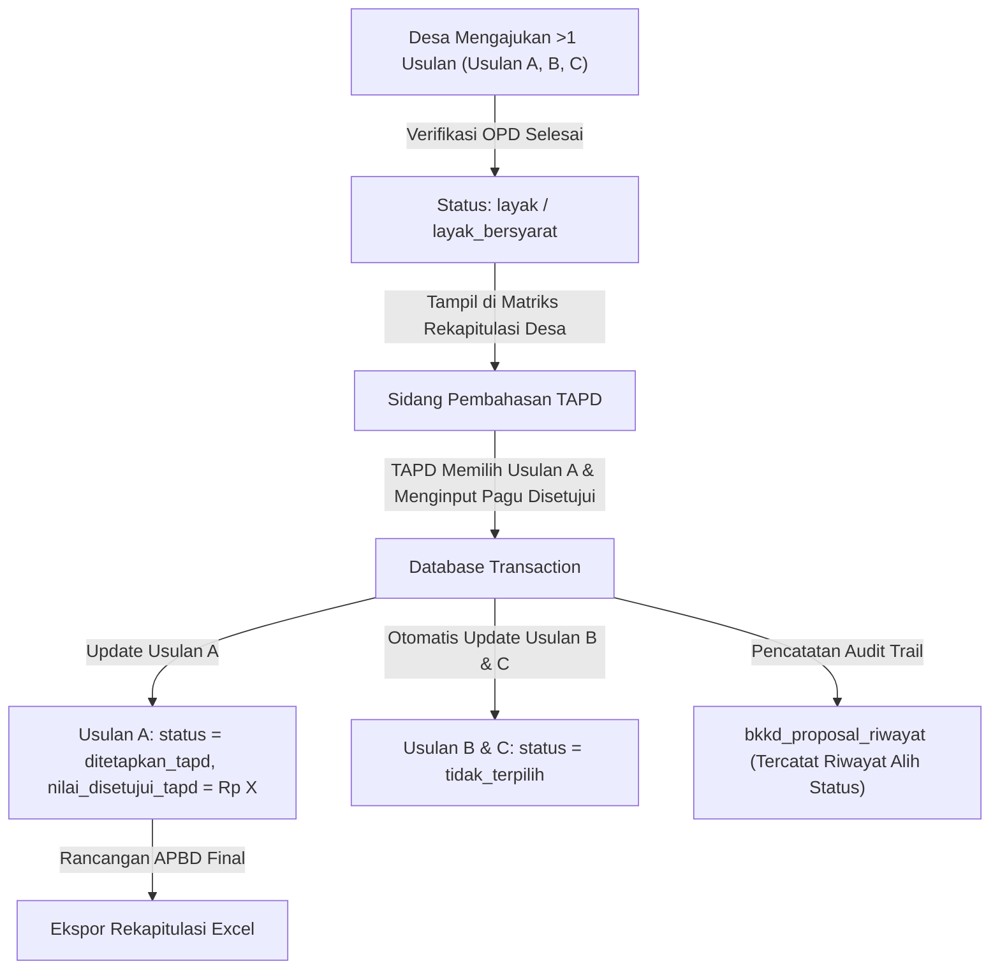

# Rekapitulasi Desa & Penetapan TAPD BKKD

Kembali ke indeks dokumentasi: [docs/README.md](../README.md)

---

## 1. Tujuan

Menyediakan antarmuka rekapitulasi usulan BKKD berbasis desa bagi Tim Anggaran Pemerintah Daerah (TAPD) untuk menyeleksi dan menetapkan 1 usulan prioritas per desa yang dimasukkan ke dalam dokumen Rancangan APBD Kabupaten Bojonegoro. Fitur ini memungkinkan TAPD menyesuaikan alokasi pagu anggaran disetujui (`nilai_disetujui_tapd`), mencatat pertimbangan kebijakan, serta mengekspor data rekapitulasi ke format spreadsheet Excel.

---

## 2. Latar Belakang & Masalah

| Kondisi Sebelum Modul Rekapitulasi & TAPD | Kondisi Sesudah Modul Rekapitulasi & TAPD |
| :--- | :--- |
| Satu desa dapat mengajukan lebih dari satu usulan proposal, memicu kebingungan bagi TAPD dalam menentukan usulan mana yang disetujui masuk APBD. | Matriks rekapitulasi mengelompokkan usulan per desa dan menampilkan status telaah kelayakan dari OPD teknis secara berdampingan. |
| Tidak ada mekanisme otomatis penegakan aturan "Satu Desa Satu Usulan Masuk APBD". | Sistem secara atomik mengalihkan usulan lain di desa yang sama menjadi `tidak_terpilih` saat TAPD menetapkan 1 usulan terpilih. |
| Penyesuaian pagu anggaran oleh TAPD sering tidak tercatat dengan jelas perbandingannya terhadap usulan desa dan telaah OPD. | Kolom `nilai_disetujui_tapd` tersimpan eksplisit bersama nilai usulan awal dan rekomendasi teknis dinas. |
| Rekapitulasi untuk sidang TAPD dan pembahasan legislatif memakan waktu lama karena dikompilasi manual. | Tersedia tombol satu klik untuk mengekspor rekapitulasi seluruh desa ke format spreadsheet Excel (.xlsx). |

---

## 3. Fitur Saat Ini / Kapabilitas Modul

- **Matriks Rekapitulasi Berbasis Desa**: Visualisasi kartu per desa yang menampilkan daftar seluruh proposal usulan yang masuk dari desa tersebut.
- **Rangkuman Eksekutif**: Metrik jumlah desa pengusul, total usulan masuk, jumlah desa terakomodir TAPD, dan total pagu alokasi Rancangan APBD.
- **Penetapan Usulan Prioritas TAPD**: Form modal untuk memilih usulan yang berstatus `layak` atau `layak_bersyarat` menjadi `ditetapkan_tapd`.
- **Penyesuaian Anggaran Pagu (`nilai_disetujui_tapd`)**: TAPD dapat menginputkan besaran pagu yang disetujui dalam Rancangan APBD, yang dapat berbeda dari usulan desa maupun rekomendasi OPD teknis.
- **Otomatisasi Status Usulan Lain (Satu Desa Satu Usulan)**: Saat satu usulan ditetapkan, usulan lain pada desa dan tahun anggaran yang sama otomatis diubah statusnya menjadi `tidak_terpilih` dengan pencatatan alasan otomatis di log riwayat.
- **Pembatalan Penetapan TAPD**: Fleksibilitas untuk membatalkan penetapan jika terjadi perubahan prioritas anggaran, mengembalikan status usulan terpilih ke status verifikasi aslinya.
- **Ekspor Dokumen Excel**: Download laporan rekapitulasi usulan BKKD kabupaten/kecamatan langsung dalam format spreadsheet resmi.

---

## 4. Logika Alur & Arsitektur

---

## 5. Halaman dan Route

### Frontend Nuxt (`apps/web`)

- `/admin/bkkd/rekapitulasi` : Matriks rekapitulasi usulan desa, kontrol pemilihan TAPD, filter wilayah, dan tombol ekspor Excel.

### Backend REST API (`apps/api`)

- `GET /api/v1/admin/bkkd/rekapitulasi-desa` : Mengambil data rekapitulasi yang dikelompokkan per desa beserta ringkasan total pagu anggaran APBD.
- `POST /api/v1/admin/bkkd/rekapitulasi-desa/{id}/tetapkan-tapd` : Menetapkan usulan proposal terpilih masuk Rancangan APBD dan menyesuaikan pagu.
- `POST /api/v1/admin/bkkd/rekapitulasi-desa/{id}/batalkan-tapd` : Membatalkan status penetapan TAPD untuk proposal tertentu.
- `GET /api/v1/admin/bkkd/rekapitulasi-desa/export` : Mengunduh spreadsheet Excel laporan rekapitulasi proposal desa.

---

## 6. Permission & Hak Akses (RBAC)

| Peran Pengguna (Role) | Hak Akses | Deskripsi Operasional |
| :--- | :--- | :--- |
| `admin` | Penuh (`*`) | Memantau seluruh rekapitulasi dan mengelola penetapan TAPD. |
| `verifierBappeda` | `bkkd-proposal-view`, `bkkd-proposal-update` | Membuka matriks rekapitulasi desa, menjalankan penetapan TAPD atas arahan pimpinan, dan mengunduh rekap Excel. |
| `verifierKecamatan` | Read-Only (`bkkd-proposal-view`) | Melihat matriks rekapitulasi desa hanya untuk desa-desa di kecamatannya. |

---

## 7. Alur Pengguna (Step-by-Step User Journey)

1. Pengguna membuka menu **Proposal BKKD ➔ Rekapitulasi & TAPD**.
2. Pengguna memilih Tahun Anggaran yang sedang dibahas dan memfilter kecamatan jika diperlukan.
3. Sistem menampilkan daftar desa pengusul lengkap dengan jumlah proposal dan status kelayakan teknis masing-masing usulan.
4. Pada kartu desa terkait, pengguna meninjau usulan yang telah berstatus `layak` atau `layak bersyarat`.
5. Pengguna mengklik tombol **Pilih Usulan Ini** pada proposal yang diprioritaskan oleh TAPD.
6. Pada modal penetapan TAPD:
   - Pengguna meninjau nilai usulan awal dan rekomendasi teknis OPD.
   - Pengguna menginputkan **Pagu Anggaran Disetujui TAPD** (dapat disesuaikan sesuai ketersediaan fiskal daerah).
   - Pengguna memasukkan Catatan TAPD dan Tanggal Penetapan.
7. Pengguna mengklik **Tetapkan Usulan Masuk APBD**.
8. Sistem secara atomik mengesahkan usulan tersebut sebagai `ditetapkan_tapd` dan menandai usulan lainnya di desa tersebut sebagai `tidak_terpilih`.
9. Pengguna dapat mengunduh rekapan utuh kapan saja menggunakan tombol **Ekspor Excel Rekapitulasi**.

---

## 8. Integrasi Data & Skema Database

### Kolom Relevan pada Tabel `bkkd_proposal`

- `nilai_disetujui_tapd`: Menyimpan nominal final pagu anggaran yang disetujui masuk ke dalam buku Rancangan APBD.
- `catatan_tapd`: Menyimpan alasan kebijakan atau pertimbangan pemilihan usulan oleh TAPD.
- `tanggal_penetapan_tapd`: Tanggal penetapan keputusan oleh TAPD.
- `ditetapkan_oleh`: UUID pengguna operator/pejabat yang memproses penetapan.

---

## 9. Efek Bisnis Penting

- **Aturan Tegas Satu Desa Satu Usulan Terpilih**: Kebijakan pemerintah daerah menetapkan alokasi BKKD dibatasi maksimal 1 kegiatan per desa dalam 1 tahun anggaran. Transaksi database menjamin konsistensi ini tanpa celah duplikasi penetapan ganda.
- **Audit Jejak Pengalihan Status**: Proposal yang beralih status menjadi `tidak_terpilih` secara otomatis mencatatkan riwayat: *"Status dialihkan menjadi tidak terpilih karena TAPD memilih usulan nomor BKKD/..."* sehingga perangkat desa dapat memahami alasan penolakan secara transparan.
- **Pemisahan dari Modul Plotting Anggaran**: Hasil penetapan TAPD ini berada pada tahap perencanaan pra-DPA (Rancangan APBD) dan sengaja tidak ditautkan ke tabel `plotting_anggaran` pelaksanaan fisik.

---

## 10. Batasan Saat Ini & Edge Cases

- **Syarat Kelayakan Usulan**: Hanya usulan yang telah diverifikasi dengan hasil `layak`, `layak_bersyarat`, atau usulan yang sebelumnya `tidak_terpilih` yang dapat dipilih oleh TAPD. Usulan yang berstatus `tidak_layak`, `dikembalikan`, atau masih `draft` ditolak oleh validasi backend.
- **Perubahan Pilihan**: Jika TAPD ingin mengganti pilihan ke usulan lain di desa yang sama, pengguna cukup langsung memilih usulan baru tersebut. Usulan yang sebelumnya ditetapkan otomatis terdegradasi menjadi `tidak_terpilih`.

---

## 11. File Sentral

### Backend (`apps/api`)
- Controller: `app/Http/Controllers/Admin/BkkdRekapitulasiController.php`
- Requests: `app/Http/Requests/Admin/TetapkanTapdRequest.php`
- Service: `app/Services/BkkdRiwayatService.php` (method: `catatAksiProposal`)

### Frontend (`apps/web`)
- Composable: `app/composables/useBkkdApi.ts`
- Components: `app/components/bkkd/BkkdPenetapanTapdModal.vue`, `app/components/bkkd/BkkdStatusBadge.vue`
- Page: `app/pages/admin/bkkd/rekapitulasi/index.vue`
