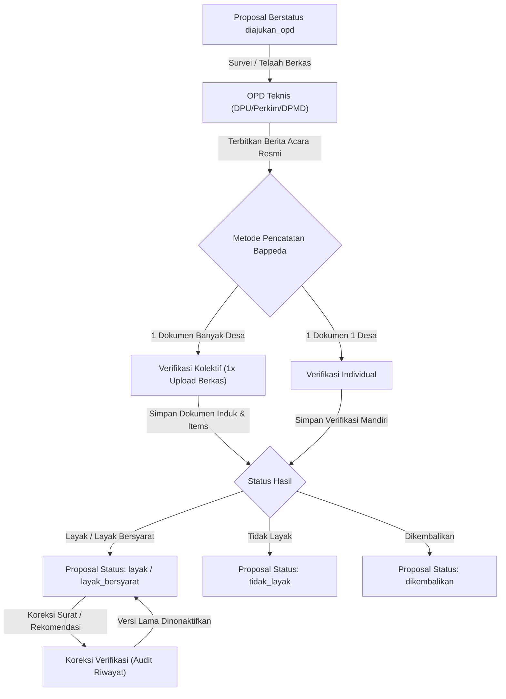

# Hasil Verifikasi OPD Teknis BKKD

Kembali ke indeks dokumentasi: [docs/README.md](../README.md)

---

## 1. Tujuan

Menyediakan modul pencatatan, pemantauan, dan koreksi hasil telaah teknis proposal BKKD yang dilakukan oleh Organisasi Perangkat Daerah (OPD) teknis (seperti Dinas Pekerjaan Umum Bina Marga, Dinas Perumahan Kawasan Permukiman dan Cipta Karya, serta Dinas Pemberdayaan Masyarakat dan Desa). Fitur ini mendokumentasikan kesimpulan kelayakan usulan, rekomendasi pagu anggaran teknis, catatan syarat pelaksanaan, serta berkas Berita Acara hasil verifikasi.

---

## 2. Latar Belakang & Masalah

| Kondisi Sebelum Modul Verifikasi | Kondisi Sesudah Modul Verifikasi |
| :--- | :--- |
| Berita Acara hasil verifikasi OPD teknis hanya tersebar dalam bentuk berkas cetak fisik, menyulitkan pelacakan status oleh Bappeda. | Seluruh Berita Acara dan surat telaah OPD terdata secara digital dengan nomor surat resmi dan berkas terunggah. |
| Rekomendasi anggaran dari OPD teknis sering berbeda dari usulan desa tanpa catatan justifikasi tertulis yang terpusat. | Tersedia kolom `rekomendasi_anggaran` dan `catatan_opd` yang terekam berdampingan dengan nilai usulan desa. |
| Jika terjadi revisi telaah (misal penambahan syarat teknis), dokumen lama hilang atau tertimpa tanpa riwayat koreksi. | Menggunakan sistem versioning dan status `is_aktif = false` (superseded) sehingga seluruh riwayat telaah tetap tersimpan utuh. |

---

## 3. Fitur Saat Ini / Kapabilitas Modul

- **Pencatatan Hasil Telaah OPD**: Input nomor surat berita acara, tanggal telaah, OPD teknis pemeriksa, kesimpulan hasil, rekomendasi anggaran, dan catatan teknis.
- **Pencatatan Berita Acara Kolektif (1 Dokumen N Usulan Desa)**: Fasilitas verifikasi massal untuk dokumen Berita Acara OPD yang melampirkan puluhan usulan desa sekaligus. Berkas fisik PDF atau tautan cloud disimpan 1 kali dan direlasikan ke seluruh usulan terkait.
- **Pemanfaatan Dokumen Terdaftar (Reusable Document)**: Saat mencatat atau mengoreksi verifikasi desa secara individual, operator dapat menghubungkan usulan ke Berita Acara kolektif yang sudah pernah diunggah tanpa upload ulang berkas.
- **Penautan / Koreksi Dokumen Langsung dari Detail Proposal**: Jika pada saat telaah awal dokumen Berita Acara belum disertakan, operator dapat melampirkannya belakangan langsung dari tab *Hasil Verifikasi* pada halaman detail proposal (`/admin/bkkd/proposal/[id]`).
- **Arsitektur Hibrida URL & Berkas Verifikasi**: Penyimpanan dokumen mendukung model master induk (`bkkd_verifikasi_dokumen`) untuk Berita Acara kolektif dan model spesifik (`bkkd_verifikasi`) untuk telaah mandiri/tambahan dengan aturan resolusi otomatis (*fallback pattern*).
- **Klasifikasi Hasil Telaah**:
  - `layak`: Usulan memenuhi seluruh kriteria kelayakan teknis dan siap dipilih masuk APBD.
  - `layak_bersyarat`: Usulan layak dengan catatan penyempurnaan dokumen atau penyesuaian teknis lapangan.
  - `tidak_layak`: Usulan tidak memenuhi kriteria teknis atau tidak sesuai kewenangan desa.
  - `dikembalikan`: Berkas proposal belum lengkap untuk dapat ditelaah.
- **Sinkronisasi Otomatis Status Proposal**: Status usulan pada tabel `bkkd_proposal` diselaraskan secara otomatis mengikuti hasil telaah aktif OPD.
- **Unggah Dokumen Berita Acara & Tautan Cloud Storage**: Mendukung 2 metode lampiran telaah: unggah berkas fisik (PDF/Excel maks 15MB) atau tautan URL cloud storage (Google Drive, OneDrive, Nextcloud, dsb.) untuk berkas berukuran sangat besar.
- **Mekanisme Koreksi & Riwayat Superseded**: Jika OPD menerbitkan ralat, telaah lama ditandai nonaktif (`is_aktif = false`) dan tercatat ke tabel audit riwayat tanpa menghapus jejak sebelumnya.

---

## 4. Logika Alur & Arsitektur

---

## 5. Halaman dan Route

### Frontend Nuxt (`apps/web`)

- `/admin/bkkd/verifikasi` : Halaman daftar hasil verifikasi OPD teknis, filter tahun/OPD/hasil, unduh berkas telaah, modal verifikasi kolektif, dan modal koreksi.
- `/admin/bkkd/proposal/:id` : Halaman rincian usulan (Tab *Hasil Verifikasi* menyediakan kartu telaah aktif, indikator dokumen belum dilampirkan, tombol "Tautkan Dokumen Sekarang", dan tombol "Koreksi / Tautkan Dokumen").

### Backend REST API (`apps/api`)

- `GET /api/v1/admin/bkkd/verifikasi` : Mengambil daftar seluruh hasil verifikasi OPD dengan pagination, filter OPD, status, dan opsi menampilkan riwayat superseded.
- `POST /api/v1/admin/bkkd/verifikasi/kolektif` : Menyimpan Berita Acara kolektif induk dan seluruh hasil telaah usulan desa terpilih secara massal.
- `GET /api/v1/admin/bkkd/verifikasi/dokumen` : Mengambil daftar master dokumen berita acara yang pernah diunggah untuk referensi autocomplete.
- `GET /api/v1/admin/bkkd/verifikasi/dokumen/{id}/download` : Mengunduh berkas fisik Berita Acara induk.
- `POST /api/v1/admin/bkkd/proposal/{id}/verifikasi` : Menyimpan hasil verifikasi baru untuk usulan proposal tertentu (mendukung tautan ke `id_dokumen` induk).
- `PUT /api/v1/admin/bkkd/verifikasi/{id}` : Mengoreksi hasil verifikasi aktif dengan pencatatan audit trail, alasan perubahan, dan dukungan menautkan atau mengganti `id_dokumen` induk.
- `GET /api/v1/admin/bkkd/verifikasi/{id}/download` : Mengunduh dokumen fisik berita acara telaah OPD atau pengalihan ke URL cloud link.
- `GET /api/v1/admin/bkkd/verifikasi/{id}/riwayat` : Mengambil riwayat snapshot koreksi verifikasi.

---

## 6. Permission & Hak Akses (RBAC)

| Peran Pengguna (Role) | Hak Akses | Deskripsi Operasional |
| :--- | :--- | :--- |
| `admin` | Penuh (`*`) | Bypass seluruh operasi verifikasi. |
| `verifierBappeda` | `bkkd-verifikasi-view`, `bkkd-verifikasi-manage` | Mencatat hasil telaah OPD, mengoreksi, dan mengunggah berkas berita acara. |
| `verifierKecamatan` | Read-Only (`bkkd-verifikasi-view`) | Melihat hasil verifikasi OPD untuk usulan di wilayah kecamatannya. |

---

## 7. Alur Pengguna (Step-by-Step User Journey)

1. Tim teknis OPD (DPU Bina Marga / Perkim / DPMD) melakukan evaluasi berkas dan survei lapangan secara offline.
2. OPD menerbitkan dokumen resmi Berita Acara / Surat Rekomendasi Hasil Telaah.
3. Operator Bappeda membuka menu **Proposal BKKD ➔ Hasil Verifikasi OPD** atau tombol aksi pada halaman detail proposal.
4. Operator memilih tombol **Catat Hasil Telaah OPD**.
5. Operator mengisi OPD pemeriksa, nomor surat telaah, tanggal, kesimpulan hasil telaah, rekomendasi pagu, serta mengunggah file PDF Berita Acara.
6. Sistem menyimpan data ke tabel `bkkd_verifikasi`, menyelaraskan status proposal secara otomatis, dan merekam log audit versi awal.
7. Jika di kemudian hari OPD mengirimkan surat ralat, operator menggunakan tombol **Koreksi Verifikasi** dan menyertakan alasan perubahan.

---

## 8. Integrasi Data & Skema Database

### Tabel Induk Dokumen: `bkkd_verifikasi_dokumen`

| Kolom | Tipe Data | Keterangan |
| :--- | :--- | :--- |
| `id` | `uuid` (Primary Key) | Identitas unik record Berita Acara induk. |
| `id_opd` | `uuid` (Foreign Key) | Relasi ke master `ref_opd`. |
| `nomor_surat_hasil` | `varchar(150)` | Nomor resmi surat telaah / Berita Acara. |
| `tanggal_surat_hasil` | `date` | Tanggal penetapan surat telaah. |
| `tanggal_diterima` | `date` (Nullable) | Tanggal berkas fisik diterima Bappeda. |
| `tahun_anggaran` | `integer` (Index) | Tahun anggaran perencanaan usulan. |
| `tipe_sumber` | `varchar(20)` (Default: file) | Pilihan sumber dokumen: `file` (berkas lokal) atau `link` (URL cloud). |
| `url_link` | `text` (Nullable) | Tautan URL penyimpanan cloud (Google Drive, OneDrive, dsb). |
| `path_dokumen` | `varchar(255)` (Nullable) | Path penyimpanan privat file PDF/Excel Berita Acara jika tipe `file`. |
| `nama_dokumen_asli` | `varchar(255)` (Nullable) | Nama asli berkas yang diunggah atau label keterangan tautan. |
| `catatan_umum` | `text` (Nullable) | Catatan ringkas cakupan Berita Acara kolektif. |
| `input_by` | `uuid` (Foreign Key) | Pengguna pencatat awal dokumen. |
| `updated_by` | `uuid` (Nullable) | Pengguna yang memperbarui dokumen terakhir. |

### Tabel Rincian Verifikasi Usulan: `bkkd_verifikasi`

| Kolom | Tipe Data | Keterangan |
| :--- | :--- | :--- |
| `id` | `uuid` (Primary Key) | Identitas unik record verifikasi. |
| `id_proposal` | `uuid` (Foreign Key) | Relasi ke tabel `bkkd_proposal`. |
| `id_dokumen` | `uuid` (Foreign Key, Nullable) | Relasi ke dokumen Berita Acara kolektif `bkkd_verifikasi_dokumen`. |
| `id_opd` | `uuid` (Foreign Key) | Relasi ke tabel master `ref_opd`. |
| `nomor_surat_hasil` | `varchar(150)` | Nomor resmi surat telaah / berita acara. |
| `tanggal_surat_hasil` | `date` | Tanggal penerbitan telaah. |
| `hasil` | `varchar(30)` | Nilai enum: `layak`, `layak_bersyarat`, `tidak_layak`, `dikembalikan`. |
| `nilai_rekomendasi` | `decimal(15,2)` (Nullable) | Nilai pagu yang direkomendasikan OPD teknis. |
| `volume_rekomendasi` | `decimal(12,2)` (Nullable) | Volume target fisik hasil telaah lapangan. |
| `panjang_rekomendasi` | `decimal(10,2)` (Nullable) | Dimensi panjang pekerjaan (meter). |
| `lebar_rekomendasi` | `decimal(10,2)` (Nullable) | Dimensi lebar pekerjaan (meter). |
| `tinggi_rekomendasi` | `decimal(10,2)` (Nullable) | Dimensi tinggi/tebal pekerjaan (meter). |
| `catatan_opd` | `text` (Nullable) | Catatan kondisi fisik dan syarat teknis realisasi. |
| `tipe_sumber` | `varchar(20)` (Default: file) | Pilihan sumber dokumen: `file` atau `link`. |
| `url_link` | `text` (Nullable) | Tautan URL penyimpanan cloud jika tipe `link`. |
| `path_dokumen` | `varchar(255)` (Nullable) | Path penyimpanan file PDF/Excel telaah pada storage privat jika tipe `file`. |
| `nama_dokumen_asli` | `varchar(255)` (Nullable) | Nama asli berkas yang diunggah atau keterangan tautan. |
| `is_aktif` | `boolean` (Default: true) | Status apakah telaah ini menjadi rujukan aktif proposal. |
| `versi` | `integer` (Default: 1) | Penanda versi verifikasi untuk audit trail. |
| `input_by` | `uuid` | Foreign key ke user pencatat awal. |
| `updated_by` | `uuid` (Nullable) | Foreign key ke user yang mengoreksi terakhir. |

### Hierarki Resolusi URL dan Berkas Dokumen (Hybrid Pattern)

Sistem menerapkan model penyimpanan dokumen ganda dengan aturan resolusi (*fallback pattern*):
1. **Mode Kolektif (`id_dokumen` terisi)**:
   - Dokumen induk `bkkd_verifikasi_dokumen` menjadi rujukan utama (*Single Source of Truth*).
   - Tautan cloud (`url_link`) atau berkas fisik (`path_dokumen`) bersumber dari dokumen induk sehingga perubahan tautan master otomatis merefleksikan perubahan ke seluruh usulan desa terkait.
2. **Mode Mandiri (`id_dokumen` kosong)**:
   - Metadata dokumen telaah dibaca langsung dari kolom `url_link` atau `path_dokumen` pada tabel `bkkd_verifikasi`.
3. **Resolusi API & Download**:
   - `BkkdVerifikasiResource` dan endpoint `download` otomatis mengevaluasi `$verifikasi->url_link ?? $verifikasi->dokumen?->url_link`, menjamin ketersediaan dokumen pada antarmuka frontend baik untuk telaah kolektif maupun mandiri.

---

## 9. Efek Bisnis Penting

- **Integritas Status Proposal**: Setiap kali verifikasi berstatus aktif disimpan atau dikoreksi, status pada `bkkd_proposal` diselaraskan secara otomatis dalam satu transaksi database (`DB::transaction`).
- **Efisiensi Penyimpanan (Single Storage Reference)**: Pada verifikasi kolektif, berkas PDF Berita Acara disimpan fisik hanya 1 kali di storage privat, mencegah pembengkakan disk server akibat file duplikat puluhan desa.
- **Konsistensi Tautan Cloud Master**: Jika OPD memperbarui tautan Google Drive / OneDrive pada Berita Acara kolektif, seluruh usulan desa yang terhubung otomatis membuka folder/dokumen terbaru tanpa perlu mengedit puluhan usulan satu per satu.
- **Audit Koreksi**: Koreksi pada hasil verifikasi yang sudah berstatus aktif mewajibkan pengisian `alasan_perubahan`. Sistem membuat snapshot data sebelum vs sesudah ke dalam tabel `bkkd_verifikasi_riwayat`.
- **Independensi OPD & Status Usulan**: Perubahan atau penerbitan Berita Acara susulan/ralat pada beberapa desa tidak menggugurkan atau merusak status desa-desa lain yang menginduk pada Berita Acara awal.

---

## 10. Batasan Saat Ini & Edge Cases

- **Pencatatan Offline ke Digital**: OPD teknis tidak login langsung ke sistem pada Fase 1. Bappeda bertindak sebagai verifikator terpusat yang menginputkan berkas hasil telaah resmi dari OPD.
- **Rekomendasi Anggaran Nol**: Hasil verifikasi berstatus `tidak_layak` atau `dikembalikan` secara otomatis mengosongkan nilai `rekomendasi_anggaran` dan dimensi fisik.

---

## 11. File Sentral

### Backend (`apps/api`)
- Model: `app/Models/BkkdVerifikasi.php`, `app/Models/BkkdVerifikasiDokumen.php`, `app/Models/RefOpd.php`
- Controller: `app/Http/Controllers/Admin/BkkdVerifikasiController.php`
- Requests & Resources: `app/Http/Requests/Admin/StoreBkkdVerifikasiRequest.php`, `app/Http/Requests/Admin/StoreBkkdVerifikasiKolektifRequest.php`, `app/Http/Requests/Admin/UpdateBkkdVerifikasiRequest.php`, `app/Http/Resources/BkkdVerifikasiResource.php`, `app/Http/Resources/BkkdVerifikasiDokumenResource.php`
- Service: `app/Services/BkkdRiwayatService.php` (method: `catatKoreksiVerifikasi`)
- Policy: `app/Policies/BkkdVerifikasiPolicy.php`

### Frontend (`apps/web`)
- Types: `app/types/bkkd.ts` (interface `BkkdVerifikasiDokumen`, `BkkdVerifikasi`)
- Composable: `app/composables/useBkkdApi.ts`
- Components: `app/components/bkkd/BkkdVerifikasiKolektifModal.vue`, `app/components/bkkd/BkkdVerifikasiFormModal.vue`, `app/components/bkkd/BkkdStatusBadge.vue`
- Pages: `app/pages/admin/bkkd/verifikasi/index.vue`, `app/pages/admin/bkkd/proposal/[id].vue`
