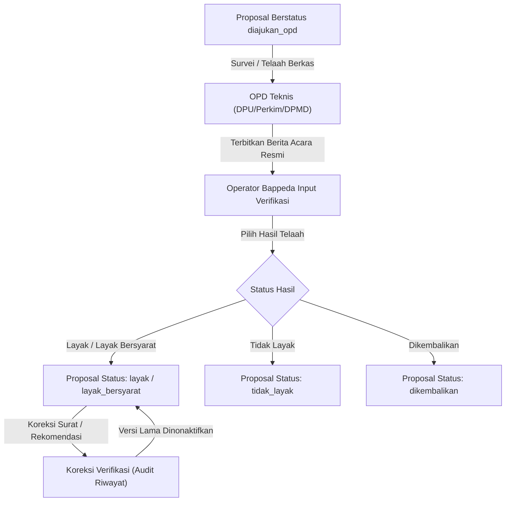

# Hasil Verifikasi OPD Teknis BKKD

Kembali ke indeks dokumentasi: [docs/README.md](../README.md)

---

## 1. Tujuan

Menyediakan modul pencatatan, pemantauan, dan koreksi hasil telaah teknis proposal BKKD yang dilakukan oleh Organisasi Perangkat Daerah (OPD) teknis (seperti Dinas Pekerjaan Umum Bina Marga, Dinas Perumahan Kawasan Permukiman dan Cipta Karya, serta Dinas Pemberdayaan Masyarakat dan Desa). Fitur ini mendokumentasikan kesimpulan kelayakan usulan, rekomendasi pagu anggaran teknis, catatan syarat pelaksanaan, serta berkas Berita Acara hasil verifikasi.

---

## 2. Latar Belakang & Masalah

| Kondisi Sebelum Modul Verifikasi | Kondisi Sesudah Modul Verifikasi |
| :--- | :--- |
| Berita Acara hasil verifikasi OPD teknis hanya tersebar dalam bentuk berkas cetak fisik, menyulitkan pelacakan status oleh Bappeda. | Seluruh Berita Acara dan surat telaah OPD terdata secara digital dengan nomor surat resmi dan berkas terunggah. |
| Rekomendasi anggaran dari OPD teknis sering berbeda dari usulan desa tanpa catatan justifikasi tertulis yang terpusat. | Tersedia kolom `rekomendasi_anggaran` dan `catatan_opd` yang terekam berdampingan dengan nilai usulan desa. |
| Jika terjadi revisi telaah (misal penambahan syarat teknis), dokumen lama hilang atau tertimpa tanpa riwayat koreksi. | Menggunakan sistem versioning dan status `is_aktif = false` (superseded) sehingga seluruh riwayat telaah tetap tersimpan utuh. |

---

## 3. Fitur Saat Ini / Kapabilitas Modul

- **Pencatatan Hasil Telaah OPD**: Input nomor surat berita acara, tanggal telaah, OPD teknis pemeriksa, kesimpulan hasil, rekomendasi anggaran, dan catatan teknis.
- **Klasifikasi Hasil Telaah**:
  - `layak`: Usulan memenuhi seluruh kriteria kelayakan teknis dan siap dipilih masuk APBD.
  - `layak_bersyarat`: Usulan layak dengan catatan penyempurnaan dokumen atau penyesuaian teknis lapangan.
  - `tidak_layak`: Usulan tidak memenuhi kriteria teknis atau tidak sesuai kewenangan desa.
  - `dikembalikan`: Berkas proposal belum lengkap untuk dapat ditelaah.
- **Sinkronisasi Otomatis Status Proposal**: Status usulan pada tabel `bkkd_proposal` diselaraskan secara otomatis mengikuti hasil telaah aktif OPD.
- **Unggah Dokumen Berita Acara**: Upload berkas PDF/Excel hasil telaah lapangan yang disimpan pada disk privat server.
- **Mekanisme Koreksi & Riwayat Superseded**: Jika OPD menerbitkan ralat, telaah lama ditandai nonaktif (`is_aktif = false`) dan tercatat ke tabel audit riwayat tanpa menghapus jejak sebelumnya.

---

## 4. Logika Alur & Arsitektur

---

## 5. Halaman dan Route

### Frontend Nuxt (`apps/web`)

- `/admin/bkkd/verifikasi` : Halaman daftar hasil verifikasi OPD teknis, filter tahun/OPD/hasil, unduh berkas telaah, dan modal koreksi.

### Backend REST API (`apps/api`)

- `GET /api/v1/admin/bkkd/verifikasi` : Mengambil daftar seluruh hasil verifikasi OPD dengan pagination, filter OPD, status, dan opsi menampilkan riwayat superseded.
- `POST /api/v1/admin/bkkd/proposal/{id}/verifikasi` : Menyimpan hasil verifikasi baru untuk usulan proposal tertentu.
- `PUT /api/v1/admin/bkkd/verifikasi/{id}` : Mengoreksi hasil verifikasi aktif dengan pencatatan audit trail dan alasan perubahan.
- `GET /api/v1/admin/bkkd/verifikasi/{id}/download` : Mengunduh dokumen fisik berita acara telaah OPD.
- `GET /api/v1/admin/bkkd/verifikasi/{id}/riwayat` : Mengambil riwayat snapshot koreksi verifikasi.

---

## 6. Permission & Hak Akses (RBAC)

| Peran Pengguna (Role) | Hak Akses | Deskripsi Operasional |
| :--- | :--- | :--- |
| `admin` | Penuh (`*`) | Bypass seluruh operasi verifikasi. |
| `verifierBappeda` | `bkkd-verifikasi-view`, `bkkd-verifikasi-manage` | Mencatat hasil telaah OPD, mengoreksi, dan mengunggah berkas berita acara. |
| `verifierKecamatan` | Read-Only (`bkkd-verifikasi-view`) | Melihat hasil verifikasi OPD untuk usulan di wilayah kecamatannya. |

---

## 7. Alur Pengguna (Step-by-Step User Journey)

1. Tim teknis OPD (DPU Bina Marga / Perkim / DPMD) melakukan evaluasi berkas dan survei lapangan secara offline.
2. OPD menerbitkan dokumen resmi Berita Acara / Surat Rekomendasi Hasil Telaah.
3. Operator Bappeda membuka menu **Proposal BKKD ➔ Hasil Verifikasi OPD** atau tombol aksi pada halaman detail proposal.
4. Operator memilih tombol **Catat Hasil Telaah OPD**.
5. Operator mengisi OPD pemeriksa, nomor surat telaah, tanggal, kesimpulan hasil telaah, rekomendasi pagu, serta mengunggah file PDF Berita Acara.
6. Sistem menyimpan data ke tabel `bkkd_verifikasi`, menyelaraskan status proposal secara otomatis, dan merekam log audit versi awal.
7. Jika di kemudian hari OPD mengirimkan surat ralat, operator menggunakan tombol **Koreksi Verifikasi** dan menyertakan alasan perubahan.

---

## 8. Integrasi Data & Skema Database

### Tabel Utama: `bkkd_verifikasi`

| Kolom | Tipe Data | Keterangan |
| :--- | :--- | :--- |
| `id` | `uuid` (Primary Key) | Identitas unik record verifikasi. |
| `id_proposal` | `uuid` (Foreign Key) | Relasi ke tabel `bkkd_proposal`. |
| `id_opd` | `uuid` (Foreign Key) | Relasi ke tabel master `ref_opd`. |
| `nomor_surat_hasil` | `varchar(100)` | Nomor resmi surat telaah / berita acara. |
| `tanggal_verifikasi` | `date` | Tanggal penerbitan telaah. |
| `hasil` | `varchar(30)` | Nilai enum: `layak`, `layak_bersyarat`, `tidak_layak`, `dikembalikan`. |
| `rekomendasi_anggaran` | `decimal(15,2)` (Nullable) | Nilai pagu yang direkomendasikan OPD teknis. |
| `catatan_opd` | `text` (Nullable) | Catatan kondisi fisik dan syarat teknis realisasi. |
| `path_dokumen` | `varchar(255)` (Nullable) | Path penyimpanan file PDF/Excel telaah pada storage privat. |
| `nama_dokumen_asli` | `varchar(255)` (Nullable) | Nama asli berkas yang diunggah. |
| `is_aktif` | `boolean` (Default: true) | Status apakah telaah ini menjadi rujukan aktif proposal. |
| `versi` | `integer` (Default: 1) | Penanda versi verifikasi untuk audit trail. |
| `diverifikasi_oleh` | `uuid` | Foreign key ke user pencatat awal. |
| `updated_by` | `uuid` (Nullable) | Foreign key ke user yang mengoreksi terakhir. |

---

## 9. Efek Bisnis Penting

- **Integritas Status Proposal**: Setiap kali verifikasi berstatus aktif disimpan atau dikoreksi, status pada `bkkd_proposal` diselaraskan secara otomatis dalam satu transaksi database (`DB::transaction`).
- **Audit Koreksi**: Koreksi pada hasil verifikasi yang sudah berstatus aktif mewajibkan pengisian `alasan_perubahan`. Sistem membuat snapshot data sebelum vs sesudah ke dalam tabel `bkkd_verifikasi_riwayat`.
- **Independensi OPD**: Satu usulan proposal dapat diverifikasi oleh lebih dari satu OPD teknis jika memiliki komponen pekerjaan lintas bidang (misal jalan desa dan jembatan).

---

## 10. Batasan Saat Ini & Edge Cases

- **Pencatatan Offline ke Digital**: OPD teknis tidak login langsung ke sistem pada Fase 1. Bappeda bertindak sebagai verifikator terpusat yang menginputkan berkas hasil telaah resmi dari OPD.
- **Rekomendasi Anggaran Nol**: Hasil verifikasi berstatus `tidak_layak` atau `dikembalikan` secara otomatis mengosongkan nilai `rekomendasi_anggaran`.

---

## 11. File Sentral

### Backend (`apps/api`)
- Model: `app/Models/BkkdVerifikasi.php`, `app/Models/RefOpd.php`
- Controller: `app/Http/Controllers/Admin/BkkdVerifikasiController.php`
- Requests & Resources: `app/Http/Requests/Admin/StoreBkkdVerifikasiRequest.php`, `app/Http/Requests/Admin/UpdateBkkdVerifikasiRequest.php`, `app/Http/Resources/BkkdVerifikasiResource.php`
- Service: `app/Services/BkkdRiwayatService.php` (method: `catatKoreksiVerifikasi`)
- Policy: `app/Policies/BkkdVerifikasiPolicy.php`

### Frontend (`apps/web`)
- Composable: `app/composables/useBkkdApi.ts`
- Components: `app/components/bkkd/BkkdVerifikasiFormModal.vue`, `app/components/bkkd/BkkdStatusBadge.vue`
- Page: `app/pages/admin/bkkd/verifikasi/index.vue`
