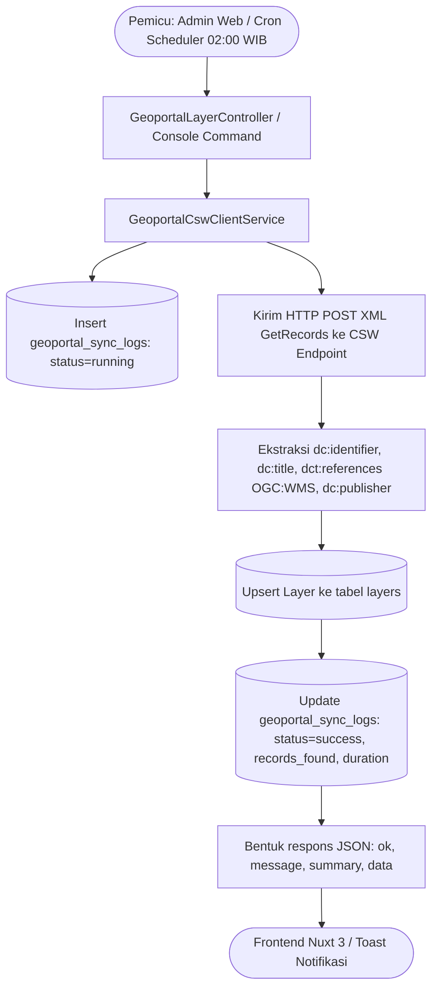

# Sinkronisasi Simpul Jaringan Geoportal (CSW & WMS)

Kembali ke indeks dokumentasi: [docs/README.md](../README.md)

---

## 1. Tujuan

Menyediakan mekanisme integrasi otomatis dan manual antara WebGIS Melarosa dengan Simpul Jaringan Geoportal Kabupaten Bojonegoro (GeoServer & CSW Catalogue Service for the Web). Fitur ini memanen metadata katalog layer spasial tematik secara berkala, memetakan layer OGC WMS ke dalam basis data lokal, mencatat riwayat pemanenan ke tabel log, serta menyajikan visualisasi katalog peta kepada pengguna publik dan administrator.

---

## 2. Latar Belakang & Masalah

| Aspek | Sebelum Implementasi | Sesudah Implementasi |
|---|---|---|
| **Pencatatan Layer Simpul Jaringan** | Operator mendaftarkan layer WMS satu per satu secara manual melalui formulir input | Sistem memanen rekaman katalog otomatis melalui protokol OGC CSW 2.0.2 ISO 19139 / Dublin Core |
| **Pembaruan Metadata Layer** | Perubahan judul, OPD pengampu, atau URL layer di server pusat tidak terdeteksi otomatis | Eksekusi sync memperbarui rekaman yang telah ada (*update existing*) dan menambah layer baru (*insert new*) |
| **Transparansi Hasil Eksekusi** | Tidak ada catatan kapan sinkronisasi berjalan, berapa layer yang masuk, dan berapa lama prosesnya | Tersedia tabel `geoportal_sync_logs` dengan metrik `records_found`, `records_inserted`, `records_updated`, dan `duration_seconds` |
| **Resiliensi Integrasi Data** | Response API yang tidak memiliki keseragaman struktur payload memicu galat JavaScript di client | Struktur payload distandardisasi dengan objek `data` dan `summary` lengkap, didukung fallback parsing defensif pada Nuxt |
| **Otomasi Terjadwal** | Bergantung sepenuhnya pada inisiatif admin untuk menekan tombol sinkronisasi | Berjalan otomatis setiap hari pukul 02:00 WIB via Laravel Task Scheduling di latar belakang (*background worker*) |

---

## 3. Fitur Saat Ini / Kapabilitas Modul

- **Pemanenan Katalog Otomatis (CSW Harvester)**: Melakukan request `GetRecords` ke endpoint CSW Geoportal Bojonegoro dengan paginasi XML (`startPosition` & `maxRecords`) sampai seluruh metadata terunduh.
- **Sinkronisasi Manual dari Antarmuka Admin (`/admin/layers`)**: Administrator dapat memicu sinkronisasi langsung melalui modal dialog dengan indikator proses dan ringkasan metrik instan.
- **Penjadwalan Otomatis (Cron Scheduler)**: Perintah console `php artisan geoportal:sync-catalog --trigger=scheduler` dijalankan harian pada pukul 02:00 WIB.
- **Pencatatan Riwayat & Status (Audit Log Pemanenan)**: Menyimpan riwayat eksekusi lengkap dengan status (`running`, `success`, `failed`), durasi eksekusi, jumlah layer, ID admin pemicu, dan rincian pesan error jika terjadi kegagalan.
- **Penyajian Status Konektivitas Real-time**: Composable `useGeoportalStatus` memantau ketersediaan endpoint CSW, waktu respons HTTP, total layer lokal vs remote, dan lini masa pemanenan.
- **Katalog Layer Publik WebGIS**: Layer hasil sinkronisasi dapat ditambahkan ke peta publik (`/map`) lengkap dengan judul, deskripsi abstrak, atribusi OPD, dan gambar legenda GetLegendGraphic.

---

## 4. Logika Alur & Arsitektur

---

## 5. Halaman dan Route

### Frontend Nuxt 3
- Halaman Manajemen Layer: `/admin/layers` (Modal Sinkronisasi & Modal Riwayat Log)
- Katalog Peta Publik: `/map` (Drawer Katalog Layer Simpul Jaringan via `GeoportalLayerSection.vue`)

### Backend API (Laravel 13)
| Method | Endpoint | Fungsi | Middleware |
|---|---|---|---|
| `POST` | `/api/v1/admin/layers/geoportal/sync` | Memicu sinkronisasi manual dari CSW ke basis data | `permission:layers-create\|layers-update\|layers-manage` |
| `GET` | `/api/v1/admin/layers/geoportal/sync-history` | Mengambil daftar riwayat eksekusi pemanenan log | `permission:layers-view\|layers-manage` |
| `GET` | `/api/v1/layers/geoportal` | Mengambil daftar layer hasil sinkronisasi untuk publik | Publik |
| `GET` | `/api/v1/layers/geoportal/status` | Memeriksa status kesehatan koneksi CSW Geoportal | Publik |
| `GET` | `/api/v1/layers/geoportal/{id}/metadata` | Mengambil rincian metadata lengkap suatu layer | Publik |

### CLI / Scheduled Tasks
- Perintah: `php artisan geoportal:sync-catalog {--trigger=cli}`
- Jadwal: Setiap hari pukul 02:00 WIB via `routes/console.php`

---

## 6. Permission & Hak Akses (RBAC)

Modul ini diproteksi menggunakan Spatie Permission:
- `layers-create`, `layers-update`, atau `layers-manage`: Diperlukan untuk memicu sinkronisasi manual melalui tombol di halaman admin.
- `layers-view` atau `layers-manage`: Diperlukan untuk membuka modal riwayat log pemanenan (`/admin/layers/geoportal/sync-history`).
- Peran Publik (tanpa login): Dapat membaca layer geoportal aktif dan memeriksa status konektivitas simpul jaringan melalui endpoint publik.

---

## 7. Alur Pengguna (Step-by-Step User Journey)

1. **Membuka Halaman Admin**: Administrator yang memiliki izin mengelola layer masuk ke rute `/admin/layers`.
2. **Membuka Dialog Sinkronisasi**: Klik tombol "Sinkronkan Simpul Jaringan" pada header atau panel status geoportal.
3. **Eksekusi Pemanenan**: Klik tombol "Jalankan Sinkronisasi Sekarang". Tombol memasuki status loading (`syncingGeoportal = true`).
4. **Penerimaan Respons**:
   - Backend memproses pemanenan XML, memperbarui basis data lokal, dan mengembalikan status 200 dengan payload `data` dan `summary`.
   - Frontend menampilkan kartu ringkasan KPI (Total Ditemukan, Baru Masuk, Diperbarui, Durasi) dan toast notifikasi sukses berwarna hijau.
5. **Inspeksi Riwayat**: Admin dapat mengklik tombol "Riwayat Log" di modal untuk meninjau log historis, termasuk eksekusi scheduler malam hari dan catatan kendala jika ada server error.

---

## 8. Integrasi Data & Skema Database

### Tabel `geoportal_sync_logs`
- `id` (BigInteger, Primary Key)
- `triggered_by` (Varchar: `scheduler`, `manual_admin`, `cli`)
- `status` (Varchar: `running`, `success`, `failed`)
- `records_found` (Integer, jumlah layer yang ditemukan dari CSW)
- `records_inserted` (Integer, jumlah layer baru yang dibuat)
- `records_updated` (Integer, jumlah layer yang diperbarui metadatanya)
- `records_skipped` (Integer, jumlah rekaman yang dilewati karena identifier kosong)
- `error_message` (Text, nullable, rincian pesan error saat gagal)
- `duration_seconds` (Decimal 8,2, durasi eksekusi dalam detik)
- `user_id` (Foreign ID ke tabel `users`, nullable jika dipicu scheduler)
- `created_at` & `updated_at` (Timestamps)

### Tabel `layers` (Kolom Terkait Geoportal)
- `source_type`: bernilai `'geoportal'`
- `geoportal_id`: identifier unik dari simpul jaringan (contoh: `BATAS_DESA_01`)
- `layer_name`: nama layer WMS pada GeoServer (contoh: `palapa:BATAS_DESA_01`)
- `protocol`: `'WMS'`
- `is_synced`: boolean penanda integrasi
- `last_synced_at`: timestamp sinkronisasi terakhir

---

## 9. Efek Bisnis Penting

- **Standardisasi Kontrak Payload**: Respons backend selalu menyertakan kunci `data` dengan atribut model resmi (`records_found`, `records_inserted`, `records_updated`, `records_skipped`, `duration_seconds`) serta kunci `summary` untuk kompatibilitas ke belakang.
- **Pencegahan Error Undefined Client**: Frontend mengadopsi fallback ekstraksi bertingkat `const summaryData = res.data ?? { records_found: res.summary?.found ?? 0, ... }`, mencegah runtime `TypeError` bila salah satu node payload tidak terisi.
- **Isolasi Mutasi**: Layer bertipe non-geoportal (layer manual, Martin Vector Tiles internal, upload Shapefile) tidak terpengaruh oleh operasi pemanenan CSW ini karena difilter ketat berdasarkan `source_type = 'geoportal'`.
- **Auditabilitas**: Setiap pemanenan manual mengikat `user_id` pelaksana, sehingga histori pembaruan layer selalu memiliki penanggung jawab yang jelas.

---

## 10. Batasan Saat Ini & Edge Cases

- **Timeout Koneksi Eksternal**: Jika server GeoServer Bojonegoro mengalami downtime atau lambat merespons (> 30 detik), service menangkap exception Guzzle, mencatat log status `failed`, dan mengembalikan HTTP 502 dengan rincian pesan tanpa menyebabkan crash pada aplikasi.
- **Format XML Non-Standar**: Jika ada OPD yang mengunggah metadata tanpa tag OGC WMS yang valid, rekaman tersebut dilewati secara aman (`records_skipped++`) agar tidak merusak antrean layer lainnya.
- **Paginasi CSW**: Service menggunakan parameter `nextRecord` untuk membaca rekaman melampaui limit 50 per batch sampai seluruh katalog selesai diproses.

---

## 11. Automated Testing & File Sentral

### Berkas Automated Tests
- **Feature Tests**: [tests/Feature/GeoportalIntegrationTest.php](file:///c:/laragon/www/melarosa-laravel-nuxt/apps/api/tests/Feature/GeoportalIntegrationTest.php) (Pengujian pemanenan mock CSW, validasi struktur respons JSON `summary` dan `data`, otorisasi RBAC, dan endpoint katalog publik).

### Berkas Kode Sentral
- Backend Controller: [app/Http/Controllers/Admin/GeoportalLayerController.php](file:///c:/laragon/www/melarosa-laravel-nuxt/apps/api/app/Http/Controllers/Admin/GeoportalLayerController.php)
- Public Controller: [app/Http/Controllers/Gis/GeoportalPublicLayerController.php](file:///c:/laragon/www/melarosa-laravel-nuxt/apps/api/app/Http/Controllers/Gis/GeoportalPublicLayerController.php)
- Service CSW: [app/Services/Gis/GeoportalCswClientService.php](file:///c:/laragon/www/melarosa-laravel-nuxt/apps/api/app/Services/Gis/GeoportalCswClientService.php)
- Model Log: [app/Models/GeoportalSyncLog.php](file:///c:/laragon/www/melarosa-laravel-nuxt/apps/api/app/Models/GeoportalSyncLog.php)
- Command Console: [app/Console/Commands/SyncGeoportalCatalogCommand.php](file:///c:/laragon/www/melarosa-laravel-nuxt/apps/api/app/Console/Commands/SyncGeoportalCatalogCommand.php)
- Frontend Admin Page: [app/pages/admin/layers/index.vue](file:///c:/laragon/www/melarosa-laravel-nuxt/apps/web/app/pages/admin/layers/index.vue)
- Frontend Composable: [app/composables/useGeoportalLayers.ts](file:///c:/laragon/www/melarosa-laravel-nuxt/apps/web/app/composables/useGeoportalLayers.ts)
- Frontend Component: [app/components/maps/GeoportalLayerSection.vue](file:///c:/laragon/www/melarosa-laravel-nuxt/apps/web/app/components/maps/GeoportalLayerSection.vue)
