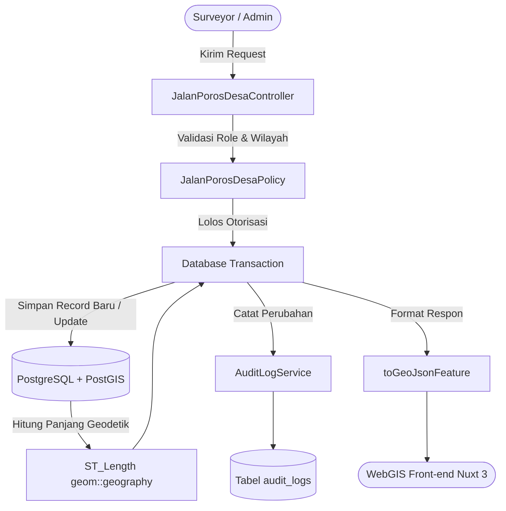

# Jalan Poros Desa

Kembali ke indeks dokumentasi: [docs/README.md](../README.md)

---

## 1. Tujuan

Menyediakan sistem inventarisasi dan tata kelola data spasial jaringan jalan poros desa di Kabupaten Bojonegoro. Modul ini memungkinkan operator desa, kecamatan, dan dinas teknis untuk memetakan ruas jalan, memantau kondisi fisik (perkerasan, tingkat kerusakan, lebar, dan panjang), serta melakukan operasi geospasial mutakhir seperti pemotongan (split) ruas jalan dengan perhitungan panjang otomatis yang akurat.

---

## 2. Latar Belakang & Masalah

| Aspek | Sebelum Implementasi | Sesudah Implementasi |
|---|---|---|
| **Penyimpanan Geometri** | Terpencar dalam file Shapefile (SHP) lokal tanpa versi terpusat | Disimpan dalam PostgreSQL/PostGIS terpusat dengan tipe `MultiLineString` (SRID 4326) |
| **Perhitungan Panjang Jalan** | Diinput manual oleh surveyor, rawan manipulasi dan ketidaksinkronan angka | Dihitung otomatis secara geodetik melalui PostGIS `ST_Length(geom::geography)` dalam satuan meter |
| **Operasi Pemotongan Segmen** | Harus menggunakan software GIS desktop berat (QGIS/ArcGIS) lalu diexport ulang | Dapat dilakukan langsung di WebGIS via koordinat klik mouse (*point split*) atau pre-split GeoJSON |
| **Isolasi Wilayah (Multi-tenant)** | Operator desa bisa melihat dan mengedit data desa tetangga tanpa sengaja | Dilindungi Scoping RBAC: operator desa terkunci hanya pada desa miliknya |
| **Audit Mutasi Data** | Tidak ada jejak siapa yang mengubah bentuk ruas atau menghapus data | Terintegrasi penuh dengan `AuditLogService` mencatat aksi `created`, `updated`, `split`, dan `deleted` |

---

## 3. Fitur Saat Ini / Kapabilitas Modul

- **GeoJSON FeatureCollection Streaming**: Menyediakan endpoint untuk render layer OpenLayers/MapLibre dengan atribut lengkap.
- **Tampilan Tabel Ringan & Paginasi (`format=table`)**: Mendukung pagination cepat tanpa membawa payload koordinat LineString yang besar, dilengkapi titik berat segmen (*centroid*).
- **Statistik & Ringkasan Agregat (`format=summary`)**: Menghitung total ruas, total panjang (meter & km), sebaran kondisi jalan (Baik, Sedang, Rusak Ringan, Rusak Berat), dan batas koordinat (*bounding box*).
- **Opsi Filter Wilayah & Kondisi (`format=options`)**: Mengambil daftar dinamis perkerasan, kondisi eksisting, serta filter kecamatan/desa berjenjang.
- **Manajemen Geometri & Atribut (CRUD)**: Menambah, mengubah nama ruas, status eksisting, lebar, perkerasan, dan koordinat.
- **Pemotongan Ruas Jalan (Segment Split)**:
  - *Mode 1 (Pre-split parts)*: Membagi 1 ruas menjadi 2 segmen terpisah berdasarkan GeoJSON potongan dari front-end.
  - *Mode 2 (Point split)*: Memotong ruas pada persentase fraksi garis terdekat dari titik klik koordinat `[lng, lat]`.
- **Penomoran Kode Ruas Otomatis**: Menghasilkan kode ruas berikutnya secara otomatis jika tidak ditentukan oleh pengguna.

---

## 4. Logika Alur & Arsitektur

---

## 5. Halaman dan Route

### Frontend Nuxt 3
- WebGIS Explorer: `/map` (Layer Jalan Poros Desa)
- Manajemen Dataset Jalan: `/admin/dataset/jalan-poros-desa`
- Detail & Editor Ruas: `/admin/dataset/jalan-poros-desa/{id}`

### Backend API (Laravel 13)
| Method | Endpoint | Fungsi |
|---|---|---|
| `GET` | `/api/v1/admin/jalan-poros-desa` | Mengambil data dalam format `geojson`, `table`, `summary`, atau `options` |
| `GET` | `/api/v1/admin/jalan-poros-desa/{id}` | Mengambil detail 1 ruas jalan beserta GeoJSON Feature |
| `POST` | `/api/v1/admin/jalan-poros-desa` | Menambahkan data ruas jalan baru |
| `PUT` | `/api/v1/admin/jalan-poros-desa/{id}` | Memperbarui atribut atau geometri ruas jalan |
| `POST` | `/api/v1/admin/jalan-poros-desa/{id}/split` | Memecah ruas jalan menjadi 2 segmen independen |
| `DELETE` | `/api/v1/admin/jalan-poros-desa/{id}` | Menghapus ruas jalan (Hanya Admin / Bappeda) |

---

## 6. Permission & Hak Akses (RBAC)

Modul ini dikendalikan oleh policy `JalanPorosDesaPolicy` dengan permission Spatie:
- `jalan-poros-desa-view` / `jalan-poros-desa-access`: Hak membaca dan melihat layer jalan.
- `jalan-poros-desa-create`: Hak membuat ruas jalan baru.
- `jalan-poros-desa-update`: Hak mengedit ruas jalan pada wilayah tugasnya.
- `jalan-poros-desa-delete`: Hak menghapus data (dibatasi hanya untuk administrator/Bappeda; operator desa dilarang keras).

---

## 7. Alur Pengguna (Step-by-Step User Journey)

1. **Eksplorasi & Filter**: Pengguna membuka halaman peta atau tabel dataset, memilih filter Kecamatan dan Desa untuk membatasi tampilan ruas jalan.
2. **Digitasi Ruas**: Operator menggambar linestring di peta, melengkapi nama ruas, lebar, perkerasan (Aspal, Rabat Beton, Makadam, Tanah), dan kondisi eksisting.
3. **Penyimpanan**: Sistem memvalidasi geometri (harus LineString atau MultiLineString valid), menghitung panjang riil, dan mencatat log aktivitas.
4. **Pemotongan (Split)**: Ketika ruas jalan mengalami perbaikan sebagian dengan sumber dana berbeda, operator mengklik tool Split pada titik tertentu. Ruas lama diperpendek hingga titik potong (Bagian 1), dan segmen baru diterbitkan dengan kode ruas unik (Bagian 2).

---

## 8. Integrasi Data & Skema Database

Tabel utama: `jalan_porosdesa`
- `id` (UUID, Primary Key)
- `kode_ruas` (Integer, Unik per dataset)
- `nama_ruas` (Varchar 255)
- `desa` (Varchar 255) & `id_desa` (Foreign ID ke `bataswilayah_desa`)
- `kecamatan` (Varchar 255) & `id_kecamatan` (Foreign ID ke `bataswilayah_kecamatan`)
- `panjang` (Numeric 10,2 - meter)
- `lebar` (Numeric 5,2 - meter)
- `perkerasan` (Varchar: Aspal, Beton, Makadam, Tanah, dll.)
- `kondisi` (Varchar: Baik, Sedang, Rusak Ringan, Rusak Berat)
- `status_awal` & `status_eksisting` (Varchar)
- `sumber_data` (Varchar)
- `geom` (`geometry(MultiLineString, 4326)`)

---

## 9. Efek Bisnis Penting

- **Database Transaction (`DB::transaction`)**: Operasi pemotongan (split) mengeksekusi update segmen lama dan create segmen baru secara atomik. Jika salah satu operasi gagal, perubahan dibatalkan seutuhnya.
- **Audit Logging Terintegrasi**: Setiap aksi dicatat ke tabel `audit_logs` dengan sanitasi geometri PostGIS agar payload tidak membebani database audit.
- **Integritas Spasial**: Nilai panjang dihitung langsung dari proyeksi sferoid geodetik (`::geography`), menjamin akurasi perhitungan tanpa distorsi koordinat derajat EPSG:4326.

---

## 10. Batasan Saat Ini & Edge Cases

- **Toleransi Titik Potong**: Pemotongan pada batas vertex ekstrem (< 0.5% atau > 99.5% dari total panjang) ditolak untuk mencegah pembuatan segmen kosong (zero-length segment).
- **Driver-Agnostic Querying**: Controller mendukung baik PostgreSQL/PostGIS untuk lingkungan produksi maupun SQLite in-memory untuk lingkungan testing otomatis.

---

## 11. Automated Testing & File Sentral

### Berkas Automated Tests
- **Feature Tests**: [tests/Feature/Dataset/JalanPorosDesaTest.php](file:///c:/laragon/www/melarosa-laravel-nuxt/apps/api/tests/Feature/Dataset/JalanPorosDesaTest.php) (17 skenario: Happy Path, Validasi, RBAC Wilayah, Split Segmen, Edge Cases).
- **Unit Tests**: [tests/Unit/Models/JalanPorosDesaModelTest.php](file:///c:/laragon/www/melarosa-laravel-nuxt/apps/api/tests/Unit/Models/JalanPorosDesaModelTest.php) (2 skenario: GeoJSON serialization & Attribute casting).

### Berkas Kode Sentral
- Controller: [app/Http/Controllers/Admin/JalanPorosDesaController.php](file:///c:/laragon/www/melarosa-laravel-nuxt/apps/api/app/Http/Controllers/Admin/JalanPorosDesaController.php)
- Model: [app/Models/JalanPorosDesa.php](file:///c:/laragon/www/melarosa-laravel-nuxt/apps/api/app/Models/JalanPorosDesa.php)
- Policy: [app/Policies/JalanPorosDesaPolicy.php](file:///c:/laragon/www/melarosa-laravel-nuxt/apps/api/app/Policies/JalanPorosDesaPolicy.php)
