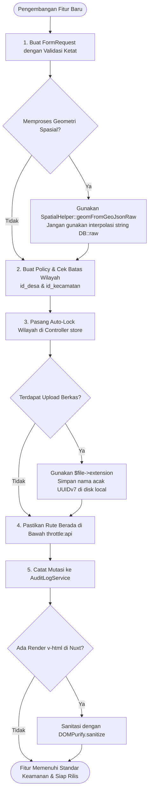

# Pedoman & Standar Keamanan Sistem (System Security Guidelines)

Kembali ke indeks dokumentasi: [docs/README.md](../README.md)

---

## 1. Tujuan & Ruang Lingkup

Dokumen ini merupakan **standar acuan paten (SOP Keamanan)** bagi setiap pengembang (baik programmer maupun agen AI) ketika merancang, membangun, atau memodifikasi fitur di ekosistem **Melarosa GIS** (Laravel 13 REST API + Nuxt 4 WebGIS + PostGIS & Martin Tile Server).

Tujuan utama standar ini adalah:
1. Mencegah terulangnya celah keamanan kritis seperti **SQL Injection spasial**, **Broken Object Level Authorization (BOLA/IDOR)**, dan **Cross-Site Scripting (XSS)**.
2. Menjamin integritas data perencanaan wilayah, usulan bantuan keuangan desa (BKKD), serta pelaporan fisik infrastruktur di Kabupaten Bojonegoro.
3. Menjadi panduan verifikasi (*checklist*) sebelum sebuah fitur dinyatakan *Ready for Production*.

---

## 2. Prinsip Pokok Keamanan (Core Security Principles)

1. **Zero-Trust Input**: Jangan pernah mempercayai data dari klien (browser, query string, form request, maupun API eksternal pihak ketiga). Seluruh input wajib divalidasi dan disanitasi di sisi backend.
2. **Server-Side Enforcement**: Tampilan frontend (seperti menyembunyikan tombol via `v-if="can(...)"` atau *route middleware* Nuxt) hanyalah **kenyamanan pengguna (UX)**, BUKAN benteng keamanan. Validasi otorisasi final wajib ditegakkan di Controller dan Policy Laravel.
3. **Multi-Tenant Territorial Boundary (Wilayah Administratif)**: Pengguna desa dan kecamatan hanya boleh melihat, mengubah, dan menghapus data yang berada di bawah yurisdiksi wilayahnya sendiri (`id_desa` / `id_kecamatan`).
4. **Least Privilege**: Akun hanya diberikan izin (*permission*) minimal yang dibutuhkan untuk menyelesaikan tugas kedinasannya.

---

## 3. Pedoman Keamanan Backend (Laravel 13)

### A. Operasi Geospasial & Pencegahan SQL Injection
PostGIS memproses data spasial melalui fungsi SQL seperti `ST_GeomFromGeoJSON`, `ST_MakePoint`, dan `ST_SetSRID`. Penggabungan string tanpa sanitasi ke dalam `DB::raw()` adalah celah SQL Injection.

* ❌ **DILARANG KERAS (Vulnerable):**
  ```php
  // Rentan SQL Injection jika string GeoJSON mengandung tanda petik tunggal (')
  $desa->geom = DB::raw("ST_SetSRID(ST_Multi(ST_GeomFromGeoJSON('$geoJsonString')), 4326)");
  ```

* ✅ **WAJIB DIGUNAKAN (Secure):**
  Gunakan helper paten [SpatialHelper::geomFromGeoJsonRaw()](file:///c:/laragon/www/melarosa-laravel-nuxt/apps/api/app/Helpers/SpatialHelper.php) yang sudah dilengkapi `$pdo->quote()`:
  ```php
  use App\Helpers\SpatialHelper;

  $desa->geom = SpatialHelper::geomFromGeoJsonRaw($geoJsonString);
  ```

* ✅ **Untuk Titik Koordinat (Point):**
  Selalu lakukan *type-casting* eksplisit ke `(float)` sebelum dimasukkan ke klausa SQL:
  ```php
  $lat = (float) $validated['latitude'];
  $lng = (float) $validated['longitude'];
  $model->geom = DB::raw("ST_SetSRID(ST_MakePoint($lng, $lat), 4326)");
  ```

---

### B. Otorisasi Objek Bertingkat & Pencegahan BOLA / IDOR
*Broken Object Level Authorization* terjadi saat pengguna dapat mengakses atau memodifikasi data entitas lain hanya dengan mengubah ID pada parameter URL/body.

#### 1. Aturan Penulisan Policy
Setiap Policy model yang memiliki relasi wilayah (`id_kecamatan` atau `id_desa`) **WAJIB** mengecek kepemilikan wilayah pada method `view()`, `update()`, dan `delete()`.

```php
// Contoh pada BkkdProposalPolicy atau InfrastrukturSegmenPolicy:
public function update(User $user, BkkdProposal $proposal): bool
{
    // 1. Cek permission RBAC dasar
    if (!$this->hasPerm($user, ['bkkd-proposal-update'])) {
        return false;
    }

    // 2. Superadmin dan Verifikator Kabupaten (Bappeda) memiliki akses global
    if ($user->hasRole('admin') || $user->hasRole('verifierBappeda')) {
        return true;
    }

    // 3. Verifikator Kecamatan hanya boleh mengedit proposal di kecamatannya
    if ($user->hasRole('verifierKecamatan') || $user->id_kecamatan) {
        return (int) $proposal->id_kecamatan === (int) $user->id_kecamatan;
    }

    // 4. Operator Desa hanya boleh mengedit proposal di desanya
    if ($user->id_desa) {
        return (int) $proposal->id_desa === (int) $user->id_desa;
    }

    return false;
}
```

#### 2. Auto-Lock Wilayah pada Method `store()`
Saat pembuatan entitas baru, **DILARANG** mempercayai `id_desa` atau `id_kecamatan` dari payload request jika pengguna yang login bukan Superadmin/Bappeda.

```php
// Di dalam Controller store() method:
$user = $request->user();
$validated = $request->validated();

// Kunci otomatis ke wilayah operator yang sedang masuk
if ($user && !$user->hasRole('admin') && !$user->hasRole('verifierBappeda')) {
    if ($user->id_kecamatan) {
        $validated['id_kecamatan'] = $user->id_kecamatan;
    }
    if ($user->id_desa) {
        $validated['id_desa'] = $user->id_desa;
    }
}
```

---

### C. Manajemen Upload & Penyimpanan Berkas

1. **Validasi Ketat di FormRequest:**
   Wajib membatasi ekstensi, MIME type riil, dan ukuran maksimum:
   ```php
   'file' => ['required', 'file', 'mimes:pdf,xlsx,xls,jpg,jpeg,png', 'max:10240'], // Maks 10MB
   ```
2. **Ekstensi Berkas Berdasarkan Tebakan Server:**
   ❌ **Dilarang:** `$file->getClientOriginalExtension()` (dapat dimanipulasi header browser).  
   ✅ **Wajib:** `$file->extension() ?: $file->guessExtension() ?: 'bin'`.
3. **Pemberian Nama Acak Berbasis UUID:**
   Gunakan `Str::uuid7()` untuk mencegah penimpaan file (*file collision*) dan *path traversal*:
   ```php
   $filename = sprintf('%s.%s', Str::uuid7(), $extension);
   ```
4. **Pemisahan Disk Penyimpanan:**
   - **Disk `public`**: Hanya untuk aset non-sensitif publik (misal avatar profil pengguna).
   - **Disk `local`**: Wajib untuk berkas dinas, dokumen lampiran proposal BKKD, dan berita acara. Berkas pada disk `local` hanya dapat diunduh melalui endpoint controller yang diproteksi `Gate::authorize()`.

---

### D. Rate Limiting & Pengamanan Rute API

1. Seluruh endpoint API di bawah [routes/web.php](file:///c:/laragon/www/melarosa-laravel-nuxt/apps/api/routes/web.php) wajib berada di dalam grup ber-middleware `throttle:api`:
   ```php
   Route::prefix('api/v1')->middleware(['throttle:api'])->group(function () {
       // Semua endpoint fitur baru diletakkan di sini
   });
   ```
2. Untuk aksi sensitif (login, ganti password, upload dokumen, pendaftaran), pasang rate limit spesifik per-menit:
   - Login: `throttle:login` (5 percobaan/menit).
   - Upload: `throttle:uploads` (10 berkas/menit untuk non-admin).
   - Reset Password: `throttle:5,1` (5 permintaan/menit).

---

### E. Integrasi HTTP Pihak Ketiga & Pencegahan SSRF

Ketika membuat fitur proxy atau mengambil data dari API luar (misal Geoportal BIG, Ina-SDI, atau Portal Pemkab):
1. **SSRF Whitelist**: Validasi skema (`http/https`) dan domain upstream menggunakan *regex whitelist* ketat.
2. **Blokir IP Privat/Loopback**: Pastikan IP tujuan bukan localhost atau subnet internal:
   ```php
   $ip = gethostbyname($host);
   if (filter_var($ip, FILTER_VALIDATE_IP, FILTER_FLAG_NO_PRIV_RANGE | FILTER_FLAG_NO_RES_RANGE) === false) {
       abort(403, 'Akses ke jaringan lokal privat dilarang.');
   }
   ```
3. **Validasi Sertifikat SSL**: Jangan gunakan `withoutVerifying()` di lingkungan *production*:
   ```php
   $http = Http::timeout(10);
   if (!app()->isProduction()) {
       $http = $http->withoutVerifying(); // Hanya diizinkan untuk dev lokal
   }
   $response = $http->get($url);
   ```
4. **Proteksi Aksi *Cache Refresh*:** Parameter yang memaksa pembatalan cache (`?refresh=1`) **hanya boleh** dieksekusi oleh pengguna yang sudah terautentikasi (`if ($request->user())`).

---

### F. Isolasi Memori Laravel Octane (`laravel/octane`)

Aplikasi berjalan di atas *long-running worker* Laravel Octane:
- ❌ **Dilarang keras:** Menyimpan data pengguna, sesi, atau konteks request ke dalam *static property* class atau objek *singleton*.
- ✅ **Gunakan:** Resolusi dinamis via dependency injection atau `Auth::user()` agar memori tidak bocor ke request pengguna lain berikutnya.

---

### G. Pencatatan Jejak Audit (Audit Trail Mandatori)

Setiap fitur yang melakukan mutasi data operasional wajib mencatat peristiwa ke [AuditLogService](file:///c:/laragon/www/melarosa-laravel-nuxt/apps/api/app/Services/AuditLogService.php):
```php
app(AuditLogService::class)->log(
    event: 'created', // created | updated | deleted | verified | split
    module: 'bkkd-proposal',
    auditable: $proposal,
    description: "Proposal {$proposal->nomor_registrasi} berhasil dibuat.",
    actor: $user,
);
```

---

## 4. Pedoman Keamanan Frontend (Nuxt 4 / Vue 3)

### A. Sanitasi HTML Terhadap Celah XSS
* ❌ **DILARANG:** Merender string dari API pihak ketiga atau input pengguna langsung ke `v-html`:
  ```html
  <!-- RENTAN Stored / Secondary XSS -->
  <div v-html="site.narasiHtml" />
  ```
* ✅ **WAJIB:** Gunakan `dompurify` sebelum melakukan render HTML mentah:
  ```typescript
  import DOMPurify from 'dompurify';

  const cleanHtml = computed(() => {
    return typeof window !== 'undefined'
      ? DOMPurify.sanitize(props.content)
      : props.content;
  });
  ```

---

### B. Tata Kelola State, Token, & Cookie
1. **Dilarang Menyimpan Token/Kredensial di `localStorage`:**
   Sanctum mengelola autentikasi berbasis sesi cookie `HttpOnly` yang tidak dapat dibaca oleh skrip JavaScript, sehingga kebal terhadap pencurian token via serangan XSS.
2. **Efisiensi CSRF Handshake:**
   Jangan memanggil `fetchCsrf()` tanpa filter. Periksa keberadaan cookie `XSRF-TOKEN` terlebih dahulu:
   ```typescript
   const xsrf = useCookie('XSRF-TOKEN');
   if (import.meta.client && !xsrf.value) {
     await auth.fetchCsrf();
   }
   ```

---

### C. Navigasi & Proteksi Rute Klien
1. Setiap halaman admin wajib dilindungi route middleware:
   ```typescript
   definePageMeta({
     middleware: ['auth', 'permission'],
     permission: 'infrastruktur-segmen-view',
   });
   ```
2. Jangan pernah menganggap *hidden button* aman: jika pengguna yang tidak berhak mengirim request langsung via console / Postman, backend harus menolak dengan `403 Forbidden`.

---

## 5. Diagram Alur Verifikasi Keamanan Fitur Baru



---

## 6. Checklist Keamanan Pengembang (Developer Pre-Commit Checklist)

Sebelum membuat Pull Request atau menyatakan fitur selesai, verifikasi daftar periksa berikut:

| No | Komponen | Kriteria Keamanan | Status |
|---|---|---|:---:|
| 1 | **FormRequest** | Seluruh field divalidasi tipe data, batas minimal/maksimal, dan keberadaannya di tabel (`exists`). | [ ] |
| 2 | **PostGIS** | Tidak ada variabel GeoJSON yang diinterpolasi langsung ke string SQL `DB::raw(...)`. | [ ] |
| 3 | **Policy Otorisasi** | Method `view`, `update`, dan `delete` memeriksa kesesuaian `id_kecamatan` dan `id_desa` pengguna. | [ ] |
| 4 | **Auto-Lock Wilayah** | Operator desa/kecamatan tidak dapat menyisipkan `id_desa`/`id_kecamatan` lain saat `store()`. | [ ] |
| 5 | **File Upload** | MIME type divalidasi riil, ekstensi menggunakan `$file->extension()`, berkas dinas tersimpan di disk `local`. | [ ] |
| 6 | **Rate Limiting** | Rute baru berada di bawah prefix `api/v1` (`throttle:api`) atau memiliki throttle khusus. | [ ] |
| 7 | **Audit Trail** | Mutasi data memicu pencatatan log riwayat via `AuditLogService`. | [ ] |
| 8 | **Frontend XSS** | Tidak ada penggunaan `v-html` tanpa filter `DOMPurify.sanitize()`. | [ ] |
| 9 | **Octane Isolation** | Tidak ada data user atau request yang disimpan di dalam *static variable* / *singleton*. | [ ] |
| 10 | **Dokumentasi** | Fitur baru telah dicatat di `docs/features/` dan diindeks pada `docs/README.md`. | [ ] |
