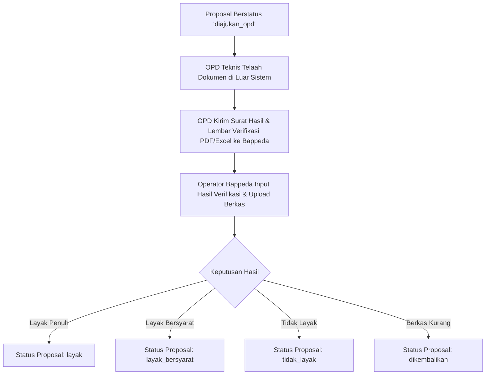

# Sub-Issue BKKD-02: Fitur Hasil Verifikasi Proposal Usulan BKKD

- **Status**: Ready for Implementation
- **Kategori**: Verifikasi Teknis (Fitur 2)
- **Komponen**: REST API Backend & Antarmuka Nuxt UI (`apps/api` & `apps/web`)
- **Dependensi**: BKKD-01 (Pengelolaan Proposal)
- **Dokumen Terkait**: [module_issue_bkkd.md](file:///c:/laragon/www/melarosa-laravel-nuxt/docs/issues/module_issue_bkkd.md)

---

## 1. Deskripsi & Tujuan

Membangun alur dan antarmuka pencatatan hasil verifikasi telaah teknis proposal BKKD. OPD teknis (seperti Dinas PUPR, DPMD, atau Dinkes) memverifikasi usulan secara offline di luar sistem, kemudian mengirimkan surat rekomendasi dan lembar evaluasi (berformat PDF atau Excel) kepada Bappeda.

Operator Bappeda mencatat hasil verifikasi tersebut ke dalam sistem: memilih instansi OPD teknis, menginput nomor dan tanggal surat rekomendasi, menentukan hasil kelayakan (`layak`, `layak_bersyarat`, `tidak_layak`, atau `dikembalikan`), menginput nilai pagu anggaran yang disetujui, mencantumkan catatan evaluasi, serta wajib mengunggah berkas dokumen asli dari OPD. Status proposal utama disinkronkan secara otomatis mengikuti hasil verifikasi aktif.

---

## 2. Alur & Aturan Bisnis Verifikasi



### 2.1 Sinkronisasi Status Proposal

- Status proposal (`layak`, `layak_bersyarat`, `tidak_layak`, `dikembalikan`) **hanya boleh berubah** melalui pencatatan verifikasi ini, dan tidak dapat diubah langsung dari form proposal.
- Nilai rekomendasi yang disetujui OPD dapat berbeda dari nilai usulan awal desa (misalnya hasil efisiensi RAB). Sistem menghitung selisih (deviasi) anggaran secara otomatis.

### 2.2 Penanganan Verifikasi Ulang (Re-Verifikasi)

Dalam praktiknya, usulan yang berstatus `dikembalikan` dapat diajukan kembali setelah desa melengkapi berkas, atau usulan dievaluasi ulang oleh tim anggaran kabupaten:
1. Satu proposal dapat memiliki lebih dari satu baris riwayat verifikasi.
2. Hanya boleh ada tepat satu baris verifikasi aktif (`is_aktif = true`) pada satu waktu (dikunci dengan partial index database).
3. Saat operator mencatat verifikasi baru pada proposal yang telah memiliki verifikasi sebelumnya, baris lama otomatis diubah menjadi `is_aktif = false`, dan riwayat lama tetap tersimpan utuh beserta file lampirannya.

---

## 3. Spesifikasi Backend (`apps/api`)

### 3.1 Endpoint REST API (`routes/web.php`)

| Method | URI | Middleware Permission | Fungsi |
| :--- | :--- | :--- | :--- |
| `GET` | `bkkd/verifikasi` | `bkkd-verifikasi-view` | Mengambil daftar seluruh hasil verifikasi OPD dengan filter |
| `POST` | `bkkd/proposal/{id}/verifikasi` | `bkkd-verifikasi-manage` | Mencatat hasil verifikasi baru untuk proposal terkait |
| `PUT` | `bkkd/verifikasi/{id}` | `bkkd-verifikasi-manage` | Mengoreksi data hasil verifikasi aktif (salah ketik nomor/nilai) |
| `GET` | `bkkd/verifikasi/{id}/download` | `bkkd-verifikasi-view` | Mengunduh file dokumen PDF/Excel hasil verifikasi dari OPD |

### 3.2 Logika Controller & Service Verifikasi

Pencatatan verifikasi dilakukan dalam database transaction:
```php
DB::transaction(function () use ($proposal, $request, $user) {
    // 1. Validasi keberadaan file dokumen pendukung (wajib PDF/Excel)
    // 2. Nonaktifkan verifikasi sebelumnya bila ada
    $verifikasiLama = BkkdVerifikasi::where('id_proposal', $proposal->id)
        ->where('is_aktif', true)
        ->first();

    if ($verifikasiLama) {
        $verifikasiLama->update(['is_aktif' => false]);
        // Catat riwayat superseded (dibahas di BKKD-04)
    }

    // 3. Simpan data verifikasi baru
    $verifikasiBaru = BkkdVerifikasi::create([
        'id_proposal' => $proposal->id,
        'id_opd' => $request->input('id_opd'),
        'nomor_surat_hasil' => $request->input('nomor_surat_hasil'),
        'tanggal_surat_hasil' => $request->input('tanggal_surat_hasil'),
        'tanggal_diterima' => $request->input('tanggal_diterima'),
        'hasil' => $request->input('hasil'),
        'nilai_rekomendasi' => $request->input('nilai_rekomendasi'),
        'volume_rekomendasi' => $request->input('volume_rekomendasi'),
        'catatan_opd' => $request->input('catatan_opd'),
        'path_dokumen' => $pathDokumenPermanen,
        'nama_dokumen_asli' => $namaDokumenAsli,
        'is_aktif' => true,
        'versi' => 1,
        'input_by' => $user->uuid,
    ]);

    // 4. Sinkronkan status proposal utama
    $proposal->update([
        'status' => $request->input('hasil'),
        'updated_by' => $user->uuid,
    ]);
});
```

---

## 4. Spesifikasi Frontend Nuxt 4 (`apps/web`)

### 4.1 Halaman Rekap Verifikasi (`pages/admin/bkkd/verifikasi/index.vue`)

- **Bilah Filter**:
  - Filter Tahun Anggaran.
  - Filter Instansi OPD Teknis (`ref_opd`).
  - Filter Keputusan Hasil: Layak, Layak Bersyarat, Tidak Layak, Dikembalikan.
  - Filter Wilayah (Kecamatan dan Desa).
  - Toggle switch: "Tampilkan hasil yang sudah tergantikan (superseded)".
- **Tabel Nuxt UI (`UTable`)**:
  - Kolom: Nomor Registrasi Proposal, Judul Usulan & Wilayah Desa, OPD Pemeriksa, Nomor & Tanggal Surat OPD, Hasil Keputusan (Badge Warna), Nilai Usulan Awal, Nilai Rekomendasi Disetujui, Selisih Anggaran, Berkas OPD, Aksi.
  - Kolom Berkas OPD: Tombol ikon unduh langsung membuka file PDF/Excel via endpoint download terproteksi.
  - Kolom Aksi: Tombol buka proposal, tombol koreksi data verifikasi.

### 4.2 Tab Verifikasi pada Detail Proposal (`pages/admin/bkkd/proposal/[id].vue`)

Struktur tampilan pada Tab Verifikasi:
1. **Bagian Atas (Hasil Verifikasi Aktif)**:
   - Panel kartu khusus yang menonjolkan status kelayakan (Badge Hijau/Kuning/Merah).
   - Nama OPD pemeriksa dan nomor surat resmi.
   - Perbandingan berdampingan: Pagu Usulan Desa vs Pagu Rekomendasi OPD.
   - Catatan teknis dan telaah rekomendasi dari tim pemeriksa.
   - Tombol unduh berkas asli OPD.
   - Tombol "Koreksi Hasil Verifikasi" (hanya untuk `verifierBappeda`).
   - Tombol "Input Verifikasi Ulang" jika usulan dievaluasi kembali.
2. **Bagian Bawah (Riwayat Verifikasi Sebelumnya)**:
   - Tabel kolapsibel yang menampilkan hasil-hasil verifikasi terdahulu yang telah digantikan, lengkap dengan tanggal dan dokumen arsipnya.

### 4.3 Modal Input Verifikasi (`VerifikasiFormModal.vue`)

- Dropdown Pemilih OPD Teknis: Otomatis memilih OPD default berdasarkan bidang kegiatan proposal terkait (`id_opd_default`), namun tetap fleksibel untuk diganti operator jika diperlukan.
- Input Nomor Surat / Nota Dinas OPD & Tanggal Surat.
- Input Tanggal Surat Diterima di Bappeda.
- Radio Group / Dropdown Pilihan Hasil:
  - `layak`: Disetujui penuh untuk diusulkan masuk anggaran.
  - `layak_bersyarat`: Disetujui dengan catatan penyempurnaan dokumen.
  - `tidak_layak`: Ditolak karena tidak memenuhi kriteria teknis.
  - `dikembalikan`: Berkas dikembalikan ke desa untuk diperbaiki.
- Input Nilai Rekomendasi Anggaran (Rp) berpemisah ribuan.
- Input Volume Rekomendasi dan Satuan.
- Textarea Catatan Evaluasi OPD.
- Upload Berkas Wajib: Mengunggah file PDF atau Excel lembar hasil verifikasi.

---

## 5. Kriteria Penerimaan (Acceptance Criteria)

- [ ] Operator Bappeda dapat menginput hasil telaah teknis OPD melalui modal verifikasi, dan sistem mewajibkan pengunggahan berkas dokumen hasil (PDF/Excel).
- [ ] Status proposal pada tabel utama langsung tersinkronisasi mengikuti nilai keputusan hasil verifikasi (`layak`, `layak_bersyarat`, `tidak_layak`, `dikembalikan`).
- [ ] File dokumen hasil verifikasi tersimpan aman di disk privat lokal dan berhasil diunduh melalui tombol aksi.
- [ ] Saat dilakukan verifikasi ulang pada proposal yang sama, sistem menandai verifikasi terdahulu menjadi tidak aktif (`is_aktif = false`) tanpa menghapus datanya.
- [ ] Halaman `/admin/bkkd/verifikasi` menyajikan daftar rekap verifikasi dengan filter OPD dan selisih anggaran yang akurat.
- [ ] Pengguna role `verifierKecamatan` hanya dapat melihat hasil verifikasi pada desa di kecamatannya dan tidak dapat mengubah data.
