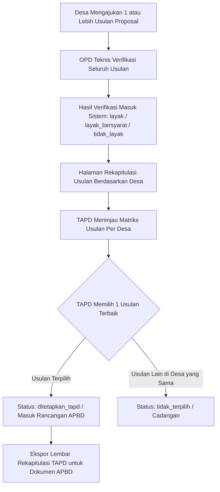

# Sub-Issue BKKD-05: Fitur Rekapitulasi Usulan Desa & Penetapan TAPD (Rancangan APBD)

- **Status**: Ready for Implementation
- **Kategori**: Rekapitulasi & Pengambilan Keputusan (Fitur 5)
- **Komponen**: REST API Backend & Antarmuka Nuxt UI (`apps/api` & `apps/web`)
- **Dependensi**: BKKD-01 (Pengelolaan Proposal) & BKKD-02 (Hasil Verifikasi OPD)
- **Dokumen Terkait**: [module_issue_bkkd.md](file:///c:/laragon/www/melarosa-laravel-nuxt/docs/issues/module_issue_bkkd.md)

---

## 1. Deskripsi & Tujuan

Membangun fitur rekapitulasi usulan bantuan keuangan khusus desa serta mekanisme pengambilan keputusan oleh Tim Anggaran Pemerintah Daerah (TAPD). 

Sesuai ketentuan administratif:
1. **Satu desa diperbolehkan mengajukan lebih dari satu usulan proposal** (misalnya Desa Sukamaju mengusulkan 2 atau 3 kegiatan fisik/sarpras yang berbeda).
2. Seluruh usulan tersebut diverifikasi oleh OPD teknis terkait untuk menguji kelayakan teknis dan kewajaran anggarannya.
3. Modul ini berdiri sendiri (independen) dan **tidak diintegrasikan ke modul plotting anggaran infrastruktur**.
4. Sistem menyediakan halaman **Rekapitulasi Usulan Berdasarkan Desa**.
5. Dari daftar usulan yang masuk dan telah diverifikasi pada satu desa, **TAPD memilih salah satu usulan** untuk ditetapkan masuk ke dalam Rancangan APBD tahun anggaran berjalan.

---

## 2. Alur Kerja Pemilihan TAPD (1 Desa 1 Usulan Terpilih)



### 2.1 Aturan Bisnis Penetapan TAPD

1. **Kelayakan Sebagai Syarat Pilihan**:
   - Hanya proposal yang berstatus `layak` atau `layak_bersyarat` dari hasil verifikasi OPD teknis yang tombol pemilihannya aktif.
   - Proposal yang masih `draft`, `diajukan_opd`, atau `tidak_layak` tidak dapat dipilih oleh TAPD.
2. **Prinsip 1 Desa 1 Usulan Terpilih**:
   - Jika sebuah desa memiliki 3 usulan yang dinyatakan layak oleh OPD, TAPD memilih 1 usulan prioritas.
   - Saat usulan terpilih ditetapkan:
     - Usulan yang dipilih mendapatkan status `ditetapkan_tapd`.
     - Usulan-usulan layak lainnya pada desa tersebut yang tidak dipilih secara otomatis mendapatkan status `tidak_terpilih`.
3. **Fleksibilitas Pengubahan Pilihan (Pindah Usulan)**:
   - Jika dalam dinamika pembahasan TAPD memutuskan beralih ke usulan lain di desa yang sama, operator cukup menekan tombol pilih pada usulan pengganti.
   - Sistem secara otomatis memindahkan status `ditetapkan_tapd` ke usulan baru, mengembalikan usulan sebelumnya menjadi `tidak_terpilih`, dan mereset pagu disetujui pada usulan lama.
4. **Penyesuaian Anggaran Pagu oleh TAPD (`nilai_disetujui_tapd`)**:
   - Berdasarkan usulan prioritas yang dipilih, TAPD melakukan **penyesuaian alokasi pagu anggaran** sesuai batas kemampuan keuangan daerah atau kebijakan plafon anggaran per desa.
   - Nilai pagu yang disetujui TAPD dapat berbeda dari nilai usulan awal desa maupun nilai rekomendasi OPD teknis.
   - Sistem menyediakan field input nominal khusus `nilai_disetujui_tapd` dan textarea `catatan_tapd` (alasan penyesuaian pagu).

---

## 3. Spesifikasi Backend (`apps/api`)

### 3.1 Endpoint REST API (`routes/web.php`)

| Method | URI | Middleware Permission | Fungsi |
| :--- | :--- | :--- | :--- |
| `GET` | `bkkd/rekapitulasi-desa` | `bkkd-proposal-view` | Mengambil data rekapitulasi usulan yang dikelompokkan per desa |
| `POST` | `bkkd/rekapitulasi-desa/{idProposal}/tetapkan-tapd` | `bkkd-proposal-update` | Memilih usulan ini dan menetapkan nominal penyesuaian pagu TAPD untuk Rancangan APBD |
| `POST` | `bkkd/rekapitulasi-desa/{idProposal}/batalkan-tapd` | `bkkd-proposal-update` | Membatalkan pilihan TAPD sehingga desa belum memiliki usulan terpilih |
| `GET` | `bkkd/rekapitulasi-desa/export` | `bkkd-proposal-view` | Mengunduh lembar rekapitulasi usulan per desa dalam format Excel (.xlsx) |

### 3.2 Logika Transaksi Penetapan & Penyesuaian Pagu TAPD

```php
DB::transaction(function () use ($proposal, $request, $user) {
    // 1. Validasi kelayakan dan input pagu
    if (!in_array($proposal->status, ['layak', 'layak_bersyarat', 'tidak_terpilih'])) {
        throw ValidationException::withMessages([
            'status' => ['Hanya usulan dengan hasil verifikasi layak yang dapat dipilih TAPD.'],
        ]);
    }

    $request->validate([
        'nilai_disetujui_tapd' => ['required', 'numeric', 'min:0'],
        'catatan_tapd' => ['nullable', 'string', 'max:1000'],
        'tanggal_penetapan_tapd' => ['nullable', 'date'],
    ]);

    $nilaiPaguBaru = $request->input('nilai_disetujui_tapd');
    $catatanTapd = $request->input('catatan_tapd');
    $tglPenetapan = $request->input('tanggal_penetapan_tapd', now()->toDateString());

    // 2. Kembalikan usulan lain di desa dan tahun anggaran yang sama yang sebelumnya terpilih
    $usulanLama = BkkdProposal::where('tahun_anggaran', $proposal->tahun_anggaran)
        ->where('id_desa', $proposal->id_desa)
        ->where('status', 'ditetapkan_tapd')
        ->where('id', '!=', $proposal->id)
        ->get();

    foreach ($usulanLama as $item) {
        $item->update([
            'status' => 'tidak_terpilih',
            'nilai_disetujui_tapd' => null,
            'updated_by' => $user->uuid,
        ]);
        // Tulis log riwayat status_changed
    }

    // 3. Tetapkan usulan pilihan TAPD dan simpan penyesuaian pagu
    $proposal->update([
        'status' => 'ditetapkan_tapd',
        'nilai_disetujui_tapd' => $nilaiPaguBaru,
        'catatan_tapd' => $catatanTapd,
        'tanggal_penetapan_tapd' => $tglPenetapan,
        'ditetapkan_oleh' => $user->uuid,
        'updated_by' => $user->uuid,
    ]);

    // 4. Catat riwayat audit
    app(BkkdRiwayatService::class)->catatPerubahanProposal(
        proposal: $proposal,
        dataBaru: [
            'status' => 'ditetapkan_tapd',
            'nilai_disetujui_tapd' => $nilaiPaguBaru,
            'catatan_tapd' => $catatanTapd,
        ],
        versiKlien: $proposal->versi,
        alasan: 'Ditetapkan TAPD masuk ke dalam Rancangan APBD dengan penyesuaian pagu anggaran',
        user: $user
    );
});
```

---

## 4. Spesifikasi Frontend Nuxt 4 (`apps/web`)

### 4.1 Halaman Rekapitulasi Desa (`pages/admin/bkkd/rekapitulasi/index.vue`)

- **Bilah Filter**:
  - Filter Tahun Anggaran (default: tahun aktif).
  - Filter Kecamatan.
  - Filter Status Pemilihan: Semua Desa, Desa Sudah Ada Usulan Terpilih, Desa Belum Memiliki Pilihan.
  - Tombol Aksi Kanan: "Ekspor Rekapitulasi Excel".
- **Kartu Metrik KPI (Ringkasan Eksekutif)**:
  - Total Desa Pengusul: Jumlah desa yang mengajukan minimal satu proposal.
  - Total Usulan Masuk: Total keseluruhan proposal yang masuk.
  - Desa Terakomodir TAPD: Jumlah desa yang sudah memiliki usulan terpilih (`ditetapkan_tapd`).
  - Total Pagu Rancangan APBD BKKD: Akumulasi nilai pagu definitif (`nilai_disetujui_tapd`) dari seluruh usulan yang berstatus `ditetapkan_tapd`.
- **Tampilan Matriks Per Desa (Grouped Table / Accordion)**:
  - Data disajikan terkelompok per Kecamatan $\rightarrow$ Desa.
  - **Header Baris Desa**:
    - Nama Desa dan Kecamatan.
    - Jumlah proposal yang diajukan desa tersebut (misal: "2 Usulan").
    - Status Pemilihan: Badge Hijau *"Sudah Terpilih"* atau Badge Kuning *"Belum Dipilih"*.
    - Pagu Anggaran Disetujui TAPD (Rp X.XXX.XXX).
  - **Tabel Usulan di Dalam Baris Desa**:
    - Kolom: Nomor Registrasi, Judul Usulan, Bidang, OPD Pemeriksa, Nilai Usulan Awal, Nilai Rekomendasi OPD, Nilai Pagu Disetujui TAPD, Status Telaah OPD, Aksi TAPD.
    - Kolom Aksi TAPD:
      - Jika belum terpilih: Tombol *"Pilih & Atur Pagu"* (hanya aktif jika status usulan layak).
      - Jika sudah terpilih: Badge Hijau *"Pilihan TAPD"* dan tombol dropdown opsi: *"Ubah Pagu"* dan *"Batalkan Pilihan"*.

### 4.2 Modal Penetapan & Penyesuaian Pagu TAPD (`PenetapanTapdModal.vue`)

Saat tombol "Pilih & Atur Pagu" atau "Ubah Pagu" ditekan, muncul modal form:
- **Ringkasan Komparasi Anggaran**:
  - Pagu Usulan Awal Desa: Rp 500.000.000
  - Pagu Rekomendasi OPD Teknis: Rp 450.000.000
- **Input Penyesuaian Pagu TAPD**:
  - Input Angka Currency (berpemisah ribuan): **Nilai Pagu Disetujui TAPD (Rp)**. Secara default otomatis terisi dari nilai rekomendasi OPD, namun bebas diedit/disesuaikan oleh TAPD.
- **Input Tanggal Penetapan TAPD**: Date picker (default hari ini).
- **Input Textarea**: **Catatan Penyesuaian Pagu / Pertimbangan TAPD** (misal: penyesuaian plafon anggaran per desa).
- **Tombol Konfirmasi**: "Tetapkan Masuk Rancangan APBD".

---

## 5. Navigasi Sidebar

Tambahkan tautan navigasi baru pada berkas `AdminNavigationService.php`:
```php
[
    'label' => 'Proposal BKKD',
    'icon' => 'i-lucide-file-text',
    'permission' => ['bkkd-proposal-view', 'bkkd-verifikasi-view', 'bkkd-riwayat-view'],
    'children' => [
        ['label' => 'Daftar Proposal', 'to' => '/admin/bkkd/proposal', 'permission' => ['bkkd-proposal-view']],
        ['label' => 'Hasil Verifikasi', 'to' => '/admin/bkkd/verifikasi', 'permission' => ['bkkd-verifikasi-view']],
        ['label' => 'Rekapitulasi Desa & TAPD', 'to' => '/admin/bkkd/rekapitulasi', 'permission' => ['bkkd-proposal-view']],
        ['label' => 'Riwayat Perubahan', 'to' => '/admin/bkkd/riwayat', 'permission' => ['bkkd-riwayat-view']],
    ],
],
```

---

## 6. Kriteria Penerimaan (Acceptance Criteria)

- [ ] Halaman `/admin/bkkd/rekapitulasi` menampilkan rekapitulasi data usulan yang terkelompok per desa dengan jelas.
- [ ] Satu desa dapat menampilkan lebih dari satu usulan yang masuk beserta hasil verifikasi OPD masing-masing usulan.
- [ ] Tombol pemilihan TAPD hanya aktif untuk proposal yang telah diverifikasi layak atau layak bersyarat oleh OPD.
- [ ] Saat TAPD memilih salah satu usulan, status usulan tersebut berubah menjadi `ditetapkan_tapd`, dan usulan lain pada desa yang sama otomatis berubah menjadi `tidak_terpilih`.
- [ ] Kartu KPI menampilkan kalkulasi akumulasi desa yang terakomodir dan total pagu alokasi Rancangan APBD BKKD secara reaktif.
- [ ] Modul ini beroperasi secara mandiri tanpa keterikatan data ke tabel `plotting_anggaran`.
- [ ] Tersedia fitur ekspor lembar rekapitulasi desa dan usulan terpilih TAPD ke dalam format Excel (.xlsx).
