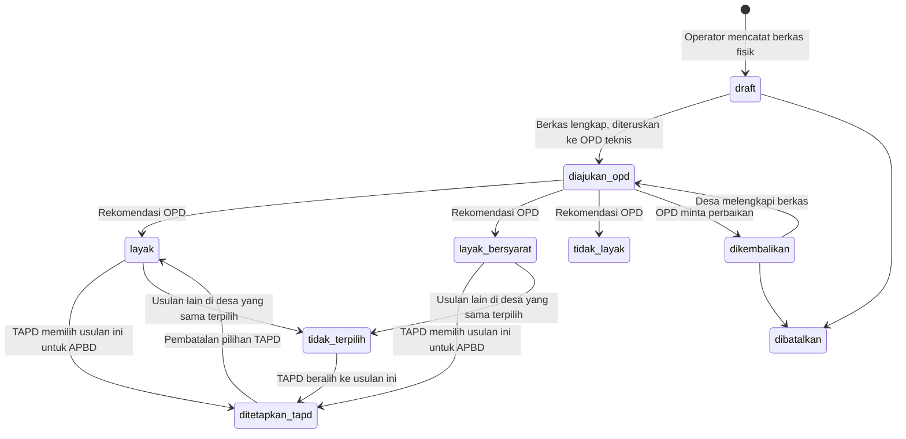

# [MODUL] Administrasi Proposal Bantuan Keuangan Khusus Desa (BKKD)

- **Status**: Ready for Implementation
- **Workspace**: `apps/api` (Laravel 13, PostgreSQL + PostGIS, Spatie Permission) dan `apps/web` (Nuxt 4, Nuxt UI, Pinia)
- **Modul terkait**: Batas Wilayah Kecamatan/Desa, Audit Log, Upload (`TemporaryUpload`)
- **Prinsip Modul**: Berdiri sendiri secara mandiri (independen) dan **tidak diintegrasikan ke modul plotting anggaran**
- **Rincian Issue Per Fitur**: Lihat folder [docs/issues/bkkd/](file:///c:/laragon/www/melarosa-laravel-nuxt/docs/issues/bkkd/README.md)

---

## 1. Latar Belakang

Desa mengajukan proposal BKKD ke kabupaten dalam bentuk berkas fisik. Satu desa diperbolehkan mengajukan lebih dari satu usulan kegiatan. Operator di Bappeda mencatat proposal tersebut, lalu meneruskannya ke OPD teknis sesuai bidang kegiatan untuk diverifikasi di luar sistem. OPD teknis mengirimkan hasil telaah dan rekomendasi kelayakan ke Bappeda dalam bentuk PDF atau Excel.

Selanjutnya, Bappeda menyajikan rekapitulasi usulan yang terkelompok per desa kepada Tim Anggaran Pemerintah Daerah (TAPD). Dari beberapa usulan yang diajukan oleh suatu desa, **TAPD memilih salah satu usulan prioritas serta melakukan penyesuaian alokasi pagu anggaran definitif** untuk dimasukkan ke dalam Rancangan APBD tahun anggaran berjalan.

Saat ini pencatatan proposal, hasil verifikasi, riwayat perubahannya, serta lembar kerja rekapitulasi penetapan pagu TAPD belum terpusat secara digital.

---

## 2. Tujuan

1. Operator Bappeda dapat mencatat proposal BKKD dari berkas fisik, lengkap dengan lampiran hasil pindai (satu desa boleh memiliki lebih dari 1 usulan).
2. Operator Bappeda dapat mencatat hasil verifikasi OPD teknis dan mengunggah dokumen sumbernya (PDF/Excel).
3. Setiap perubahan pada proposal dan hasil verifikasi tersimpan sebagai versi, beserta alasan perubahan, dan bisa dibandingkan sebelum vs sesudah.
4. Menyediakan antarmuka Rekapitulasi Usulan Berdasarkan Desa agar TAPD dapat memilih 1 usulan terpilih per desa dan menyesuaikan pagu anggaran definitifnya untuk masuk Rancangan APBD.
5. Skema data menyiapkan kolom geometri `geom` agar visualisasi spasial bisa ditambahkan pada fase berikutnya tanpa migrasi ulang.

---

## 3. Lingkup Fitur

| Fitur | Dokumen Sub-Issue | Keterangan |
| :--- | :--- | :--- |
| Fondasi & Skema Database | [BKKD-00](file:///c:/laragon/www/melarosa-laravel-nuxt/docs/issues/bkkd/00-skema-database-dan-fondasi.md) | Tabel master, transaksi, lampiran, verifikasi, riwayat, enum, dan service upload |
| Daftar Proposal Usulan BKKD | [BKKD-01](file:///c:/laragon/www/melarosa-laravel-nuxt/docs/issues/bkkd/01-daftar-proposal-usulan.md) | CRUD usulan proposal, nomor registrasi unik, upload lampiran, filter wilayah/status |
| Hasil Verifikasi Proposal | [BKKD-02](file:///c:/laragon/www/melarosa-laravel-nuxt/docs/issues/bkkd/02-hasil-verifikasi-proposal.md) | Input hasil telaah OPD teknis, upload berkas PDF/Excel hasil, penanganan verifikasi ulang |
| Historis Perubahan Usulan | [BKKD-03](file:///c:/laragon/www/melarosa-laravel-nuxt/docs/issues/bkkd/03-historis-perubahan-usulan.md) | Versioning data usulan, optimistic lock 409, alasan perubahan wajib, tampilan diff |
| Historis Perubahan Verifikasi | [BKKD-04](file:///c:/laragon/www/melarosa-laravel-nuxt/docs/issues/bkkd/04-historis-perubahan-verifikasi.md) | Riwayat koreksi verifikasi, retensi file lama, portal audit log riwayat terpusat |
| Rekapitulasi Desa & Penetapan TAPD | [BKKD-05](file:///c:/laragon/www/melarosa-laravel-nuxt/docs/issues/bkkd/05-rekapitulasi-desa-dan-penetapan-tapd.md) | Rekapitulasi matriks per desa, TAPD memilih 1 usulan masuk Rancangan APBD, ekspor Excel |
| Visualisasi Spasial (Roadmap) | [BKKD-06](file:///c:/laragon/www/melarosa-laravel-nuxt/docs/issues/bkkd/06-visualisasi-spasial.md) | Kolom `geom` PostGIS 4326, peta choropleth desa, integrasi layer Martin GIS |

Di luar lingkup modul BKKD:
- Tidak diintegrasikan ke modul `plotting_anggaran`.
- Desa login dan mengajukan proposal sendiri secara online (diajukan offline fisik di fase ini).
- OPD teknis login dan mengisi verifikasi langsung di sistem (dikirim dokumen fisik/digital ke Bappeda).

---

## 4. Aktor dan Hak Akses

Seluruh pencatatan data di modul BKKD dipusatkan kepada operator Bappeda.

| Aktor | Role | Kewenangan |
| :--- | :--- | :--- |
| Operator Bappeda | `verifierBappeda` | Input/ubah/batalkan proposal, kelola lampiran, catat hasil verifikasi, pilih usulan TAPD, hapus dan pulihkan proposal, akses riwayat |
| Verifikator Kecamatan | `verifierKecamatan` | Lihat proposal, hasil verifikasi, dan rekapitulasi di kecamatannya sendiri (read-only) |
| Super Admin | `admin` | Bypass Gate via `isAdmin()` untuk dukungan teknis sistem |

### 4.1 Master Permissions (Kebab-Case)

| Permission | Deskripsi | Default Role |
| :--- | :--- | :--- |
| `bkkd-proposal-view` | Melihat daftar, detail, dan rekapitulasi proposal | `verifierBappeda`, `verifierKecamatan` |
| `bkkd-proposal-create` | Mencatat berkas proposal baru | `verifierBappeda` |
| `bkkd-proposal-update` | Mengubah proposal, lampiran, dan status TAPD | `verifierBappeda` |
| `bkkd-proposal-delete` | Menghapus (soft delete) dan memulihkan proposal | `verifierBappeda` |
| `bkkd-verifikasi-view` | Melihat hasil verifikasi OPD | `verifierBappeda`, `verifierKecamatan` |
| `bkkd-verifikasi-manage` | Mencatat dan merevisi hasil verifikasi OPD | `verifierBappeda` |
| `bkkd-riwayat-view` | Melihat riwayat perubahan dan diff versi | `verifierBappeda` |

---

## 5. Alur Status Proposal & Pemilihan TAPD

Enum `StatusBkkdProposal`:
- `draft`: Draft awal pencatatan
- `diajukan_opd`: Menunggu telaah OPD teknis
- `dikembalikan`: Dikembalikan untuk perbaikan berkas
- `layak`: Dinyatakan layak oleh OPD teknis
- `layak_bersyarat`: Dinyatakan layak dengan catatan oleh OPD teknis
- `tidak_layak`: Dinyatakan tidak layak oleh OPD teknis
- `ditetapkan_tapd`: Dipilih oleh TAPD masuk ke dalam Rancangan APBD (1 desa 1 usulan terpilih)
- `tidak_terpilih`: Usulan layak lainnya pada desa yang sama yang tidak terpilih kuota TAPD
- `dibatalkan`: Usulan dibatalkan

---

## 6. Ringkasan Antarmuka Pengguna Nuxt (`apps/web`)

1. **Daftar Proposal (`/admin/bkkd/proposal`)**: Filter wilayah, status, tabel data proposal, kartu metrik nominal usulan, dan modal form proposal.
2. **Detail Proposal (`/admin/bkkd/proposal/[id]`)**: Tampilan tab (Data Usulan, Berkas Lampiran, Hasil Verifikasi, dan Riwayat Versi).
3. **Rekap Verifikasi OPD (`/admin/bkkd/verifikasi`)**: Rekapitulasi hasil verifikasi seluruh OPD, perbandingan nilai usulan vs rekomendasi, dan unduh berkas evaluasi PDF/Excel.
4. **Rekapitulasi Desa & Penetapan TAPD (`/admin/bkkd/rekapitulasi`)**: Matriks usulan terkelompok per desa, tombol aksi penetapan usulan pilihan TAPD untuk Rancangan APBD, dan tombol ekspor Excel.
5. **Portal Riwayat Terpusat (`/admin/bkkd/riwayat`)**: Log audit riwayat seluruh perubahan usulan dan verifikasi dilengkapi slideover diff sebelum vs sesudah.

---

## 7. Kriteria Penerimaan Utama (Acceptance Criteria)

- [ ] AC-1: Migrasi dan seeder BKKD berjalan lancar tanpa error di database PostgreSQL.
- [ ] AC-2: Satu desa dapat memiliki lebih dari satu proposal usulan BKKD pada tahun anggaran yang sama.
- [ ] AC-3: Operator Bappeda dapat mencatat hasil verifikasi OPD dan wajib mengunggah berkas PDF/Excel hasil telaah.
- [ ] AC-4: Halaman Rekapitulasi Desa menyajikan seluruh usulan yang masuk per desa beserta status verifikasi masing-masing usulan.
- [ ] AC-5: TAPD dapat memilih 1 usulan terbaik per desa yang berstatus layak serta menyesuaikan pagu anggaran definitif (`nilai_disetujui_tapd`) untuk ditetapkan masuk ke Rancangan APBD (`ditetapkan_tapd`).
- [ ] AC-6: Saat satu usulan dipilih TAPD, usulan layak lainnya pada desa yang sama otomatis diset menjadi `tidak_terpilih`.
- [ ] AC-7: Setiap perubahan data usulan di luar status draft mewajibkan pengisian alasan perubahan dan menaikkan nomor versi (+1).
- [ ] AC-8: Tab Riwayat dan portal riwayat mampu menampilkan perbandingan nilai sebelum vs sesudah secara rapi.
- [ ] AC-9: Modul BKKD beroperasi mandiri tanpa dependensi atau integrasi ke modul `plotting_anggaran`.
- [ ] AC-10: Lembar kerja rekapitulasi desa dan pilihan TAPD dapat diekspor ke file Excel (.xlsx).
- [ ] AC-11: Kolom atribut PostGIS `geom` SRID 4326 dengan indeks GiST telah siap di database untuk kebutuhan peta visualisasi di fase berikutnya.
