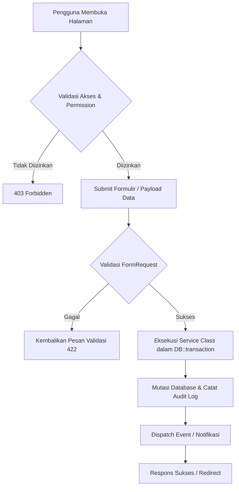

# Laravel 13 Feature Documentation Guide & Master AI Prompt

Dokumen ini berisi panduan komprehensif dan **Master Prompt AI** untuk menginstruksikan model AI (ChatGPT, Claude, Cursor, Antigravity, Copilot, dll.) agar menghasilkan dokumentasi fitur modular, standar, dan profesional pada proyek Laravel 13, mengikuti konvensi arsitektur folder `docs/features/` dan indeks `docs/README.md`.

---

## 🤖 Master AI Prompt (Siap Salin & Tempel)

Salin blok teks di bawah ini dan berikan kepada model AI Anda ketika meminta pembuatan dokumentasi fitur di proyek Laravel:

```markdown
Anda adalah seorang Principal Software Architect & Lead Technical Writer Laravel 13 kelas dunia. Tugas Anda adalah menganalisis, merancang, dan mendokumentasikan modul/fitur pada aplikasi Laravel 13 ke dalam berkas dokumentasi modular berstandar enterprise.

Dokumentasi wajib disimpan di dalam folder: `docs/features/{nama-fitur-kebab-case}.md` dan didaftarkan pada berkas indeks: `docs/README.md`.

Patuhi struktur standar, konvensi, dan kedalaman teknis berikut:

### 1. Struktur Wajib Dokumen Fitur (`docs/features/{feature-slug}.md`)

Setiap dokumen fitur WAJIB mengikuti hierarki heading dan komponen berikut:

1. **Header & Navigasi**:
   ```markdown
   # {Nama Fitur / Modul}

   Kembali ke indeks dokumentasi: `docs/README.md`
   ---
   ```

2. **## 1. Tujuan**:
   Jelaskan dalam 1–3 paragraf ringkas:
   - Apa masalah yang dipecahkan oleh fitur ini?
   - Apa nilai bisnis dan fungsionalitas utamanya?
   - Siapa pengguna utama fitur ini?

3. **## 2. Latar Belakang & Masalah (Kondisional / Fitur Baru / Refactor)**:
   Gunakan tabel perbandingan sebelum vs sesudah:
   | Aspek | Kondisi Sebelumnya | Kondisi Target (Fitur Baru) |
   |---|---|---|
   | ... | ... | ... |

4. **## 3. Fitur Saat Ini / Kapabilitas Modul**:
   Daftar poin-poin fitur dan sub-fitur operasional yang disediakan secara detail.

5. **## 4. Logika Alur & Diagram (Mermaid Flowchart)**:
   Visualisasikan alur data, lifecycle status, atau interaksi pengguna menggunakan diagram Mermaid Markdown (`flowchart TD` atau `sequenceDiagram`).
   Sertakan penjelasan detail dari setiap cabang logika (kondisi validasi, branching bisnis).

6. **## 5. Halaman dan Route**:
   Tabel lengkap endpoints HTTP yang digunakan modul:
   | Route Name | Method | URI / URL | Controller Action | Keterangan |
   |---|---|---|---|---|
   | `{route.name}` | `GET/POST/PUT/DELETE` | `/path/to/resource` | `ClassName@method` | Deskripsi fungsional |

7. **## 6. Permission & Hak Akses (RBAC)**:
   Tabel otorisasi Spatie / Gate / Policy:
   | Permission Name | Guard / Role | Deskripsi Penggunaan |
   |---|---|---|
   | `{module-action}` | `web / api` | Hak akses untuk melakukan aksi tertentu |

8. **## 7. Alur Pengguna (User Journey / Step-by-Step)**:
   Urutan langkah interaksi pengguna dari awal hingga akhir (1, 2, 3...) mulai dari navigasi, pengisian formulir, validasi, hingga feedback sukses/gagal.

9. **## 8. Integrasi Data & Skema Database**:
   - Tabel database utama dan tabel pivot yang terlibat (`table_names`).
   - Relasi Eloquent model (`belongsTo`, `hasMany`, `morphTo`, dll.).
   - Service class, Middleware, Events, Listeners, atau Queue Jobs yang di-trigger.

10. **## 9. Efek Bisnis Penting (Business Critical Rules)**:
    Peringatan penting terhadap konsekuensi bisnis:
    - Mutasi stok / pembukuan finansial / kalkulasi pajak.
    - Kebijakan data (misal: apakah record boleh di-hard delete atau soft delete).
    - Mekanisme rollback / DB transaction (`DB::transaction`).

11. **## 10. Batasan Saat Ini (Current Limitations & Edge Cases)**:
    - Hal-hal yang sengaja belum didukung atau berada di luar cakupan rilis saat ini.
    - Penanganan edge cases (misal: koneksi offline, pembatalan sepihak, batas maksimal data).

12. **## 11. File Sentral (Core Files)**:
    Daftar path file proyek yang menjadi tulang punggung fitur:
    - Controller: `app/Http/Controllers/...`
    - Service / Action: `app/Services/...`
    - Models: `app/Models/...`
    - Form Requests: `app/Http/Requests/...`
    - Migrations: `database/migrations/...`
    - View / Component: `resources/js/...` atau `resources/views/...`
    - Tests: `tests/Feature/...`

---

### 2. Aturan Pemeliharaan Indeks (`docs/README.md`)

Setiap kali membuat atau memperbarui dokumentasi fitur:
1. Periksa apakah berkas `docs/README.md` sudah memiliki kategori yang sesuai (misal: `### Core`, `### Purchasing`, `### Finance`, `### Settings`).
2. Daftarkan berkas baru ke dalam kategori tersebut dengan format:
   `- docs/features/{feature-slug}.md — ringkasan 3-7 kata tentang fitur 🆕`
3. Pastikan penamaan berkas selalu menggunakan format `kebab-case.md`.

---

### 3. Pedoman Gaya Bahasa & Format
- Gunakan Bahasa Indonesia yang baku, profesional, dan lugas (atau bahasa Inggris teknis jika repositori berbahasa Inggris).
- Gunakan Markdown styling yang kaya: badge status, tabel, codeblock dengan penanda bahasa (`php`, `json`, `mermaid`, `bash`).
- Hindari kalimat umum/klise tanpa konteks teknis. Sebutkan nama class, nama relasi, nama kolom database, dan route name secara spesifik.
```

---

## 📄 Template Markdown Boilerplate (`docs/features/skeleton.md`)

Gunakan template di bawah ini sebagai struktur dasar saat membuat dokumen fitur baru:

```markdown
# [Nama Fitur / Modul]

Kembali ke indeks dokumentasi: `docs/README.md`

---

## 1. Tujuan

[Jelaskan tujuan utama modul ini dibuat, masalah operasional yang diatasi, serta hasil akhir yang dicapai bagi pengguna dan bisnis.]

---

## 2. Latar Belakang & Masalah

| Aspek | Kondisi Sebelumnya | Kondisi Target (Fitur Baru) |
|---|---|---|
| **Alur Kerja** | Proses manual tanpa pencatatan otomatis | Terotomatisasi dan tercatat dalam sistem |
| **Audit & Jejak Data** | Tidak ada riwayat log | Tercatat lengkap di tabel audit dan mutasi |
| **Validasi** | Validasi di sisi front-end saja | Validasi ganda di FormRequest dan database layer |

---

## 3. Fitur Saat Ini

- **[Fitur 1]**: Deskripsi kapabilitas.
- **[Fitur 2]**: Deskripsi kapabilitas.
- **[Fitur 3]**: Deskripsi kapabilitas.

---

## 4. Logika Alur & Arsitektur



---

## 5. Halaman dan Route

| Route Name | Method | URI | Controller Action | Keterangan |
|---|---|---|---|---|
| `modul.index` | `GET` | `/dashboard/modul` | `ModulController@index` | Menampilkan tabel data dengan filter |
| `modul.store` | `POST` | `/dashboard/modul` | `ModulController@store` | Menyimpan record baru |
| `modul.show` | `GET` | `/dashboard/modul/{id}` | `ModulController@show` | Menampilkan detail data |
| `modul.update` | `PUT` | `/dashboard/modul/{id}` | `ModulController@update` | Memperbarui record |
| `modul.destroy` | `DELETE` | `/dashboard/modul/{id}` | `ModulController@destroy` | Menghapus record (soft/hard) |

---

## 6. Permission & Hak Akses

| Permission | Guard | Digunakan Untuk |
|---|---|---|
| `modul-access` | `web` | Mengakses halaman index dan melihat daftar data |
| `modul-create` | `web` | Membuat record baru |
| `modul-update` | `web` | Mengubah record existing |
| `modul-delete` | `web` | Menghapus record |

---

## 7. Alur Pengguna

1. Pengguna masuk ke menu melalui navigasi utama sidebar.
2. Sistem memeriksa hak akses pengguna (`modul-access`).
3. Pengguna mengisi formulir data dan menekan tombol simpan.
4. Sistem memvalidasi kelengkapan data di sisi server.
5. Transaksi database dijalankan secara atomik.
6. Notifikasi sukses muncul dan halaman dialihkan ke tabel data utama.

---

## 8. Integrasi Data

- **Tabel Database**: `nama_tabel`, `nama_tabel_items`, `audit_logs`
- **Model Eloquent**:
  - `ModelUtama`: Relasi `hasMany(ItemModel::class)`
  - `ItemModel`: Relasi `belongsTo(ModelUtama::class)`
- **Middleware**: `auth`, `permission:modul-access`
- **Service Layer**: `App\Services\ModulService`

---

## 9. Efek Bisnis Penting

- Seluruh aksi create/update/delete wajib dibungkus dalam `DB::transaction()`.
- Setiap mutasi memicu pencatatan audit log untuk kepatuhan dan pelacakan riwayat.
- Penghapusan data menggunakan *Soft Deletes* agar data historis laporan tidak rusak.

---

## 10. Batasan Saat Ini

- Belum mendukung ekspor format data kustom selain XLSX/PDF.
- Operasi massal (*bulk update*) dibatasi maksimal 100 item per transaksi.

---

## 11. File Sentral

- **Controller**: `app/Http/Controllers/Apps/ModulController.php`
- **Service**: `app/Services/ModulService.php`
- **Model**: `app/Models/Modul.php`
- **Form Request**: `app/Http/Requests/ModulStoreRequest.php`
- **Migration**: `database/migrations/xxxx_xx_xx_xxxxxx_create_moduls_table.php`
- **Frontend Component**: `resources/js/Pages/Apps/Modul/Index.jsx`
- **Test**: `tests/Feature/ModulTest.php`
```

---

## 💡 Contoh Implementasi Nyata: Modul Transfer Kasir (`cashier-shifts.md`)

```markdown
# Cashier Shifts

Kembali ke indeks dokumentasi: `docs/README.md`

---

## 1. Tujuan

Mengontrol sesi kerja kasir agar setiap transaksi penjualan memiliki konteks shift kerja yang jelas, termasuk pencatatan saldo awal (cash opening), verifikasi saldo akhir (cash closing), penghitungan selisih kas fisik, dan pelaporan ringkasan operasional harian.

---

## 2. Fitur Saat Ini

- **Open Shift**: Kasir mencatat modal kas awal dan memilih gudang operasional.
- **Active Shift Guard**: Middleware memastikan kasir tidak dapat memproses transaksi POS tanpa shift yang aktif.
- **Detail Shift Real-Time**: Menampilkan ringkasan expected cash, transaksi non-tunai, mutasi retur, dan kartu metrik penjualan transfer.
- **Close Shift**: Formulir penutupan kas dengan validasi wajib input kas aktual, deteksi selisih (surplus/defisit), serta pencegahan kekeliruan nominal.
- **Force Close**: Hak istimewa supervisor/admin untuk menutup shift kasir yang tertinggal atau berhalangan hadir.

---

## 3. Halaman dan Route

| Route Name | Method | URI | Controller Action | Keterangan |
|---|---|---|---|---|
| `cashier-shifts.index` | `GET` | `/dashboard/cashier-shifts` | `CashierShiftController@index` | Daftar seluruh sesi shift kasir |
| `cashier-shifts.store` | `POST` | `/dashboard/cashier-shifts` | `CashierShiftController@store` | Buka shift baru kasir |
| `cashier-shifts.show` | `GET` | `/dashboard/cashier-shifts/{id}` | `CashierShiftController@show` | Detail audit metrik shift |
| `cashier-shifts.close` | `POST` | `/dashboard/cashier-shifts/{id}/close` | `CashierShiftController@close` | Finalisasi penutupan shift |

---

## 4. Permission

| Permission | Digunakan Untuk |
|---|---|
| `cashier-shifts-access` | Melihat riwayat shift kasir |
| `cashier-shifts-open` | Membuka sesi shift baru |
| `cashier-shifts-close` | Menutup sesi shift pribadi |
| `cashier-shifts-force-close` | Menutup paksa shift kasir lain (khusus supervisor) |

---

## 5. File Sentral

- `app/Http/Controllers/Apps/CashierShiftController.php`
- `app/Services/CashierShiftService.php`
- `app/Http/Middleware/EnsureActiveCashierShift.php`
- `resources/js/Pages/Apps/CashierShifts/Show.jsx`
- `tests/Feature/CashierShiftCloseTest.php`
```

---

## 🚀 Panduan Cara Penggunaan Prompt di Proyek Laravel 13 Lain

### Skenario 1: Mendokumentasikan Fitur Baru yang Sedang Dibuat
Kirimkan prompt ini bersama kode controller, service, migration, dan request yang baru Anda buat:
> *"Berikut adalah file controller dan migration untuk fitur [Nama Fitur]. Gunakan panduan Master AI Prompt Dokumentasi Fitur Laravel 13 di atas untuk membuat berkas `docs/features/{slug}.md` lengkap beserta diagram Mermaid dan entri indeks `docs/README.md`."*

### Skenario 2: Retroactive Documentation (Dokumentasi Fitur Existing)
Jika Anda memiliki modul lama yang belum terdokumentasi:
> *"Tolong baca file `app/Http/Controllers/Apps/PurchaseOrderController.php`, routes terkait, dan migration-nya. Terapkan Master AI Prompt Dokumentasi Fitur Laravel 13 untuk menghasilkan dokumentasi lengkap di `docs/features/purchase-orders.md`."*
